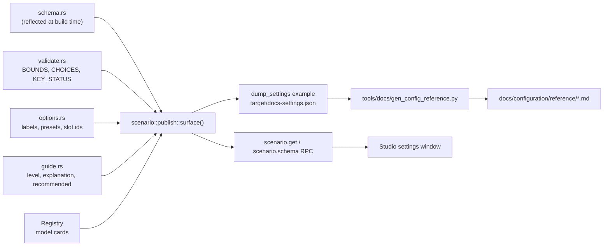

# Configuration overview

Every setting that changes a run is a field of the scenario file. There is no other
configuration file and no environment variable that changes results; see
[How settings work](../configuration.md) for where each setting is defined in the code and
the validation rules worth knowing.

This section has three parts:

| Part | What it is | Source |
|---|---|---|
| [Generated reference](reference/index.md) | one page per top-level scenario section, every editable leaf with its type, unit, default, range or choices, level and status; plus [model parameters](reference/models.md) | generated from the engine |
| [How settings work](../configuration.md) | the files a setting is defined in, the published surface, the validator | hand-written |
| Curated tables | settings grouped by research question, per-domain parameter inventories, SCMS constants, sensitivity results | hand-written, see [below](#curated-tables) |

## How the generated reference is produced

The reference is produced from the same data the Studio's settings window and the
assistant read, so it cannot describe a field the engine does not have or miss one it
does.



```sh
just docs-gen
# which runs:
cargo run -q -p v2xw-engine --example dump_settings -- --out target/docs-settings.json
python3 tools/docs/gen_config_reference.py target/docs-settings.json
cargo run -q -p v2xw-engine --example dump_metrics -- --out target/docs-metrics.json
python3 tools/docs/gen_metric_catalogue.py target/docs-metrics.json
```

The last two lines generate the [metric catalogue](../metrics/catalogue.md) the same way,
from the `MetricDef` of every provider the engine can install.

The generator names no scenario field itself: sections, subsections, units, defaults,
ranges, choices, statuses and descriptions all come from its input. It fails if a
published field lands on no page or on two, and if a generated page is missing from the
`nav` of `mkdocs.yml`.

The engine's own tests hold the input honest (`crates/v2xw-engine/src/scenario/publish.rs`):

| Test | Guarantees |
|---|---|
| `every_shipped_scenario_is_described` | every key in every file under `scenarios/` is in the published schema |
| `the_published_defaults_load` | a document built from the published defaults passes the loader, whose `deny_unknown_fields` rejects an invented key |
| `every_leaf_has_a_status` | every leaf matches a `KEY_STATUS` row |
| `every_number_publishes_a_unit` | every numeric leaf has a unit, read off its name or declared |

!!! warning "Do not edit `docs/configuration/reference/` by hand"
    Change the engine (see [Extending: settings](../dev/extending/settings.md)) and run
    `just docs-gen`.

## How to read a row

Each section page opens with its group and blurb, then one table per subsection:

| Column | Meaning | Comes from |
|---|---|---|
| **Setting** | the dotted path. `[]` is a list element (`actors.rsus[].profile`), `*` a map key (`nodes.per_class.*`). Each row has an anchor, `#s-<path-with-dashes>` | `schema.rs` field names after `serde` renames |
| **Type** | the JSON type; `optional` when the field may be absent or null; the Rust type in brackets where the JSON type alone is ambiguous | `schema.rs` |
| **Unit** | the unit. Field names carry their unit as a suffix (`_s`, `_ms`, `_us`, `_ns`, `_m`, `_km`, `_mps`, `_mps2`, `_hz`, `_db`, `_dbm`, `_dbi`, `_deg`, `_kbps`, `_mbps`, `_veh_per_h`); the few numeric leaves whose name does not carry one declare it in `publish.rs` | `publish.rs` `UNIT_SUFFIXES` |
| **Default** | the value the loader uses when the field is absent. Blank means absent is meaningful (the row's description says what happens) | `Scenario::minimal()` serialised |
| **Range or choices** | `[lo, hi]` or `(lo, hi]` for a numeric bound (no upper value means unbounded); a list of values for a closed set; "(or another value)" for an open set; "narrowed by `x` when `y`" when another field restricts the set; "recommended ..." advice for basic fields | `validate::BOUNDS`, `validate::CHOICES`, `options`, `guide` |
| **Level** | `basic` for the fields that decide what a run models; `advanced` for model internals, fidelity tiers and developer switches | `guide::level_of` |
| **Status** | whether editing the field changes the run (vocabulary below) | `validate::KEY_STATUS` |
| **Description** | the field's doc comment and its plain-language explanation; for a model slot, the family and a link to its parameters; for a conditional field, when it applies; for a status other than `wired`, the status note | `schema.rs`, `guide`, `KEY_STATUS` |

A closed set whose values have labels gets a second table under the row with each value,
its label and its meaning (from `scenario::options`).

## Status vocabulary

| Status | Label | Meaning |
|---|---|---|
| `wired` | Active | The engine reads it and it changes the run. |
| `partial` | Partly active | The engine reads part of it, or acts on it only under the conditions the field's own note states. Editing it may do less than it appears to. |
| `not-implemented` | Not yet implemented | Validated and part of the scenario digest, and read by nothing. Editing it changes the scenario hash and nothing else. |
| `refused` | Only its implemented values load | The loader rejects every value this build cannot act on, so the field exists but its choices are narrower than the schema's. |
| `descriptive` | Description | Describes the scenario (name, tags, notes); kept in the run's record and by design changes nothing computed. |
| `unknown` | Unclassified | No `KEY_STATUS` row matches. The `every_leaf_has_a_status` test keeps this out of a build. |

`KEY_STATUS` entries are path prefixes and the longest match wins, so a section is
classified once and exceptions are stated beneath it. The vocabulary itself is published
(`statuses` in the surface), so the Studio and the generator render it without
hard-coding the words. The [reference index](reference/index.md) counts the settings per
status.

## Scenario fields and model parameters

A **scenario field** is a typed leaf of the scenario, checked by the loader against
`BOUNDS` and `CHOICES`. A **slot** is a field that selects a model; its value is a
`ModelChoice`:

```yaml
radio:
  models:
    propagation:
      id: propagation/winner-plus-b1       # the model's registry id
      params: { heights: effective }       # overrides of the card's defaults
```

The parameters a model accepts are not scenario fields of their own. They live on the
model's card (`v2xw_core::card::ModelCard`), each with a unit, default, range and source,
and are listed on the generated [Model parameters](reference/models.md) page, which also
lists every slot with its family and selectable ids. Anything not named in `params` keeps
the card's value, so a parameter set is content-addressable from the id and the
overrides. Some slots take a bare id instead of `{ id, params }`; the slot table on the
models page says which.

A few model parameters are also published as typed fields so the settings window needs no
JSON for them (for example the Misbehaviour Authority's `detection.ma.params.*`); they
appear on their section page with a range and status like any other leaf.

!!! note "Parameters marked `todo-calibrate`"
    A card parameter with no published source is marked `todo-calibrate` with a
    calibration plan rather than given an invented value. The models page shows each
    card's list.

## Curated tables

Hand-written cross-cutting views. They complement the generated pages; where the two
disagree, the generated page reflects the build.

| Page | Use it for |
|---|---|
| [Settings by research question](../reference/configuration-reference.md) | which settings to vary to compare V2X protocols |
| [Traffic, world and run inventory](../reference/config-inventory-traffic.md) | every hard-coded number and model field in mobility, demand and world |
| [Radio and network inventory](../reference/config-inventory-network.md) | the same for radio, net, msg, sec and node |
| [Security and SCMS inventory](../reference/config-inventory-scms.md) | certificate-system and security knobs |
| [SCMS constants](../reference/scms-constants.md) | every SCMS default with where it lives and its source |
| [Sensitivity catalogue](../reference/sensitivity-catalogue.md) | how each published setting moves the metrics, one at a time on a fixed seed |
| [Sensitivity expectations](../reference/sensitivity-expectations.md) | the expected direction of each setting, checked against same-seed runs |
