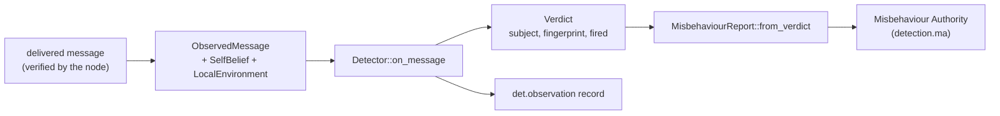

# Extending: detectors

A local misbehaviour detector runs on each receiver, judges every delivered message
against what that receiver believes, and produces a verdict that the node turns into a
misbehaviour report. This page walks through `examples/detector-heading-rate`, then shows
where the engine's own suites are wired so a new suite can be added. Model background:
[Threats and misbehaviour detection](../../models/threats.md). Card and registration rules:
[Extending: models](models.md).



## The trait

`v2xw_threat::detect::Detector` (re-exported as `v2xw_threat::Detector`):

```rust
pub trait Detector: Model {
    fn on_message(
        &mut self,
        ctx: &mut dyn ThreatCtx,
        me: &SelfBelief,
        m: &ObservedMessage,
        env: &dyn LocalEnvironment,
    ) -> Verdict;

    fn cost(&self) -> DetectorCost;     // DetectorCost { per_message_us }
}
```

There is no world, actor id or true position in the signature: a detector cannot ask for
ground truth because the argument types carry none.

### Inputs

| Argument | Type (`v2xw_threat::obs`, `ctx`) | What it holds |
|---|---|---|
| `ctx` | `ThreatCtx` | `now()` (simulated time, for record timestamps only), `rng(domain, entity)` (keyed stream), `emit(record)` |
| `me` | `SelfBelief` | the receiver's own node id, `believed_time` (its own clock), believed position, radio range |
| `m` | `ObservedMessage` | `signer` (the certificate `HashedId8`, the only identity a receiver has), `kind`, `received_at`, `claimed_generation_time`, claimed position, speed, heading and broadcast position confidence, `repetitions` in this interval, the certificate validity window, the declared `station_type`, BSM extras (`secMark`, `accelSet.long`), and `verification` (what the node concluded about the signature) |
| `env` | `LocalEnvironment` | the node's own map store: `distance_to_road_m(x, y)`. A node with no map passes `NoMap`, whose answer is that every point is on the road |

### The verdict

| Field | Meaning |
|---|---|
| `subject` | the signer digest in hex (`m.signer_hex()`) |
| `fingerprint` | every check's score, indexed by `DetectorId` (the `detnorm_*` columns a fusion model reads) |
| `fired` | the checks that fired, as `Observation { detector, score, subject, at }`, highest score first; `fired()` and `leading()` read it |

Scores are normalised so that **1 is the firing threshold** in every check, which is what
lets checks in metres, degrees and seconds be compared and fused.

## Walkthrough: `detector-heading-rate`

A vehicle cannot turn arbitrarily fast. The detector keeps the last heading each signer
claimed and scores the change over the interval the two beacons claim to span:

$$
\text{score} = \frac{\lvert \angle(\psi_\text{now} - \psi_\text{before}) \rvert}{\Delta\psi_\text{max}}
$$

```rust
impl v2xw_threat::Detector for HeadingRate {
    fn on_message(&mut self, ctx: &mut dyn ThreatCtx, me: &SelfBelief,
                  m: &ObservedMessage, _env: &dyn LocalEnvironment) -> Verdict {
        let subject = m.signer_hex();
        let mut fingerprint = Fingerprint::default();
        let mut fired = Vec::new();

        // 1. gate: beacons only, attributable (valid signature), fast enough to have a heading
        if !(matches!(m.kind, ObservedKind::Beacon)
             && m.verification.is_valid()
             && m.claimed_speed_mps >= self.params.min_speed_mps) {
            return Verdict { subject, fingerprint, fired };
        }
        // 2. interval from the *claimed* generation times (the sender's own timeline)
        // 3. score, quantised onto its 1e-3 grid BEFORE the threshold comparison
        let score = self.score(last.heading_rad, m.claimed_heading_rad);
        fingerprint.set(DetectorId::HeadingInconsistency, score);
        if score >= 1.0 && streak >= self.params.min_consecutive {
            fired.push(Observation { detector: DetectorId::HeadingInconsistency, score,
                                     subject: subject.clone(), at: me.believed_time });
            let host_now = ctx.now();
            ctx.emit(v2xw_threat::DetObservation { t: host_now, node: me.node,
                detector: MODEL_ID.to_string(), subject: subject.clone(), score: Some(score) });
        }
        // 4. remember this beacon per signer (a BTreeMap, never a HashMap)
        Verdict { subject, fingerprint, fired }
    }
    fn cost(&self) -> DetectorCost { DetectorCost { per_message_us: 1.0 } }
}
```

Rules this example demonstrates:

| Rule | In the code |
|---|---|
| belief, never truth | the argument types; no world is reachable |
| decisions on the node's clock | thresholds compare `me.believed_time` and claimed times; `ctx.now()` only stamps the emitted record so channels share one timeline |
| quantise before comparing | `math::quantize_to(change_deg / max_heading_change_deg, 1e-3)`, so a last-bit difference in a transcendental cannot flip a firing between platforms |
| no content check on an unattributable message | gate on `m.verification.is_valid()`; a bad signature is not the signer's claim |
| abstain, don't score zero, when an input is missing | a first beacon from a signer, or claims out of order, produce no score |
| transcendentals through `v2xw_core::math` | `math::sin_cos`, `math::atan2` in `angle_difference_rad` |
| declared cost | `cost()` is charged against the node's CPU budget; the value is on the card with a calibration plan |

Its card follows [Extending: models](models.md#2-build-the-card), with `Family::Detector`
and the id `example/detector/heading-rate`.

!!! warning "Check names are a closed set"
    `Verdict` names checks with `DetectorId`, a closed enumeration of the engine's own
    checks (`PositionSpeedInconsistency`, `PositionJump`, `HeadingInconsistency`,
    `StaleOrReplay`, `ConstantPositionFrozen`, `ImplausibleAcceleration`,
    `SybilCoLocation`, `AcceptanceRangeThreshold`, `BeaconFrequency`,
    `SignatureVerification`, `CertValidity`, `MapOffRoad`, `VruImpersonation`,
    `DenmPlausibility`, `KalmanConsistency`, `ImplausibleSpeed`, `BrakeAcceleration`).
    A new check must report under the nearest existing id (the example uses
    `HeadingInconsistency`) or add a variant. The `det.observation` record carries the
    detector name as a string, so it can name a new detector.

## Testing

Use `v2xw_threat::CollectingCtx` as the host: it owns an `RngRegistry` and keeps every
emitted record, so a test asserts on the same numbers and records the engine would see.
The example also exposes `beacon(...)` and `belief(...)` helpers to build inputs.

Then run the plug-in conformance suite (`v2xw-conformance` as a dev-dependency, path
`tests/conformance`). The example's `conformance` module is the template:

```rust
impl PluginUnderTest for Subject {
    fn model(&self) -> &dyn Model { &self.model }
    fn entities(&self) -> Vec<EntityRef> {               // a detector acts for a node
        vec![EntityRef::Node(NodeId::new(1)), EntityRef::Node(NodeId::new(2))]
    }
    fn exercise(&self, ctx: &mut ProbeCtx, e: EntityRef) -> Vec<f64> {
        let mut detector = HeadingRate::with_defaults();  // fresh per call: exercise is &self
        /* script six beacons with ctx.set_now(t), return each fingerprint score */
    }
    fn sources(&self) -> Vec<PathBuf> { vec![PathBuf::from(file!())] }
    fn quantum(&self) -> f64 { SCORE_QUANTUM }
    fn runs_as_node(&self) -> bool { true }   // emitted records must not carry ground truth
}

#[test]
fn the_conformance_suite_passes() {
    assert!(run_suite(&Subject::new(), 0x5EED).complete());
}
```

`report.passed()` tolerates a check the suite could not run; `report.complete()` requires
every check to have run (it needs `sources()` and `quantum()`).

```sh
cd examples && cargo test -p v2xw-example-detector
```

## From verdict to report

`v2xw_threat::report::MisbehaviourReport::from_verdict(report_id, reporter,
reporter_cert_digest, &verdict, &evidence)` returns `None` when nothing fired; otherwise a
report whose `reason_codes` and `detector_outputs` are the fired checks, whose subject is
the signer digest, and whose floats are quantised at construction. Every identity in it is
a pseudonym certificate digest. The engine batches reports per reporter at the report
interval (`REPORT_INTERVAL_S` = 1 s by default, `report_interval_s` in the suite's params)
and submits them through the credential protocol to the MA pipeline (`detection.ma`).
Records: `det.observation` (per firing), the MA report records, and the MA's decisions
([Metrics and outputs](../../recording-and-metrics.md)).

## Adding a suite the engine runs

`detection.local[]` accepts exactly the suites compiled into the engine, all in
`crates/v2xw-engine/src/phase2.rs`:

| Id | Suite | Notes |
|---|---|---|
| `detect/legacy-12` | `v2xw_threat::detect::Legacy12` | the research suite |
| `detect/us-sm-mbr` | `v2xw_threat::us_mbr::UsSmMbr` | the strict US misbehaviour profile; the default under the US SCMS deployment when `detection.local` is empty |
| `detect/ts103759` | `v2xw_threat::ts103759::Ts103759Suite` | the ETSI TS 103 759 observations; must be listed alone |

Any other id is refused at load with an error naming `detection.local[i]`. To add one:

1. Implement `Detector` in `v2xw-threat` (or a crate the engine depends on), with a card.
2. In `phase2.rs`: add an id constant beside `LEGACY_12`; accept it and parse its
   `params` in `detection_params` (refuse unknown keys with an error naming
   `detection.local[i].params.<key>`); add a `LocalSuite` variant and build it in
   `Phase2::local_suite`; dispatch it in `LocalSuite::on_message`; and return its id from
   `local_suite_id`.
3. Register its card in the engine's catalogue so the slot lists it with its parameters
   (`scenario::publish`'s catalogue registers the TS 103 759 card this way).
4. Add a same-seed engine test that selecting it changes the reports, and run
   `just docs-gen`.

!!! note "Python detectors"
    A Python object can stand behind the `Detector` family through
    `python/v2xw/plugins.py`, called once per window with an Arrow record batch. See
    [Plugins](plugins.md).
