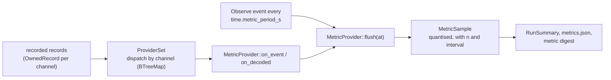

# Extending: metrics

A metric provider reads recorded channels and turns them into `metric.sample` values with
units, sample counts and intervals. This page walks through
`examples/metric-detector-load`, then covers registration, health direction and the
invariant checks. What each shipped metric means: [Metrics and outputs](../../recording-and-metrics.md).
Card rules: [Extending: models](models.md).



## The trait

`v2xw_metrics::MetricProvider` (in `crates/v2xw-metrics/src/provider.rs`):

```rust
pub trait MetricProvider: Model {
    fn defs(&self) -> Vec<MetricDef>;                 // the metrics it computes
    fn subscribe(&self) -> Vec<ChannelName>;          // the channels it reads
    fn on_event(&mut self, ev: &EventRecord);         // one record, in run order
    fn flush(&mut self, at: SimTime) -> Vec<MetricSample>; // close the window ending at `at`

    // defaulted
    fn on_decoded(&mut self, ev: &Decoded<'_>) { self.on_event(ev.record()) }
    fn on_pause(&mut self, from: SimTime, to: SimTime) {}   // a time.fast_forward window
    fn rejected(&self) -> u64 { 0 }                        // records it could not decode
    fn validate_defs(&self) -> Result<()>;                 // MetricDef::validate on each def
    fn def(&self, name: &str) -> Option<MetricDef>;
}
```

| Rule | Why |
|---|---|
| read channels, never engine state | a metric computed live and from a recording must agree; there is no world in the signature |
| `flush` drains per-window accumulators | flushing twice at one instant gives the samples once, then an empty or insufficient set. Whole-run accumulators (a revocation's stage times, a confusion matrix) are not drained; say which is which in the definition |
| count what you cannot decode | `on_event` returns `()`; increment a counter and return it from `rejected()`. `ProviderSet::rejected_total` puts the sum in the manifest |
| integers for counts and bytes | accumulate as `u64`; floats only in the final estimate |

Windows close on the engine's `Observe` events, every `time.metric_period_s` (1 s when
unset).

## Declaring a metric: `MetricDef`

```rust
MetricDef::new(REPEAT_SHARE, "ratio",
        Agg::ratio("observations about a (node, subject) pair already seen in this window",
                   "observations after the first sighting of each pair"),
        Visibility::Node, Quantum::RATIO,
        "Of the observations one detector produced in the window, the share that ...")
    .with_dims([Dim::T, Dim::Detector])
    .with_source(source)
    .with_min_samples(self.min_samples)
    .not_accounting_for("whether any subject was really misbehaving: that is ground truth ...")
    .not_accounting_for("repeats across windows ...")
```

| Field | Meaning |
|---|---|
| `name` | stable name (`pdr`, `verify_rate`, ...); what a scenario's `metrics:` list and every export use |
| `unit` | `ratio`, `ms`, `B/s`, `1/s`, `s`, `veh/h`, `count`, ... |
| `dims` | the closed `Dim` set: `T`, node, vehicle class, distance bin, density bin, region, protocol, RAT, tier, run, and per-metric dimensions such as cause, channel, detector. A new `Dim` is a schema change |
| `agg` | `Sum`, `Mean`, `Max`, `Count`, `Quantile`, `Ratio { numerator, denominator }`, `Rate`, `Distribution` |
| `visibility` | `v2xw_core::ctx::Visibility`; a metric derived from a ground-truth channel is `Gt`, and the tag propagates into every export |
| `definition_md` | the definition and formula, in Markdown |
| `source` | the citation, where one exists |
| `quantum` | the grid the writer quantises every value onto (`Quantum::RATIO`, `Quantum::COUNT`, ...) |
| `min_samples` | below this many samples the value is reported insufficient, not as a point estimate |
| `not_accounted` | what the number excludes; **must be non-empty** |
| `min_value`, `max_value` | the physically possible range (zero for a latency, one for a proportion), checked by `invariants::check_metric_ranges` |
| `breakdown`, `breakdown_only` | one dimension a live view shows as its own series, with the values it will take |
| `health` | filled by `MetricDef::new` from `health::band_for(name)` |
| `diagnostic` | a machine-dependent runtime figure, excluded from every digest |

`MetricDef::validate` refuses an empty name, unit or definition, an empty
`not_accounted`, a quantile outside [0, 1], a ratio without numerator or denominator text,
an empty range, a breakdown on an undeclared dimension, and a duplicated dimension.

## Producing values: `MetricSample` and `stats`

Build samples with `MetricSample::new(&def, at, dims, value)`; it carries the definition's
unit, quantum, visibility and aggregation. The value is a `SampleValue`:

| Variant | Build it with | Use for |
|---|---|---|
| `Count { .. }` | `SampleValue::count(n)` | an exact integer count; never quantised, never insufficient (zero events is a measurement) |
| `Ratio(RatioEstimate)` | `stats::Proportion::estimate(min_trials, level)` | a proportion with its Wilson interval, or `Insufficient` below `min_trials` |
| `Ratio(RatioEstimate::RatioOfSums { .. })` | `stats::ratio_of_sums(num, den, n, min_n)` | a ratio of sums (bytes per message, ...), deliberately without an interval |
| `Distribution(DistributionSummary)` | `stats::Distribution::observe(x)`, then `.summary(min_samples)` | percentiles, extremes, mean, with the interpolation rule |
| `Scalar(Estimate)` | `Distribution::mean`, `Distribution::sum` | a scalar with its sample count, or a refusal |

Never compute an interval yourself: `stats::wilson_interval` is the one implementation.
Three firings out of four is not 75 %.

## Walkthrough: `metric-detector-load`

Two metrics over `det.observation`, per detector:

| Metric | Shape | Says |
|---|---|---|
| `example_det_firings` | count | observations the detector produced in the window |
| `example_det_repeat_share` | proportion with Wilson interval | share of those about a subject the same node had already flagged in this window |

```rust
impl MetricProvider for DetectorLoad {
    fn defs(&self) -> Vec<MetricDef> { vec![self.def(FIRINGS), self.def(REPEAT_SHARE)] }

    fn subscribe(&self) -> Vec<ChannelName> {
        vec![DetObservationView::channel_name()]   // from the record type: cannot be misspelled
    }

    fn on_event(&mut self, ev: &EventRecord) {
        if ev.channel != DetObservationView::CHANNEL { return; }
        match decode::<DetObservationView>(ev) {
            Ok(view) => self.observe(view.node, &view.detector, &view.subject),
            Err(_) => self.rejected += 1,           // counted, never swallowed
        }
    }

    fn flush(&mut self, at: SimTime) -> Vec<MetricSample> {
        let mut out = Vec::new();
        for (detector, window) in core::mem::take(&mut self.windows) {   // drain = windowed
            let mut dims = Dims::new();
            dims.insert(Dim::Detector, DimValue::label(detector));
            out.push(MetricSample::new(&self.def(FIRINGS), at, dims.clone(),
                                       SampleValue::count(window.firings)));
            out.push(MetricSample::new(&self.def(REPEAT_SHARE), at, dims,
                SampleValue::Ratio(window.repeats.estimate(self.min_samples, self.level))));
        }
        out
    }

    fn rejected(&self) -> u64 { self.rejected }
}
```

Both metrics are `Visibility::Node` because `det.observation` is node-visible. The
accounting lives in a plain method (`observe`) so tests can feed typed values without
building JSON records. Per-window state is in a `BTreeMap`.

!!! note "`det.observation` is opt-in"
    The engine records `det.observation` only when the scenario's `metrics:` list names
    the `detection-scores` group or one of its metrics, so a provider over it sees records
    only in such runs.

## Register it

```rust
pub fn register(registry: &mut Registry, set: &mut ProviderSet)
    -> v2xw_metrics::Result<ModelRef> {
    set.register(registry, Box::new(DetectorLoad::new()))
}
```

`ProviderSet::register` validates the card and every `MetricDef`, registers the **card**
in the `Registry` (a provider is mutated on every event, so the live object stays in the
set and `Registry::get_model` answers `None` for it), and indexes the provider by channel.

In the engine, `crates/v2xw-engine/src/wiring.rs` builds a run's set in
`build_metrics_for`:

| Provider group | Installed when |
|---|---|
| `v2xw_metrics::register_all`: comms, latency, awareness, load, overhead, frag, security, detection, safety, runtime | `metrics: [all]`, or a named list containing one of the provider's metric names |
| energy (`v2xw_energy::EnergyProvider`) | the scenario has an `energy:` section, or names one of its metrics |
| signing (`v2xw_metrics::signing`) | `metrics` names `signing` or a `sig_*` metric |
| traffic control (`v2xw_metrics::traffic`) | the scenario has a `traffic:` section, or names the group or a metric |
| detection scores | `metrics` names `detection-scores` or one of its metrics |

A named `metrics:` list selects by metric **name**: a provider is installed when it
defines at least one metric the scenario asked for. A new built-in provider goes into
`register_all` (part of `all`) or behind an opt-in group in `build_metrics_for`; an opt-in
keeps the digests of existing `all` scenarios unchanged.

```yaml
metrics: [all]                      # every provider in register_all
metrics: [pdr, cbr, e2e_latency]    # only the providers that define these
metrics: [all, signing]             # all plus an opt-in group
```

## Health direction and bands

| Table | File | Read by |
|---|---|---|
| `HealthBand` per metric name: which direction is better, the caution and unhealthy thresholds, three one-line notes, the source and its basis (`standard`, `literature`, `engineering`) | `crates/v2xw-metrics/src/health.rs`, `band_for` | `MetricDef::health`, the Studio's cards, the run summary, the assistant's analyst |
| direction only, for metrics without a band: `BANDED`, `HIGHER`, `NEUTRAL`, and name hints (`recall`, `delivery`, ...) | `crates/v2xw-metrics/src/polarity.rs` | the server's run comparison, the Studio |

A band's `judged` suffix says which series it applies to (`""` the headline, `.p99` a
percentile, `[100m]` a breakdown value). A band is a judgement about the acceptable, not
the possible range (that is `min_value`/`max_value`). For a headline metric, add a band
with its source, or a direction in `polarity.rs`. The Studio reads
`ui/apps/studio/src/metrics/polarity.generated.json`; regenerate it with:

```sh
V2XW_REGEN_POLARITY=1 cargo test -p v2xw-metrics polarity
```

The test `studio_table_is_current` fails when the file is stale.

## Invariant checks

`v2xw_metrics::invariants` holds runnable checks over an `EventLedger` built from the same
records, each returning the subject and the numbers of every violation:

| Check | Holds |
|---|---|
| `check_i_r3` | every lost frame has exactly one cause, every received frame none; busy time at least own airtime |
| `check_i_n1` | every byte is attributed to exactly one bucket |
| `check_i_n2` | a fragmenter's card documents its reassembly timeout and loss amplification |
| `check_i_m1` | mobility output within a step is ordered by actor id |
| `check_i_p4` | revocation stage timestamps are emitted in order |
| `check_i_t2` | no record carries a visibility its channel may not carry; nothing ground-truth on a node channel |
| `check_i_t3` | every attack action that changed bytes is on a ground-truth channel and matches a transmission |
| `check_i_s1` | modelled and real crypto give identical outcomes and sizes |
| `check_i_c1` | two runs emit byte-identical records |
| `check_d9_quantisation` | every sample value is finite and on its grid |
| `check_m_*`, `check_metric_ranges` | reception, delivery, latency, byte and share consistency; values inside `min_value`/`max_value` |

`check_all(&ledger, &samples)` runs them; a check with no data reports `skipped` with the
reason. A new metric gets `check_metric_ranges` for free from its declared range; a new
accounting rule gets its own check here.

## Test it

```rust
#[test]
fn the_card_validates_and_so_does_every_definition() {
    card(v2xw_metrics::stats::DEFAULT_MIN_SAMPLES).validate().expect("the card must validate");
    DetectorLoad::new().validate_defs().expect("every definition must validate");
}
```

Then: feed records and assert on the flushed samples (one subject flagged repeatedly is
all repeats; distinct subjects are none), flush twice and check the second is empty, feed
a malformed record and check `rejected()`, and show each test fails when its rule is
broken.

```sh
cd examples && cargo test -p v2xw-example-metric
```
