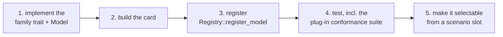

# Extending: models

A model is an object that implements one **family trait** and carries a **model card**.
This page walks through adding one, using the two worked examples in `examples/`:
`propagation-log-distance` (a radio model that draws randomness) and
`carfollowing-constant-time-gap` (a pure mobility model). The rules every extension keeps
are on [Conventions](../conventions.md); the overview of every extension point is
[Extending](../../extending.md).



## 1. Implement the family trait

Every family trait extends `v2xw_core::model::Model`, whose one required method returns
the card. A registered model therefore always has a card, and the card is reachable from
the live object.

```rust
pub trait Model {
    fn card(&self) -> &ModelCard;            // required
    fn tiers(&self) -> &[Tier];              // from the card
    fn implements_tier(&self, tier: Tier) -> bool;
    fn id(&self) -> &str;
    fn version(&self) -> &str;
    fn family(&self) -> Family;
    fn id_at_version(&self) -> String;       // "id@version", how scenarios and manifests name it
}
```

`Model` is dyn-compatible; the registry stores a `ModelHandle =
Arc<dyn Model + Send + Sync>`, so a model must be `Send + Sync` (no `Rc`, `Cell` or
thread-local state).

| Family (`v2xw_core::card::Family`) | Trait |
|---|---|
| `propagation`, `fading`, `obstacle`, `phy`, `mac`, `dcc` | `v2xw_radio::traits::{Propagation, Fading, ObstacleModel, Phy, Mac, Dcc}` |
| `mobility`, `vru`, `gnss`, `clock` | `v2xw_mobility::traits::{CarFollowing, LaneChange, IntersectionControl, Router, Demand, VruMobility, GnssModel, ClockModel}` |
| `net`, `fragmenter` | `v2xw_net::netlayer::NetLayer`, `v2xw_net::frag::Fragmenter` |
| `codec` | `v2xw_msg::codec::MessageCodec` |
| `crypto-backend` | `v2xw_sec::crypto::CryptoBackend` |
| `verification-policy`, `service-model`, `safety-app` | `v2xw_node::policy::VerificationPolicy`, `v2xw_node::server::ServiceModel`, `v2xw_node::safety::SafetyApp` |
| `attacker`, `detector`, `ma-pipeline` | `v2xw_threat::attack::Attacker`, `v2xw_threat::detect::Detector`, `v2xw_threat::ma::MaPipeline` ([detectors](detectors.md)) |
| `metric` | `v2xw_metrics::MetricProvider` ([metrics](metrics.md)) |
| `emission`, `energy` | `v2xw_energy::traits::{EmissionModel, EvEnergyModel}` |
| `protocol` (threshold) | `v2xw_proto::threshold::ThresholdProtocol` (template: `crates/v2xw-proto/src/threshold/template.rs`) |

`Family` is closed: a new family means a new trait, a new variant, a conformance suite and
a Python base class.

### The propagation example

```rust
impl<C: Ctx + ?Sized> Propagation<C> for LogDistance {
    fn tier(&self) -> Tier { self.tier }

    fn loss_db(&mut self, ctx: &mut C, tx: &RadioEndpoint, rx: &RadioEndpoint,
               f_hz: f64, _los: &LosResult, _w: &WeatherState) -> LossBreakdown {
        let d = tx.pos.distance(rx.pos);
        let path = self.params.path_loss_db(d, f_hz);           // uses v2xw_core::math::log10
        let shadow = if self.params.shadowing_sigma_db > 0.0 {
            let link = LinkKey(tx.node, rx.node);                 // directed: (a,b) != (b,a)
            ctx.rng(RngDomain::Shadow, EntityRef::Link(link))
                .normal(0.0, self.params.shadowing_sigma_db)
        } else { 0.0 };
        LossBreakdown::new(path, shadow, 0.0, 0.0, tx.gain_dbi + rx.gain_dbi)
    }
}
```

It computes $PL(d) = PL_0 + 10\,n\,\log_{10}(d/d_0) + X_\sigma$, $X_\sigma \sim
\mathcal{N}(0,\sigma^2)$, with $PL_0$ the Friis loss at $d_0 = 10$ m. Points to copy:

- **Randomness only from the context.** `ctx.rng(domain, entity)` checks out a keyed
  stream; the key (`Shadow`, this directed link) makes the draw independent of event
  order, other links and thread count. Never own a generator.
- **Transcendentals through `v2xw_core::math`** (`math::log10`, not `f64::log10`).
- **No per-call state** unless keyed in a `BTreeMap` by entity; the model stays `Sync`.
- **The arithmetic is callable without an engine** (`LogDistanceParams::path_loss_db`), so
  tests can assert on the equation directly.
- **Ignored inputs are named** (`_los`, `_w`) and listed on the card's `ignores`.

### The car-following example

```rust
impl CarFollowing for ConstantTimeGap {
    fn accel(&self, ego: &VehicleView, leader: Option<&LeaderView>,
             lane: &LaneView, w: &WeatherState) -> f64 { /* ... */ }
}
```

$e = g - (s_0 + T v)$; following: $a = k_\text{position}\, e + k_\text{speed} (v_\text{lead} - v)$;
free road: $a = k_\text{free} (v_0 - v)$, clamped to the driver's comfortable limits. `accel` takes no
context: a car-following model must be pure, and driver heterogeneity (`T`, `s0`, `a_max`,
`b`) arrives per vehicle in a `DriverProfile` (`CarFollowing::profile`). A stop line,
signal or junction arrives as a virtual leader. Optional hooks: `begin_step(now, dt)` for
discrete-time models and `cooperative()` for models that read V2X.

## 2. Build the card

`v2xw_core::card::ModelCard`; read the example's `card()` function before the model.

| Field | Content |
|---|---|
| `id` | `family/name`, matching `^[a-z0-9][a-z0-9-]*(/[a-z0-9-]+)*$`; never changed once published. The examples use an `example/` prefix |
| `family`, `version`, `api_version` | the `Family`; the model's semver (bump it when the numbers change); `v2xw_core::card::API_VERSION` (`1.0.0`) |
| `tier` | non-empty list of `abstract`, `medium`, `high` |
| `purpose` | one paragraph |
| `equations` | `Equation { name, latex_or_text, notes }` |
| `parameters` | `Parameter { name, unit, default, range, source, calibration }`: every number the model reads |
| `assumptions`, `limitations`, `ignores` | lists of sentences; what a reader of a result checks first |
| `sources` | `Source { kind, ref, accessed, note }`; `kind` is `standard`, `paper`, `datasheet`, `dataset`, `code` or `todo-calibrate` |
| `validation` | `status` (`unvalidated`, `unit-tested`, `literature-checked`, `field-checked`), references, test names |
| `determinism` | `uses_rng` and the `rng_domains` drawn from; the conformance suite checks the declaration against what the model drew |
| `cost` | optional per-call cost class |

`ModelCard::validate` (run by every `register*` call) refuses:

| Error (`CardError`) | When |
|---|---|
| `InvalidId` | the id does not match the pattern |
| `EmptyField` | empty `version`, `api_version`, `purpose`, or no `tier` |
| `DuplicateParameter` | two parameters share a name |
| `DefaultOutOfRange` | a parameter's default lies outside its own `range` |
| `MissingCalibration` | a `todo-calibrate` source without a non-empty `calibration` plan |
| `ApiVersionMismatch` | `api_version` is not one this engine implements |

A number nobody publishes is declared honestly. The car-following example's three gains
are a manufacturer's calibration, so each is `Source::todo_calibrate(...)` with a
`calibration` plan, and the card says `unvalidated`:

```rust
Parameter {
    calibration: Some(plan.to_string()),
    ..Parameter::new("k_position", "1/s^2", json!(params.k_position),
                     Source::todo_calibrate("proportional gain on the spacing error; ..."))
}
```

A scenario overrides a parameter by name in `params`. `ParamSet::resolve(card, overrides)`
merges the overrides over the card's defaults and refuses an unknown name, a JSON type
different from the default's, or a value outside the declared range.

## 3. Register it

```rust
pub fn register(registry: &mut Registry) -> Result<ModelRef, RegistryError> {
    let model: ModelHandle = Arc::new(LogDistance::medium());
    registry.register_model(model)
}
```

| Call | Use |
|---|---|
| `Registry::register(card)` | card only (catalogue entry, no live object) |
| `Registry::register_model(handle)` | the live model; the card is taken from it, so they cannot disagree |
| `register_with_licence`, `register_model_with_licence` | in process under a declared licence; refuses a copyleft or unknown licence (`LicenceRequiresOutOfProcess`) |
| `register_out_of_process`, `register_model_out_of_process` | a model that runs in its own process, any licence |

Registration validates the card, checks the API version, refuses a duplicate id with a
different card, hashes the card's canonical bytes (the content hash the run manifest
pins) and stores it. `Registry::get_model_by_id` and `resolve` find it again.

## 4. Test it

Each example's tests are the template. At minimum:

- `card().validate()` succeeds and `register` succeeds;
- the equation: one assertion that distinguishes the model from its nearest neighbour
  (the propagation example pins the $10n$ dB-per-decade slope, which fails at $n = 2$);
- a family property (propagation loss never decreases with distance);
- determinism: two links draw different values, a reversed link is a different link,
  the same seed reproduces;
- a test **shown to fail**: change the value the test is about and watch it go red
  (`tools/mutate/mutate.py` automates this).

A propagation model's tests need a `Ctx`; the example's `TestCtx` (an `RngRegistry`, a
`Scheduler`, a `ParamSet`, a `ProvenanceLog`) is the smallest one and can be copied.

Then run the **plug-in conformance suite** from `tests/conformance` (crate
`v2xw-conformance`):

```rust
use v2xw_conformance::plugin::{PluginUnderTest, ProbeCtx, run_suite};

struct Subject(LogDistance);
impl PluginUnderTest for Subject {
    fn model(&self) -> &dyn Model { &self.0 }
    fn entities(&self) -> Vec<EntityRef> { /* two or more */ }
    fn exercise(&self, ctx: &mut ProbeCtx, e: EntityRef) -> Vec<f64> { /* one unit of work */ }
    fn sources(&self) -> Vec<PathBuf> { vec![/* your .rs files */] }   // empty = scans unchecked
    fn quantum(&self) -> f64 { 1e-3 }      // the grid every output must sit on
    fn runs_as_node(&self) -> bool { false } // true: no emitted record may carry ground truth
}

let report = run_suite(&Subject(LogDistance::medium()), 0x5EED);
assert!(report.passed(), "{report}");
```

| Property | How it is established |
|---|---|
| owns no RNG | source scan for `rand::`, `thread_rng`, generator types, a second `RngRegistry` |
| reads no wall clock | source scan for the firewall's wall-clock needles |
| reaches no ground truth | source scan for the ground-truth needles, plus the visibility of emitted records |
| valid card, every default cited | `ModelCard::validate` plus a source on every parameter |
| deterministic under reordering | the entities exercised forwards, backwards and on eight threads, compared value for value |
| outputs quantised | every returned value on `quantum()` |

`examples/detector-heading-rate` wires the suite up in its `conformance` module.

```sh
cd examples && cargo test                       # all four examples
cd examples && cargo test -p v2xw-example-propagation
```

## 5. Make it selectable

Registering puts a model in the registry, the manifest and the published `models` list.
A scenario can select it only where the engine builds that slot from an id, and each slot
accepts a fixed set of ids. To add a built-in model to a slot, edit the engine:

| Slot | Where the id is turned into an object |
|---|---|
| `radio.models.<family>` (`propagation`, `fading`, `per`, `phy`, `obstacle`, `sidelink`, `dcc`) | `crates/v2xw-engine/src/wiring.rs`: add the id to `RADIO_MODEL_FAMILIES`, parse it and its `params` in `radio_models` (for propagation, a `PropagationChoice` variant), and build it in `build_radio_at` |
| `actors.vehicles.driving.car_following` / `.by_class.*` | `crates/v2xw-mobility/src/carfollowing/library.rs`: one `CfFactory { id, short, cooperative, build, card }` line in `FACTORIES`; `crates/v2xw-engine/src/driving.rs` builds what the scenario names |
| `detection.local[]`, `threats.attackers[].id`, `detection.ma` | `crates/v2xw-engine/src/phase2.rs` ([detectors](detectors.md)) |
| `net.layer`, `net.fragmenter`, `messages.generator`, ... | the slot's builder in `crates/v2xw-engine/src/`; the card goes in `wiring::register_all` |
| metrics | `v2xw_metrics::register_all` ([metrics](metrics.md)) |

The published settings surface reads each slot's selectable ids from the registry through
`scenario::options::slot_values`, so once the card is registered (in `wiring::register_all`
or, for catalogue-only cards, `scenario::publish`'s catalogue) and the slot builds it, the
Studio and the [generated model reference](../../configuration/reference/models.md) list it
with its parameters. Run `just docs-gen` to regenerate the reference.

Example scenario use once wired:

```yaml
actors:
  vehicles:
    driving:
      car_following: { model: krauss }                 # short name or full id
      by_class:
        truck: { model: gipps }
        passenger: { model: cacc-ploeg, share: 0.4 }   # 40 % of cars
radio:
  models:
    propagation: { id: propagation/two-ray-interference, params: { epsilon_r: 1.02 } }
```

!!! warning "Out-of-tree models are not selectable from a scenario"
    The slots above accept the ids compiled into the engine. A model in your own crate
    (like the `examples/` crates) registers, validates, hashes and passes the conformance
    suite, but a scenario cannot name it until the slot's builder in the engine learns its
    id. See [Plugins](plugins.md) for what is supported out of tree.

Finally, add a same-seed test that selecting the model changes the run, and a
[model page](../../models/index.md) entry if it is a new law.
