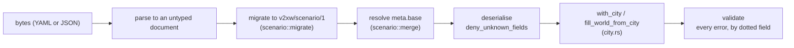

# Extending: scenarios and cities

A **scenario** says what happens (traffic, radio, network, security, attacks, metrics); a
**city** says where. They are chosen separately: any scenario runs on any city of the
library. Writing scenarios as a user is covered in [Scenarios](../../scenarios.md); this
page is about adding files the repository ships and adding cities.

## How a scenario file is loaded



`Scenario::load(path)` (`crates/v2xw-engine/src/scenario/mod.rs`) runs these steps.

### Overlays: `meta.base`

`meta.base` names another scenario file, **relative to the including file's directory**.
The base is loaded (and migrated on its own), then the overlay is merged onto it on the
untyped document, before deserialisation, so "absent" stays distinguishable from "set to
the default":

| Base | Overlay | Result |
|---|---|---|
| mapping | mapping | merged key by key, recursively |
| anything | non-mapping value | the overlay replaces the base |
| a list | a list | the overlay's list replaces the base's (a list is a value, not a set) |
| a key | `null` | the key is removed |

`meta.base` is dropped from the merged document. Bases may chain up to
`MAX_BASE_DEPTH` (16) levels; deeper is refused as a likely cycle.

```yaml
# scenarios/midtown-rain.yaml: four lines of difference from the baseline
schema: v2xw/scenario/1
meta:
  base: midtown-normal.yaml
  name: Heavy rain
  description: >-
    Midday downtown in heavy rain on a wet road ...
  tags: [traffic, weather, rain, scms, dsrc]
weather:
  initial: rain
  intensity: 0.8
  surface: wet
```

## The `scenarios/` layout

| Path | Holds |
|---|---|
| `scenarios/*.yaml` | the ready-made scenarios, the study library (sweeps), and the end-to-end slices |
| `scenarios/base/` | shared deployments the overlays build on: `city.yaml` (a downtown at midday, the US SCMS, roadside units at the busiest signalised intersections, demand per lane-kilometre), `midtown.yaml`, `radio-faceoff.yaml` |
| `scenarios/ready-made.txt` | the Studio picker's list, in order: one file name per line, `##` starts a heading, `#` is a comment; read by the server's `scenario.list` (`crates/v2xw-server/src/live.rs`) |
| `scenarios/scale/` | the wall-clock ladder, each rung an overlay on `scale/base.yaml` |
| `scenarios/sensitivity/` | the family files the catalogue sweep routes settings to |
| `scenarios/real-world/`, `interop/`, `platform/`, `edge/`, `benchmark/` | scenarios for specific data, SUMO interop, platform and edge cases, benchmarks |
| `scenarios/tests/` | fixtures that Rust integration tests and the Studio's end-to-end specs load; each named for what it exercises |

## Adding a shipped scenario

1. **Start from the closest file**, or write a short overlay on `scenarios/base/`.
2. **Header comment**: what it measures, what it does **not** measure, and why each
   non-default number is that number, with its source.
3. **City-independent forms**, so it runs on any city:

    | Instead of | Write | The engine (`city.rs`) |
    |---|---|---|
    | a fixed arrival rate | `actors.vehicles.demand.rate_veh_per_h_per_lane_km` | multiplies it by the imported network's driving-lane length |
    | explicit RSU positions | `actors.rsu_placement: {count, roles, min_spacing_m}` | places units at the city's busiest signalised intersections |
    | a named street in a closure | `target: auto` | closes a side street of whatever city it is |
    | a jammer position | `at: busiest-junction` | the busiest signalised intersection |

4. **`meta.name` and `meta.description`** are what the picker shows.
5. **For a sweep**, set every swept path in the base: a sweep replaces a value already in
   the serialised scenario, and an optional field left unset is not serialised.
6. **Validate**: `v2xw validate scenarios/<file>.yaml` must report no error.
7. **Offer it in the picker** (optional): add its file name to `scenarios/ready-made.txt`
   under the right `##` heading.
8. **Run the tests that read the folder**.

| Test | What it requires of every `scenarios/*.yaml` |
|---|---|
| `scenario::publish::every_shipped_scenario_is_described` (`cargo test -p v2xw-engine --lib every_shipped_scenario_is_described`) | every key of every file that loads is in the published schema |
| `v2xw-trafficval` `invariants/shipped-scenarios` (`traffic_validation --only invariants`) | the traffic auditor's classes stay at zero on every shipped scenario that puts traffic on the road |
| `v2xw-netval` end-to-end checks | the shipped scenarios they name load and run under conservation and determinism properties |
| `crates/v2xw-engine/tests/scenario.rs`, `calendar.rs`, `crates/v2xw-cli/tests/cli.rs` | named shipped files still load, validate and hash; compressed-calendar files declare it |

!!! warning "A scenario that fails to load is skipped by the coverage test"
    `every_shipped_scenario_is_described` skips files the loader refuses, so run
    `v2xw validate` on every new file yourself.

A fixture for a new test goes in `scenarios/tests/`, named for what it exercises, with a
header saying what it changes.

## Adding a city

The city library is `worlds/cities.yaml` (schema `v2xw/cities/1`), compiled into the
binary so every interface lists the same cities.

1. **Add an entry** under `cities:`:

    ```yaml
    - id: example-city                  # also the extract's file name: worlds/cache/<id>.osm.xml
      name: "Example City"
      state: XX                         # USPS code
      state_name: "Example State"
      region: west                      # northeast, southeast, south, midwest, southwest, west
      role: largest                     # largest, studied, metro, international
      bbox: [S, W, N, E]                # degrees, WGS 84; the south-west corner is the world origin
      area_km2: 2.24
      utc_offset_h: -8                  # for time.local_start
      highway_preset: urban-us-xx       # crates/v2xw-world/src/jurisdiction.rs (cites each)
      fetched: "YYYY-MM-DD"             # becomes world.imported_at
      description: "Downtown ..."
    ```

    Optional `drive_lane_km` and `signals` record the network size the city audit
    measures. With `drive_lane_km` set, a fixed arrival rate moved to the city is rescaled
    by the lane-km ratio; without it, the engine uses a reference length until the world
    is imported, then measures the imported network (`city::drive_lane_km`). A jurisdiction with
    no preset needs one in `v2xw-world`'s `jurisdiction.rs`, with citations.

2. **Fetch the extract**: `worlds/fetch.sh <id>` writes `worlds/cache/<id>.osm.xml`
   (git-ignored; OpenStreetMap data under ODbL 1.0). The script queries the Overpass API
   for the box's nodes, ways, turn restrictions and building multipolygons, retries with
   backoff, pauses between downloads (`FETCH_PAUSE_S`, default 15 s), tries mirrors
   (`OVERPASS_URL` puts your own first) and checks the answer was not cut short.
   `worlds/fetch.sh --list` shows which extracts are present; `V2XW_WORLDS_DIR` points
   the engine at another directory.

3. **Audit it**:

    ```sh
    cargo run -p v2xw-cli --bin city_audit -- scenarios/base/city.yaml --only example-city \
        [--seconds S] [--json OUT.jsonl]
    ```

    The scenario is put on the city as `v2xw run --city` would (`Scenario::with_city`),
    the world imported and fitted (`city::adapt_to_world`), and the traffic stepped under
    the auditor. A city passes when it imports, at least one vehicle completes a trip, the
    roadside units find intersections, no safety-class violation occurs and no vehicle
    stands past the standstill limit. A city that fails goes under `dropped:` with the
    reason.

4. Rebuild, then `v2xw cities` lists it and `v2xw run <scenario> --city example-city` runs
   on it.

### Other world data

| Script | Produces |
|---|---|
| `worlds/fetch-gtfs.sh <name> [YYYYMMDD]` | `worlds/cache/<name>.gtfs/`: a GTFS feed clipped to the city's box and one service day (via `v2xw-demand gtfs-clip`), for the `mobility/demand/gtfs` demand kind. The scenario names the same date in `params.date` or has `time.t0` on it |
| `worlds/fetch-lust.sh [netconvert]` | rebuilds the committed LuST subsection `worlds/sumo/lust-veremi-sub.net.xml` (MIT) from a pinned commit and prints its sha256 for comparison with its provenance file |
| `worlds/dem/` | elevation models draped under the lanes (see each file's provenance note) |

See [Worlds and maps](../../guide/worlds-and-maps.md) for the importers and
[Citation and licence](../../about/citation.md) for the data licences.
