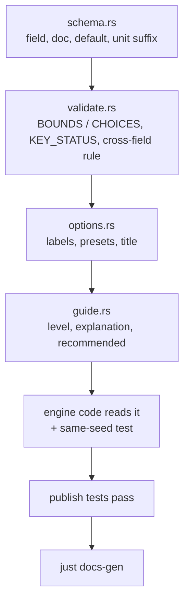

# Extending: settings

A setting is a scenario field. Adding one touches six files under
`crates/v2xw-engine/src/scenario/`, and the published-surface tests refuse a field that
is missing any of them, so the Studio, the assistant and the
[generated reference](../../configuration/reference/index.md) cannot fall behind the
schema. Background: [How settings work](../../configuration.md),
[Configuration overview](../../configuration/overview.md).



As a running example, a hypothetical numeric field `radio.phy.example_margin_db` and a
closed-set field `net.example_mode`.

## 1. The field in `schema.rs`

```rust
/// The extra link margin the receiver demands, dB. 0 dB (no margin) by default.
#[serde(default, skip_serializing_if = "Option::is_none")]
pub example_margin_db: Option<f64>,
```

| Rule | Why |
|---|---|
| the unit is the name's suffix (`_s`, `_ms`, `_m`, `_db`, `_dbm`, `_mps`, `_hz`, `_veh_per_h`, ...) | the published surface reads the unit off the name (`publish::UNIT_SUFFIXES`); a numeric leaf that cannot carry one goes in `publish::UNIT_OVERRIDES`, or in `DIMENSIONLESS` if it has none |
| the doc comment's first paragraph says what it is, its unit and its default | it is the field's published `description` (reflected at build time by the crate's `build.rs`) |
| optional or skip-serialised at its default (`#[serde(default, skip_serializing_if = ...)]`) | existing scenario hashes and the golden digests must not move |
| structs keep `#[serde(deny_unknown_fields)]` | a misspelt key is an error |

A field that selects a model is a `ModelChoice { id, params }` (or a bare id) and also
gets a `publish::SLOTS` row (`Slot { path, label, family, bare_id }`); its selectable ids
then come from the registry.

## 2. Range or value set in `validate.rs`

A number gets one `Bound` in `validate::BOUNDS`:

```rust
Bound {
    path: "radio.phy.example_margin_db",
    lo: 0.0,
    hi: 20.0,
    exclusive_lo: false,
    what: "the receiver's extra link margin",   // used in the error message
},
```

A closed string set gets a row in `validate::CHOICES`:

```rust
choices("net.example_mode", &["off", "basic", "full"]),
```

A set may narrow on another field (`narrowed_by`, `narrowed_when`, `narrowed_to`), as
`security.signature` narrows under `security.crypto_mode: real`. Sets whose members come
from a registry (model ids, hardware profiles) are slots, not `CHOICES` rows.

The rules read these tables, so the form and the loader cannot disagree. A cross-field
rule goes in `validate::validate`, and its error is built with the dotted field and the
conflict:

```rust
e.push(conflict("radio.phy.example_margin_db",
    "is set, and radio.tiers.phy is abstract, which has no SNR to apply it to".into()));
```

A setting that would change nothing in a context (as above) is refused at load with an
error that names it; `crates/v2xw-engine/tests/inert_setting_refusals.rs` holds such
rules, each with a test that the refusal lifts once the setting can act.

## 3. Its status in `KEY_STATUS`

```rust
KeyStatus {
    path: "radio.phy.example_margin_db",
    status: Status::Wired,
    note: "Raises the SNR every reception needs by this many dB.",
},
```

Statuses: `Wired`, `Partial` (the note states the conditions), `NotImplemented`,
`Refused` (only implemented values load), `Descriptive`. Entries are prefixes and the
longest match wins. Keys whose tables live beside the engine module that implements them
(for example `ma_policy.rs`, `scms_topology.rs`) are reached through
`scenario/module_keys.rs`.

## 4. Words in `options.rs`

| Need | Where |
|---|---|
| a label and one sentence per value of a closed set | a match arm in `options::words(path, value)`, returning `(label, description, available)`. Without one, the value falls back to a humanised id and the model card's purpose |
| named values beside a number, each with its source | a `Preset { path, label, value, note }` in `PRESETS` (or `SCMS_PRESETS`, `MODULE_PRESETS`) |
| a plain-language title where the Rust name reads badly | `options::title` |
| a value set that is neither `CHOICES` nor a reflected enum | `options::extra_values` |
| "only relevant when ..." | `options::relevant_when` (published as `x-relevant-when`) |
| a numeric step for the form's spinner | `publish::STEPS` |

## 5. Level and guidance in `guide.rs`

Every field is `advanced` unless listed. A field that decides what a run models gets a
`Basic { path, explain, recommended }` row in `guide::BASIC`: one sentence on what it is
in the real world and a recommended range in words, with the source of any number. An
advanced field can carry the same row in `guide::ADVANCED`. A quick setting or a study
starting point (`guide::quick`, `guide::studies`) is a patch the tests apply to the
minimal scenario and validate.

```rust
Basic {
    path: "radio.phy.example_margin_db",
    explain: "Extra signal strength a receiver insists on before it trusts a frame.",
    recommended: "0 (default); 3 to 6 to model a conservative receiver.",
},
```

## 6. Read it in the engine

Read the field where the engine builds the affected model (`wiring.rs` for radio and
mobility, `phase2.rs` for security, threats and detection, `run.rs` for the loop), and
add tests:

- a same-seed comparison showing that changing the setting changes the run (and that the
  default leaves the golden digests unchanged);
- if theory predicts a direction, an expectation row in
  `crates/v2xw-engine/tests/expectations/<family>.yaml`:

```yaml
- {setting: radio.phy.example_margin_db, change: high, metric: range90_m, expect: down,
   source: "a higher SNR requirement shortens range (cite the text)"}
```

`expect` is `up`, `down`, `same` or `changes`; `change` is `low`, `high` (the ends of the
recommended range) or a literal; `min_change` defaults to 0.01. `v2xw sensitivity
--expect` checks the rows against same-seed runs, and
`tests/sensitivity_expectations.rs` checks that they load and are consistent.

## 7. Migration (only for a breaking change)

An additive optional field needs no migration. Renaming or restructuring a field means a
new schema version: add one single-step `Migration` to `migrate::Chain::shipped()` that
rewrites the untyped document from the previous version, bump
`schema::CURRENT_SCHEMA`, and update the shipped scenarios. The chain walks one step at a
time and fails with `ScenarioError::MigrationGap` when a step is missing. `v2xw/scenario/1`
is the only version so far, so the shipped chain is empty.

## 8. The tests that guard the published surface

`cargo test -p v2xw-engine --lib scenario` runs them:

| Test | File | Fails when |
|---|---|---|
| `every_leaf_has_a_status` | `publish.rs` | a leaf matches no `KEY_STATUS` row |
| `every_number_publishes_a_unit` | `publish.rs` | a numeric leaf has no suffix, override or `DIMENSIONLESS` entry |
| `the_tables_name_real_fields` | `publish.rs` | a `BOUNDS`, `CHOICES` or `KEY_STATUS` row names a path the schema does not have |
| `the_published_defaults_load` | `publish.rs` | a document of the published defaults does not load |
| `every_shipped_scenario_is_described` | `publish.rs` | a key in a file under `scenarios/` is not in the schema |
| `every_section_has_a_group` | `publish.rs` | a new top-level section has no display group |
| `every_model_parameter_publishes_its_provenance` | `publish.rs` | a model card parameter in the catalogue lacks a unit, default or source |
| `module_keys_publish_menus_ranges_and_status` | `publish.rs` | a module-owned key lacks a title, a menu, a unit, a range or a step |
| `every_quick_choice_and_study_loads` | `guide.rs` | a quick-setting or study patch does not validate |
| `every_quick_field_and_basic_path_is_published` | `guide.rs` | a `BASIC` row names an unpublished path |
| `the_typed_fields_are_choices` | `options.rs` | a field with a closed set of accepted values is not offered as a menu of exactly those values |

## 9. Regenerate the reference

```sh
just docs-gen       # dump_settings -> tools/docs/gen_config_reference.py
just docs-build     # optional: build the site and check links
```

Commit the regenerated `docs/configuration/reference/` with the change.

## Checklist

- [ ] field in `schema.rs`: unit suffix, doc with default, skip-serialised at default
- [ ] `BOUNDS` or `CHOICES` row (or a `SLOTS` row for a model)
- [ ] `KEY_STATUS` row with a one-line note
- [ ] labels (`options::words`) and presets with sources
- [ ] `guide::BASIC` row if it decides what a run models
- [ ] read in the engine; same-seed test; expectation row if theory predicts a direction
- [ ] publish tests green; `just docs-gen` run
