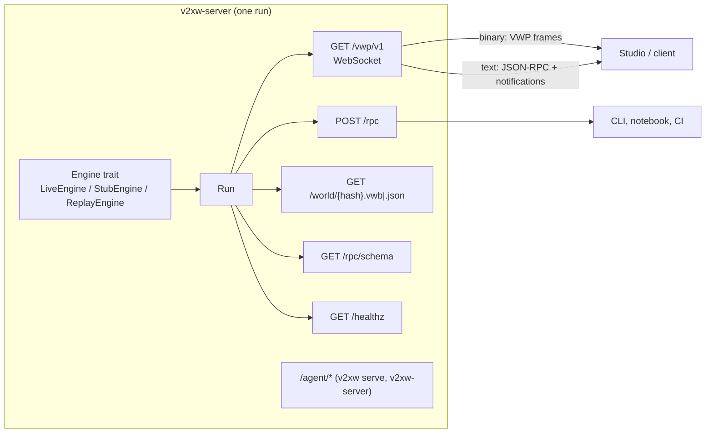

# Engine server and RPC

`crates/v2xw-server` serves one run (live from the engine, or the synthetic fixture) to
browsers, notebooks and scripts: the binary VWP stream over a WebSocket and a JSON-RPC 2.0
control surface over the same socket and over HTTP. The normative wire specification is
[VWP v1](../protocol/vwp-v1.md); this page is the developer's map of it, with every
method of `v2xw_server::rpc::METHODS`.

## Starting a server

| Command | Serves |
|---|---|
| `v2xw-server --scenario <file>` | a live engine run of the scenario, with the agent's endpoints and watcher |
| `v2xw-server` (no `--scenario`) | the synthetic fixture: a deterministic procedural grid with `--actors`, `--grid`, `--block`, `--duration`, `--seed`; every number it reports is a fixture value |
| `v2xw serve --scenario <file>` | the same live run with the agent's endpoints, through the main CLI |
| `v2xw serve --attach <url>` | only the agent's endpoints, in front of an engine already running |
| `just serve <scenario>` / `just serve-fixture [ACTORS]` | the two above on port 8787 |
| `./run-sim.sh [scenario]` | builds if needed and starts the engine with the agent on |

`v2xw-server` options:

| Option | Default | Meaning |
|---|---|---|
| `--scenario <p>` | none (fixture) | scenario to run |
| `--record <p>` | none | write the MCAP recording here |
| `--build-utc <t>` | now, read by the binary | manifest timestamp (the engine reads no clock) |
| `--retain <n>` / `--retain-mb <n>` | 36000 steps / 1024 MB | history kept for `run.seek` |
| `--lookahead <n>` | 64 | steps the kernel may run ahead of the stream |
| `--resume <p>` | none | open a `v2xw run --checkpoint-every` run at its `checkpoint.json` and serve it paused there |
| `--port <n>` | 8787 | TCP port; 0 picks an ephemeral one |
| `--host <addr>` | 127.0.0.1 | bind address; a non-loopback bind needs `--token` |
| `--token <t>` | none | bearer token required on the upgrade and on every HTTP request |
| `--speed <x>` | 1 | multiple of real time; 0 is unthrottled |
| `--paused` | off | start paused at t = 0 |
| `--label <s>` | | human label in `Hello` |
| `--no-agent` | off | serve without the agent's endpoints and watcher |
| `--env-file <p>` | `./.env` when present | where the agent's model-provider keys are read from |
| `--quiet` | off | no banner |

From Rust: `v2xw_server::serve_scenario(ServerOptions, path, LiveOptions)`,
`serve_stub(ServerOptions, StubOptions)` and `serve_replay(ServerOptions, recording, world,
world_json)` each return a running `VwpServer`. `ServerOptions { bind, token, extension }`
takes an extra `axum::Router` merged on the same origin, which is how the agent's routes
are added. No shipped binary serves a replay; the Studio replays recordings in the browser
through `v2xw-wasm` ([Recording format](recording-format.md#reading-a-recording)).

## Transports



| Endpoint | Purpose | Spec |
|---|---|---|
| `GET /vwp/v1?run=&session=&resume=&profile=full\|node&compress=zstd\|none&v=1` | WebSocket, subprotocol `vwp.v1`. Binary frames carry the stream; text frames carry JSON-RPC | [§1.1](../protocol/vwp-v1.md#11-endpoint), [§1.2](../protocol/vwp-v1.md#12-telling-binary-from-text) |
| `POST /rpc` | the same methods, one call per request; connection-scoped methods return `-32009` | [§6.2](../protocol/vwp-v1.md#62-json-rpc-over-http) |
| `GET /rpc/schema` | the OpenRPC 1.3.2 document (`rpc.discover`'s result) | [§6.3](../protocol/vwp-v1.md#63-self-description) |
| `GET /world/{hash}.vwb`, `.json` | the world geometry, `vwp-world/1`, content-addressed and immutable | [§4](../protocol/vwp-v1.md#4-the-world-payload-vwp-world1) |
| `GET /healthz` | liveness | [§1.1](../protocol/vwp-v1.md#11-endpoint) |

Every response carries the cross-origin isolation headers
(`Cross-Origin-Opener-Policy: same-origin`, `Cross-Origin-Embedder-Policy: require-corp`,
`Cross-Origin-Resource-Policy: same-origin`). A missing or wrong bearer token is HTTP 401,
never a WebSocket close.

| Stream topic | Spec |
|---|---|
| handshake (`Hello`), reconnect and resume by session token and `seq` | [§1.3](../protocol/vwp-v1.md#13-handshake), [§1.4](../protocol/vwp-v1.md#14-reconnect-and-resume) |
| backpressure: bounded queues, drop policy, `stream.drop` | [§1.5](../protocol/vwp-v1.md#15-backpressure-the-server-never-queues-unboundedly) |
| 24-byte frame header, flags, message types, symbol table, compression | [§2](../protocol/vwp-v1.md#2-binary-framing) |
| `Hello`, `Keyframe`, `Delta`, `Telemetry`, `Event`, `MetricSample`, `Provenance`, `WorldChunk`, `Error`, `Bye` | [§3](../protocol/vwp-v1.md#3-message-layouts) |
| `full` and `node` visibility profiles | [§5](../protocol/vwp-v1.md#5-visibility-and-the-node-only-profile) |
| replay, byte identity, seek | [§7](../protocol/vwp-v1.md#7-replay) |
| versioning | [§8](../protocol/vwp-v1.md#8-versioning) |

Every frame the server sends is built by `v2xw-record`'s encoder (`v2xw_record::wire`);
only the connection-scoped `Error` and `Bye` frames are written in `http.rs`.

## JSON-RPC conventions

- JSON-RPC 2.0, single objects only (a batch array is refused with `-32600`); params by
  name. [§6.1](../protocol/vwp-v1.md#61-framing)
- Long operations return a `Job` (`{job_id, state, progress, message, outputs}`) and finish
  with `job.progress` / `job.done` notifications.
- `rpc.discover` (or `GET /rpc/schema`) returns every method's params schema, result
  schema and error list; the shared schemas (`SimTimeNs`, `RunId`, `NodeId`, `Sha256Hex`,
  `ValueRef`, `Provenance`, `ValidationError`, `WorldImportResult`, `Job`) are in
  [§6.5](../protocol/vwp-v1.md#65-shared-schema-definitions).
- Times are integer nanoseconds since the scenario's `time.t0`.

### Error codes

| Code | Name | `data` |
|---|---|---|
| −32700 | `parse_error` | |
| −32600 | `invalid_request` | |
| −32601 | `method_not_found` | |
| −32602 | `invalid_params` | `[{path, message, hint}]` |
| −32603 | `internal_error` | |
| −32000 | `run_not_found` | |
| −32001 | `run_already_running` | |
| −32002 | `run_not_running` | |
| −32003 | `seek_out_of_range` | `{min_ns, max_ns}` |
| −32004 | `scenario_invalid` | `{errors: [{path, message, hint}]}` |
| −32005 | `world_not_found` | |
| −32006 | `unknown_id` | `{kind, id}` |
| −32007 | `unknown_metric` | `{metric, did_you_mean}` |
| −32008 | `export_failed` | `{stage, detail}` |
| −32009 | `not_supported_here` | `{why}`: replay-only, live-only or HTTP restriction |
| −32010 | `busy` | `{operation, job_id}` |
| −32011 | `experiment_not_found` | |
| −32013 | `io_error` | `{path, errno}` |
| −32040 | `visibility_denied` | `{field, visibility}`: the `node` profile forbids it |
| −32041 | `unauthorized` | |
| −32050 | `unsupported_version` | |

The OpenRPC document also lists −32012 `plugin_drift` and −32042 `rate_limited`; the
server's `ServerError` raises neither. Full table: [§6.4](../protocol/vwp-v1.md#64-error-codes).

## Methods

`METHODS` holds 44 names; the client list in `ui/packages/protocol/src/rpc.ts` is held
equal by `crates/v2xw-server/tests/rpc.rs`. In the tables, a **bold** param is required;
results list the main fields (required ones in bold). "Spec" links the method's section in
VWP v1 where it has one.

### Run control

| Method | Params | Result | Errors | Spec |
|---|---|---|---|---|
| `run.start` | `scenario` (path or object), `city`, `seed`, `speed` (0 to 100), `paused`, `record`, `record_path`, `label` | **`run_id`**, **`state`**, **`world_hash`**, **`scenario_hash`**, `recording_path`, `t_end_ns` | −32001, −32004, −32005, −32013 | [run.start](../protocol/vwp-v1.md#runstart) |
| `run.pause` | none; pauses at the next mobility-step boundary after flushing every frame up to it | **`state`**, **`t_ns`** | −32002 | [run.pause](../protocol/vwp-v1.md#runpause) |
| `run.resume` | none | **`state`**, **`t_ns`** | −32002 | [run.resume](../protocol/vwp-v1.md#runresume) |
| `run.step` | `unit` (`step`, `event`, `keyframe`, `second`), `count` (1 to 100000) | **`state`**, **`t_ns`**, **`stepped`**, `last_event` | −32002 | [run.step](../protocol/vwp-v1.md#runstep) |
| `run.seek` | `t_ns`, `fraction`, `event`, `pause_after`; the keyframe and deltas arrive before the reply | **`t_ns`**, **`keyframe_seq`**, **`deltas_applied`**, **`elapsed_ms`**, `state` | −32003, −32009 | [run.seek](../protocol/vwp-v1.md#runseek) |
| `run.speed` | **`speed`** (0 to 100), `sync` (`free`, `client`) | **`speed`**, **`sync`** | −32002 | [run.speed](../protocol/vwp-v1.md#runspeed) |
| `run.stop` | `finalize_exports` | **`state`**, **`t_ns`**, `digest`, `files`, `recording_path` | −32002, −32008 | [run.stop](../protocol/vwp-v1.md#runstop) |
| `run.status` | `run_id` | **`run_id`**, **`state`**, **`t_ns`**, **`t_end_ns`**, **`speed`**, **`live`**, **`profile`**, `actors`, `nodes`, `seq`, `dropped`, `sync`, `warnings` | −32000 | [run.status](../protocol/vwp-v1.md#runstatus) |

### View (connection-scoped; WebSocket only)

| Method | Params | Result | Errors | Spec |
|---|---|---|---|---|
| `view.follow` | `node`, `actor`, `camera`, `radius_m`, `telemetry`, `feed` (bool or options: the followed node's message feed), `clear` | **`following`**, **`subscribed_nodes`**, `camera`, `feed` | −32006, −32009 | [view.follow](../protocol/vwp-v1.md#viewfollow), [feed](../protocol/vwp-v1.md#671-the-followed-nodes-message-feed-v11) |
| `view.camera` | **`mode`** (`map`, `chase`, `dashboard`, `free`, `rsu`, `jump`), `node`, `position`, `target`, `fov_deg`, `projection`, `extent_m`, `animate_ms` | **`mode`**, **`position`**, **`target`**, **`fov_deg`**, **`projection`** | −32006, −32602, −32009 | [view.camera](../protocol/vwp-v1.md#viewcamera) |
| `overlay.set` | `overlays` (name to on/off), `opacity`, `list` | **`overlays`**, `catalogue` | −32040, −32602 | [overlay.set](../protocol/vwp-v1.md#overlayset) |

### Inspection

| Method | Params | Result | Errors | Spec |
|---|---|---|---|---|
| `inspect.node` | **`node`**, `t_ns`, `include` (any of `telemetry`, `stores`, `queues`, `neighbors`, `certs`, `crl`, `gnss`, `clock`, `apps`, `detectors`, `provenance`, `messages`), `limit` | **`node`**, **`kind`**, **`profile_id`**, **`t_ns`**, `label`, `provenance`, and the requested blocks | −32006, −32040 | [inspect.node](../protocol/vwp-v1.md#inspectnode) |
| `inspect.link` | `tx`, `rx` or `link`, `t_ns`, `window_ns` | **`kind`**, **`t_ns`**, `distance_m`, frame counts, PDR, RSSI, SINR, `provenance` | −32006, −32040 | [inspect.link](../protocol/vwp-v1.md#inspectlink) |
| `inspect.entity` | **`entity`**, `t_ns`, `limit` | **`entity`**, **`role`**, **`state`**, **`t_ns`**, `provenance` | −32006, −32040 | [inspect.entity](../protocol/vwp-v1.md#inspectentity) |
| `inspect.pdu` | **`id`**, `view` | **`id`**, **`type`**, **`len`**, `hex`, `tree` (the ASN.1 value tree in JER from the real decoder), `opened` (the recipient's plaintext), `sealed_to` | −32006, −32009, −32040 | |
| `inspect.cert` | **`hashedid8`**, `t_ns` | **`id8`**, **`chain`**, **`trace`** (chain to a CTL root, signatures, issuer permissions, chain length, validity, region, CRL), **`valid`**, `tree` | −32006, −32009 | |
| `inspect.trust` | `t_ns` | **`state`** (providers and components with role, region and status; the CTL with history and electors; CRL heads), **`activity`** (components that carried traffic in the 2 s before `t_ns`), **`t_ns`**, `messages` (sender, receiver, name, flow, bytes; no payload), `history`, `certificates_known` | −32006, −32009 | |
| `inspect.flows` | `flow`, `device`, `provider`, `t_ns`, `limit` | **`flows`** (per-flow counts), **`instances`** (newest first), **`total`** | −32006, −32009 | |
| `inspect.flow` | **`instance`**, `t_ns` | **`instance`**, **`flow`**, **`records`** (every message with sender, receiver, bytes, transport and SPDUs, and every stage stamp, in time order), `dropped` | −32006, −32009 | |
| `inspect.knowledge` | **`entity`**, `view` | **`entity`**, **`role`**, **`holds`**, **`cannot_see`** (what it handles but cannot read), `truth` (the join onto devices, ground-truth view only) | −32006, −32009, −32040 | |
| `inspect.pki` | **`topic`** (`vehicles`, `vehicle`, `cases`, `crls`, `crl`), `device`, `hashedid8`, `view` | the topic's table: every vehicle's pool and provisioning state; one vehicle's i × j certificate grid and pseudonym history; every misbehaviour case with its stages; every CRL version with its SLA clock and the CTL; one CRL's decoded entries | −32006, −32009, −32040 | |
| `explain` | **`subject`** (`ValueRef`), `depth`, `format` (`json`, `markdown`) | **`subject`**, **`chain`** (the provenance chain back to model cards), `value`, `unit`, `definition_md`, `caveats`, `markdown` | −32006, −32007, −32040 | [explain](../protocol/vwp-v1.md#69-explain) |

The `inspect.pdu` to `inspect.pki` methods read the recorded PKI channels (`pki.flow`,
`pki.state`); ground-truth views require the `full` profile.

### Scenario

| Method | Params | Result | Errors | Spec |
|---|---|---|---|---|
| `scenario.get` | `path` (JSON Pointer), `resolved`, `with_schema` | **`scenario`**, **`hash`**; with `with_schema`, the settings surface (`schema`, `fields`, `groups`, `slots`, `models`, `statuses`, `quick`, `studies`, `validator`) | −32602 | [scenario.get](../protocol/vwp-v1.md#scenarioget) |
| `scenario.schema` | `sections` (any of `version`, `engine`, `generated_from`, `validator`, `groups`, `statuses`, `schema`, `fields`, `slots`, `models`, `quick`, `studies`) | **`version`**, **`engine`**, and the requested sections of `scenario::publish::surface()`; a property of the build, not the run | −32602 | [Configuration overview](../configuration/overview.md) |
| `scenario.set` | `scenario` or `patch` (JSON Patch operations), `validate`, `apply_live` | **`valid`**, **`hash`**, `errors`, `applied_live`, `requires_restart` | −32004, −32602 | [scenario.set](../protocol/vwp-v1.md#scenarioset) |
| `scenario.validate` | `scenario`, `strict` | **`valid`**, **`errors`**, **`warnings`**, `resolved_tiers`, `estimated_cost`, `us_system` | −32602 | [scenario.validate](../protocol/vwp-v1.md#scenariovalidate) |
| `scenario.save` | **`path`**, `scenario`, `format` (`yaml`, `json`), `overwrite` | **`path`**, **`bytes`**, **`hash`** | −32013, −32004 | [scenario.save](../protocol/vwp-v1.md#scenariosave-scenarioload-scenariolist) |
| `scenario.load` | `path` (file or preset id), `city`, `validate`; a city alone puts the next run on that city | **`scenario`**, **`hash`**, `valid`, `errors` | −32013, −32004 | [scenario.load](../protocol/vwp-v1.md#scenariosave-scenarioload-scenariolist) |
| `scenario.list` | `kind` (`presets`, `saved`, `runs`, `all`), `prefix`, `limit` | **`items`**; presets come from `scenarios/ready-made.txt` when the server's scenario folder has one | −32013 | [scenario.list](../protocol/vwp-v1.md#scenariosave-scenarioload-scenariolist) |
| `cities.list` | `query` | **`cities`** (grouped by state, with whether each extract is on this machine), `current`, `staged`, `dropped`, `attribution` | | |

`scenario.validate` runs the loader's own validator, so a form validating inline and the
engine refusing cannot disagree.

!!! warning "`scenario.save` does not write"
    This build's server refuses every `scenario.save` with `-32013` (`EROFS`): it writes
    nothing outside a recording path the operator named. Save from the client, or with
    `v2xw validate` and a file editor.

### World

| Method | Params | Result | Errors | Spec |
|---|---|---|---|---|
| `world.import_osm` | `file` or `bbox`, `buildings`, `cache`, `lane_inference`, `simplify_tolerance_m`, `default_levels_height_m`, `terrain` | a `Job`; `job.done` carries a `WorldImportResult` | −32005, −32013, −32010 | [world.import_osm](../protocol/vwp-v1.md#worldimport_osm) |
| `world.generate` | **`kind`** (`grid`, `manhattan`, `highway`, `ring`, `intersection`, `custom`), `block_m` (20 to 5000), `lanes_per_direction` (1 to 6), `lane_width_m` (2 to 5), `seed`, ... | a `WorldImportResult` (deterministic in its parameters and seed) | −32602, −32013 | [world.generate](../protocol/vwp-v1.md#worldgenerate) |

!!! warning "`world.import_osm` has no importer wired"
    The server returns the `Job` and then fails it through `job.done`. Import with
    `v2xw import-osm`, `worlds/fetch.sh` and a scenario's `world` or `city`
    ([Worlds and maps](../guide/worlds-and-maps.md)).

### Events, metrics, export

| Method | Params | Result | Errors | Spec |
|---|---|---|---|---|
| `events.set` | `subscribe`, `unsubscribe`, `only` (channel names), `filter`, `max_events_per_step`, `list` | **`subscribed`**, `available` | −32040, −32602 | [events.set](../protocol/vwp-v1.md#eventsset) |
| `metrics.query` | `metrics` (omit for the catalogue), `runs`, `t_from_ns`, `t_to_ns`, `bin_ns`, `agg` (`sum`, `mean`, `p50`, `p95`, `p99`, `ratio`, `rate`, `max`, `min`), `group_by`, `where`, `limit`, `format` (`json`, `arrow`) | **`columns`**, **`rows`**, `binned`, `run_wide`, pooled window, `truncated`, `provenance`, `catalogue` | −32007, −32040, −32602 | [metrics.query](../protocol/vwp-v1.md#metricsquery) |
| `metrics.plot` | **`metric`** (name or list), `x`, `kind` (`line`, `scatter`, `bar`, `box`, `heatmap`, `cdf`), `by`, `ci`, `runs`, `preset`, `render`, `width_px`, `height_px` | **`figure`** (a Plotly figure: one trace per metric, x in seconds), `provenance` | −32007, −32040 | [metrics.plot](../protocol/vwp-v1.md#metricsplot) |
| `export.dataset` | **`exporter`** (`ma-dataset`, `receiver-logs`, `telemetry`, `net-trace`, `backend-log`, `metrics`), `out_dir`, `visibility` (`node`, `gt`, `both`), `t_from_ns`, `t_to_ns`, `compress`, `opts` | | −32008, −32013, −32040, −32010 | [export.dataset](../protocol/vwp-v1.md#exportdataset) |
| `export.recording` | `path`, `profile` (`full`, `node`), `t_from_ns`, `t_to_ns`, `channels`, `compression`, `chunk_mb` | `{path, bytes, profile, finished}` | −32008, −32013, −32040 | [export.recording](../protocol/vwp-v1.md#exportrecording) |

!!! note "Exports in this build"
    On a live run, `export.recording` copies the run's recording (started with `--record`)
    to `path` in the `full` profile; any other profile returns `-32009`. `export.dataset`
    returns `-32008`: dataset writers run as part of `v2xw run`, through the scenario's
    `exporters` list ([Datasets and exports](../guide/datasets.md)).

### Experiments

| Method | Params | Result | Errors | Spec |
|---|---|---|---|---|
| `experiment.define` | **`name`**, **`sweep`**, `base`, `seeds`, `replications_policy`, `outputs`, `resources` | **`experiment_id`**, **`cells`**, **`estimated_wall_s`**, `cell_keys`, `warnings` | −32004, −32602 | [experiment.define](../protocol/vwp-v1.md#experimentdefine) |
| `experiment.run` | **`experiment_id`**, `cells`, `resume`, `runner` | a `Job` | −32011, −32010, −32013 | [experiment.run](../protocol/vwp-v1.md#experimentrun) |
| `experiment.status` | `experiment_id` or `job_id`, `include_cells` | **`experiment_id`**, **`state`**, **`cells_total`**, **`cells_done`**, `cells_failed`, `progress`, `eta_s`, `outputs` | −32011 | [experiment.status](../protocol/vwp-v1.md#experimentstatus) |

!!! warning "Sweeps run from the command line"
    The server has no batch runner: `experiment.run` returns a `Job` that fails through
    `job.done`. Run sweeps with `v2xw experiment run` ([Experiments and sweeps](../guide/experiments-and-sweeps.md)).

### Runs and meta

| Method | Params | Result | Errors |
|---|---|---|---|
| `runs.list` | none | **`runs`**: the current run and up to eight earlier runs of this server, newest first, each with the `ref` the next two take; `can_compare_previous` | |
| `runs.compare` | `a`, `b` (run refs), `all`, `format` (`json`, `markdown`, `csv`, `text`) | **`a`**, **`b`**, **`settings`** (that differ), **`rows`** (each headline metric's pooled value on both sides, change, direction and health), **`summary`**, **`schema`**, `same_seed`, `noise_note` (for different seeds: a batch-means error test) | −32602 |
| `runs.digest` | `run`, `metrics` | one run reduced to scenario, seed and headline metrics with series (**`schema`** `v2xw/run-digest/1`); save it to compare later with `v2xw compare` | −32602 |
| `rpc.discover` | `method` (narrow to one) | the OpenRPC document | −32601 |

See [Comparing runs](../guide/comparing-runs.md) for the comparison method.

## Notifications

Server to client, never requests ([§6.14](../protocol/vwp-v1.md#614-server-client-notifications)):

| Notification | When |
|---|---|
| `run.state` | the run's state changes |
| `stream.drop` | backpressure dropped frames for this connection |
| `job.progress`, `job.done` | a long operation progresses or ends |
| `view.changed` | the connection's view changed |
| `log` | a server log line |
| `validation` | validation results for a staged scenario |
| `experiment.progress` | an experiment's progress |
| `node.feed` | the followed node's messages and queues, while a `view.follow {feed}` stands |

## Agent endpoints

Served on the same origin by `v2xw-server` and `v2xw serve` unless `--no-agent` is given
(then only `GET /agent/status` answers, with `available: false`). The agent reaches the
engine through the same JSON-RPC as any client, so it has a Studio user's authority. Model
keys stay in the server process (read from the environment or `--env-file`) and are never
returned. See [Assistant](../guide/assistant.md).

| Endpoint | Does |
|---|---|
| `GET /agent/status` | whether a model is attached, which one, where its key comes from (named, never shown) |
| `POST /agent/ask {prompt}` | starts the agent on a prompt; follow-ups continue the conversation |
| `POST /agent/run {base}` | runs a shipped scenario and analyses it, no model needed |
| `POST /agent/analyse` | analyses the run on screen, no model needed |
| `GET /agent/events?job=&after=` | a job's events from `after`: plan, changes, progress, analysis, report |
| `POST /agent/stop` | stops the job at its next check, pausing a run it started |
| `POST /agent/reset` | forgets the conversation |
| `POST /agent/undo {setup}` | gives the settings window back what it held before that setup |
| `GET /agent/watch?after=` | the always-on watcher: what it noticed about the runs since `after` |
| `GET /agent/summary` | the last finished run's summary: verdict, layers, problems, overview, analysis |
| `POST /agent/compare-signatures {document?, scenario?, schemes?, duration_s?}`, `GET` the same | runs one scenario under several signature schemes on a thread; `GET` reports progress and the result |

The watcher reads `run.status` once a second and the run's evidence every few seconds; it
never pauses, steps or changes a run.

## Examples

```sh
# start a fixture server paused, then drive it over HTTP
v2xw-server --actors 50 --paused --no-agent &
curl -s localhost:8787/rpc -H 'content-type: application/json' \
  -d '{"jsonrpc":"2.0","id":1,"method":"run.status"}'
curl -s localhost:8787/rpc -H 'content-type: application/json' \
  -d '{"jsonrpc":"2.0","id":2,"method":"run.step","params":{"unit":"second","count":5}}'
curl -s localhost:8787/rpc -H 'content-type: application/json' \
  -d '{"jsonrpc":"2.0","id":3,"method":"scenario.schema","params":{"sections":["groups","statuses"]}}'
curl -s localhost:8787/rpc/schema > openrpc.json
```

## Tests

| Test | Holds |
|---|---|
| `crates/v2xw-server/tests/rpc.rs` | `METHODS` equals the OpenRPC method list and the client's `VWP_METHODS`, by name and order |
| `cargo test -p v2xw-conformance --test vwp` | the VWP v1 checklist ([§10](../protocol/vwp-v1.md#10-conformance-checklist)), one test per item |
| `crates/v2xw-record/tests/byte_identity.rs` | replayed frames equal live frames |
