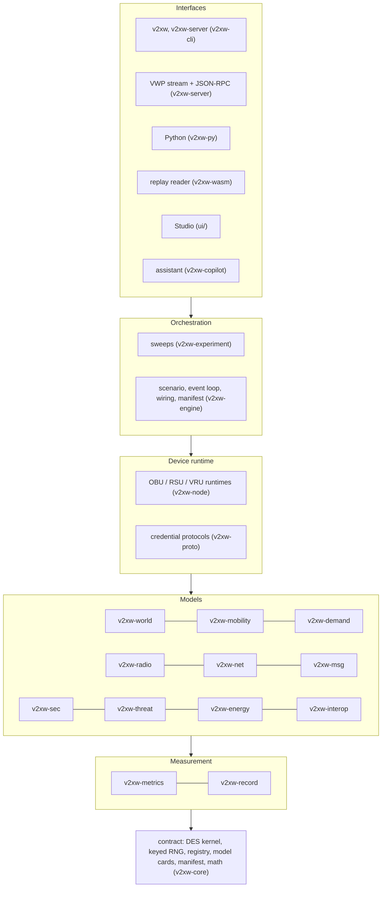

# Introduction

The simulator answers quantitative questions about connected-vehicle security and privacy
that need the whole system in one loop: traffic that moves, radios that lose frames,
devices that sign and verify under a compute budget, a credential system that provisions,
reports and revokes, attackers who lie with valid signatures, and detectors that only see
what a fielded device could see. A run is one scenario file and one seed; its recording
replays byte for byte.

## Who it is for

| Reader | Start with |
|---|---|
| A researcher running studies | [Your first simulation](first-simulation.md), [Experiments and sweeps](../guide/experiments-and-sweeps.md), [Comparing runs](../guide/comparing-runs.md) |
| A reviewer checking a result | [Determinism](#the-determinism-promise), the [model cards](../configuration/reference/models.md), [Metrics and outputs](../recording-and-metrics.md) |
| A user exploring a city in the browser | [Studio tour](studio-tour.md) |
| A developer (human or coding agent) extending the engine | [Architecture](../architecture.md), [Crates](../crates.md), [Extending](../extending.md) |

## The layer stack

Each model crate owns one domain and reaches no other crate's state; the engine composes
them into a run. Dependencies point down.

What each crate owns: [Crates](../crates.md). How one run flows through them (load, build,
the event loop, finish): [Architecture](../architecture.md).

## The determinism promise

**Same scenario file, seed, engine build and plug-in set give byte-identical outputs**, on
any thread count. The mechanisms are in `v2xw-core` and are enforced by tests:

| Rule | Mechanism |
|---|---|
| no shared random generator | every draw comes from a stream keyed by `SHA-256(master_seed ‖ domain ‖ entity)` (`v2xw_core::rng`), so a draw does not depend on what was drawn before it |
| no platform maths | transcendentals go through `v2xw_core::math` (pure-Rust `libm`) |
| no wall clock in the engine | the manifest timestamp is an argument (`Engine::build(scenario, build_utc)`; `--build-utc` on the CLI) |
| no hash-order outputs | ordered collections wherever iteration reaches an output |
| quantised floats | every recorded float is put on its declared grid before it is written or digested |
| one event order | events pop in `(time, priority, seq)` order; parallel phases are pure maps merged in id order |

The run's identity is `content_digest` in `run-report.json`: SHA-256 over every recorded
message's topic, time and bytes. The MCAP file's own SHA-256 is not reproducible (its
summary index is written in hash-map order), which is why `v2xw run` reports both.

!!! note "What is checked across platforms"
    CI builds and tests on Linux, macOS and Windows (`.github/workflows/ci.yml`) and
    requires the world-import digest of the committed fixture to agree on all three. The
    conformance kit's golden records (`tests/conformance/golden/`) pin, per fixed
    scenario, the scenario hash, world hash, a digest over every record and per-channel
    counts.

## Modelled versus simplified

Every model is registered with a card that lists its assumptions, limitations and what it
ignores relative to the next tier up; the full text of every card is in the
[model parameters reference](../configuration/reference/models.md). A few that shape what
a result can claim:

| Area | Modelled | Simplified or left out (from the cards) |
|---|---|---|
| Car following (`mobility/car-following/idm`) | IDM with Kesting 2010 car and truck parameters, FHWA weather response | no driver imperfection (`sigma`), action-step length or sub-second reaction time |
| Lane change (`mobility/lane-change/mobil`) | MOBIL incentive and safety criteria | SUMO's cooperative helping, keep-right rule and speed-gain lookahead |
| Imported worlds (`world/source/osm`) | lanes, junctions, connectors, conflict matrices, synthesised fixed-time signals, buildings | no terrain unless a DEM is attached; the source carries no signal timing, so plans are synthesised |
| Cryptography (`crypto-backend/modeled`) | each operation's measured time on the device profile | no mathematics at all; `security.crypto_mode: real` does the arithmetic (P-256 only) |
| Cryptography (`crypto-backend/real`) | ECDSA P-256 (RFC 6979 nonces), SHA-256 and ECQV reconstruction on real bytes | post-quantum primitives (cost tables only), side channels, key storage |
| SCMS (`protocol/scms/camp`) | the CAMP entities and their messages over modelled links | certificate encryption is modelled by its size and cost, not performed |
| Network layer (`net/wsmp/1609-3`) | exact WSMP v3 header sizes and the WSM payload cap | IEEE 1609.4 channel switching is sized, never acted on |
| GeoNetworking (`net/gn-btp/en302636`) | exact GeoNetworking and BTP header sizes and the MTU rule | GBC multi-hop forwarding, the location table, duplicate detection and DCC_NET |
| Jammers (`attacker/jammer/*`) | constant, pulsed and reactive wideband jammers | subcarrier-selective jamming; the jammer's own antenna pattern |
| Cellular Uu (`cellular/uu/*`) | fixed latency, M/M/1 cell capacity, packet-level proportional fair, handover outage | fast fading, frequency-selective scheduling, MIMO and beam management |

Where a number has no source it is marked `todo-calibrate` on its card with a calibration
plan, and the generated reference shows it. Settings the engine validates but acts on only
partly, or not at all, carry a status in the [configuration
reference](../configuration/reference/index.md#by-status).

## Platforms

| Target | Status |
|---|---|
| Linux, macOS, Windows | built and tested in CI on the GitHub-hosted runners of all three |
| Toolchain | Rust `1.98.1`, pinned in `rust-toolchain.toml` (edition 2024) |
| WebAssembly (`wasm32-unknown-unknown`) | the replay reader only (`crates/v2xw-wasm`); its build needs a WebAssembly-capable `clang` |
| Browser | the Studio (Node 22+, pnpm 10 to build) |
| Python | 3.9+, built with maturin from `crates/v2xw-py` |

Next: [Install and build](../getting-started.md), then [your first
simulation](first-simulation.md).
