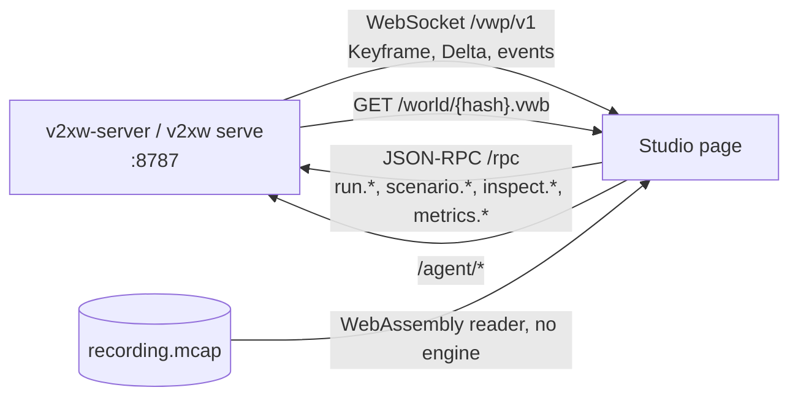

# Studio tour

The Studio is the browser interface to a running engine. It adds nothing to the wire:
every control is a JSON-RPC method of the engine and every picture is decoded from the VWP
stream ([Engine-UI protocol](../protocol/vwp-v1.md)), so what the page shows is what the
engine computed. Package layout and the developer checks: [Studio](../studio.md).



## 1. Start the engine and the page

Two terminals, from the repository root:

```sh
./run-sim.sh scenarios/midtown-normal.yaml    # or any scenario; default scenarios/manhattan-5min.yaml
```

```sh
pnpm --dir ui install
pnpm --dir ui --filter @vwp/studio dev        # http://127.0.0.1:5173
```

`run-sim.sh` builds and starts `v2xw-server` paused at t = 0 and unthrottled. The
equivalents, with every flag in the [command reference](cli.md#serve):

```sh
v2xw serve --scenario scenarios/midtown-normal.yaml --paused --speed 0
v2xw-server --scenario scenarios/midtown-normal.yaml --port 8787 --paused
v2xw-server --actors 200 --port 8787          # synthetic fixture stream, no map needed
```

The dev server proxies `/vwp/v1`, `/rpc`, `/world` and `/agent` to `VWP_ENGINE` (default
`http://127.0.0.1:8787`); `VWP_STUDIO_PORT` moves the page. A non-loopback `--host` needs
`--token`.

!!! warning "Fixture or simulator"
    With no `--scenario` the server streams a deterministic synthetic fixture whose numbers
    are fixture values. The header's engine chip says which one answered ("simulator" or
    "test fixture"); a plot drawn from the fixture is a plot of the fixture.

## 2. Pick a scenario and a city

The scenario picker is two steps: **what happens** (the ready-made scenarios of
`scenarios/ready-made.txt`, by their `meta.name` and `meta.description`), then **where**
(a city of the library, `cities.list`, searchable by name and state). Run loads the
scenario on the city (`scenario.load {path, city}`) and starts it: the engine moves the
roadside units to that city's busiest signalised intersections, scales demand to its lane
length and keeps the local time of day ([Worlds and maps](../guide/worlds-and-maps.md#the-city-library)).

## 3. The view

| Control | What it does |
|---|---|
| **Camera** | Map (whole area from above; click a vehicle to follow it), Chase, Driver's view, Free, Roadside unit. Chase and Driver's view need a vehicle on the road |
| **Layers** | Radio: transmissions, received messages, channel load, roadside coverage and range rings. Security: attackers, reported and revoked vehicles, detections, claimed versus true position, backend traffic. Map: paths driven, buildings, lane markings, traffic signals, name tags, density, the detailed-simulation area |
| **Blind evaluation** | turns off and locks every layer drawn from ground truth, so the screen shows only what the radios could know. Ground-truth layers carry a GT tag |
| **Lighting** | how street-level views are lit; the map view is always in daylight |

Selecting a vehicle subscribes to its telemetry (`view.follow`). **I** opens the vehicle
overlay: an overview (identity, health, radio, security, queues, neighbours heard), every
sent and received message with its decoded contents, and its five queues.

## 4. The timeline

The transport bar is play or pause, step, speed, the clock and the timeline. Each control
is one RPC (`run.resume`, `run.pause`, `run.step`, `run.speed`, `run.seek`, `run.start`).

- Certificate changes, detections, revocations and safety warnings are ticks above the
  track; the scenario's planned events are taller ticks. Click one to jump there;
  **Alt + arrow** jumps to the next or previous event.
- The part of the run already simulated is drawn apart from the part that is not; a seek
  outside the produced range is refused and the range that would work is shown.
  `--retain` and `--retain-mb` on the server set how much history `run.seek` can return to.
- A disabled control says why: which controls the engine accepts depends on its state.

## 5. Settings

**Ctrl/Cmd + ,** opens the settings window. Every row is generated from the engine's
published settings surface (`scenario.get`): its label, unit, explanation, default,
recommended range, level (Basic or Advanced) and status, the same rows as the
[configuration reference](../configuration/reference/index.md). Sections follow a
research workflow (Run, Traffic, Radio and Channel, Medium Access, Congestion Control,
Messages, Networking, Security and Crypto, Certificates and SCMS, Backend and Cellular,
Attackers, Output); search looks across all of them. Edits are checked with
`scenario.validate` and applied with `scenario.set`; **Changes** lists what differs from
the scenario the engine holds, each with an undo.

**Quick settings** is the short list people change most (published by the engine from
`crates/v2xw-engine/src/scenario/guide.rs`); it edits the same draft. `?view=settings`
opens the settings window in a browser window of its own.

## 6. Metrics

**M** opens the metrics dashboard: every measurement of the run, grouped by question
(channel load, delivery and reliability, latency, security and PKI, misbehaviour
detection, privacy, traffic, safety applications), searchable, with favourites pinned
first. Click a card to expand it. The dashboard's address is its state
(`#metrics/<metric>/<dimension>?from=…&to=…`), so a link or a reload reopens the same chart.
What each metric means and how its interval is computed: [Metrics and
outputs](../recording-and-metrics.md#metrics).

## 7. The other panels

Panels open over the view and are mirrored in the URL hash (`#settings`, `#metrics`,
`#runs`, …), so the browser's Back button closes them.

| Panel | Hash | What it is for |
|---|---|---|
| Certificate system | `#backend` | the credential system as the engine runs it: entities, flows, vehicles, cases and revocation lists, viewed as ground truth or as one entity ("as RA", "as LA1") sees it. The ETSI CCMS falls back to a single backend diagram |
| Agent | `#agent` | the assistant: type a request, it prepares the settings and shows what it changed with undo; the always-on watcher posts alerts while a run moves ([Assistant](../guide/assistant.md)) |
| Runs and recordings | `#runs` | the run on screen, recordings opened in this page, the world under them |
| Compare two runs | `#compare` | a second run beside this one with a synchronised clock: from a second engine, a local recording or a recording over HTTP; manifest diff and metric differences |
| Commands | `#commands` | the engine's own method list (`rpc.discover`) and a log of every JSON-RPC call the page made |
| Run details | `#details` | identifiers, hashes and counters of the run and the world |

## 8. Replay a recording without an engine

A finished `recording.mcap` can be scrubbed in the page with no server. The replay reader
is the engine's own Rust reader compiled to WebAssembly (`crates/v2xw-wasm`), and the frames
it returns are the recorded `Keyframe` and `Delta` frames byte for byte, so the page
decodes them with the same code as the live stream. It is a build step, because the
recording's zstd codec is C and needs a WebAssembly-capable `clang` (Apple's has no
`wasm32` back end; Homebrew's `llvm` does):

```sh
crates/v2xw-wasm/scripts/build-wasm.sh --web ui/apps/studio/public/wasm
```

That writes `v2xw_replay.js` and `v2xw_replay_bg.wasm` where the Studio loads them
(`/wasm/`). Open the recording from the Runs or Compare panel; a recording served over
HTTP is fetched a range at a time. Without the module, the panel says how to build it.

!!! note "Geometry"
    A recording carries poses and signals but no world payload, so a replay needs the
    world from elsewhere: a `world.vwb` beside the recording (`v2xw import-osm` writes
    one) or the run it is being compared against. The page says which it used.
