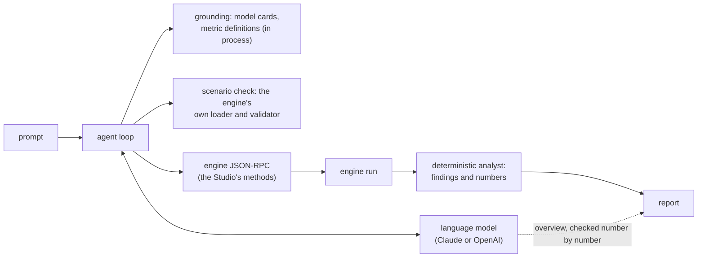

# Assistant

The built-in assistant (`crates/v2xw-copilot`) turns a request in plain words into a
scenario, runs it, watches it and reports what happened. It is built on one premise: a
language model knows nothing about this simulator and is never asked to. Every fact it
states comes from something machine-readable the engine already has, and every number in a
report comes from a deterministic analyst, not the model. It is optional: a run never
depends on it, and nothing it does reaches a recording, a metric, a manifest or a digest.



## Three ways to use it

| Where | Command or place | What happens |
|---|---|---|
| Command line | `v2xw agent "<prompt>"` | builds a scenario, runs it to the end, prints a Markdown report on stdout (progress on stderr) |
| Studio | the Agent panel (`#agent`) | prepares the settings as the settings window's draft, shows each change with undo; the watcher posts alerts while the run moves |
| HTTP | `/agent/*` on `v2xw serve` or `v2xw-server` | the endpoints the panel uses |

```sh
v2xw agent "compare DSRC and LTE-V2X delivery at rush hour" > report.md
v2xw agent --no-model > report.md                 # no language model: run as shipped, analyst's report
v2xw agent --engine http://127.0.0.1:8787 --analyse   # analyse the run an engine is serving
v2xw serve --scenario scenarios/midtown-normal.yaml   # the engine with the assistant's endpoints
```

Without `--engine`, `v2xw agent` starts an engine in-process with `--scenario` (default
`scenarios/phase1-grid.yaml`) and stops it after the report. `v2xw-server` serves the
endpoints unless `--no-agent`; `v2xw serve --attach <url>` serves only the endpoints in front
of an engine already running. Every flag: [`agent`](../getting-started/cli.md#agent),
[`serve`](../getting-started/cli.md#serve).

## Providers and their environment variables

The provider is chosen in the server's environment. `v2xw-server` and `run-sim.sh` also
read these from `--env-file` (default `./.env`) when they are not already set; only these
variables are taken from the file.

| Variable | Meaning |
|---|---|
| `V2XW_AGENT_PROVIDER` | `anthropic` (default; `claude` also accepted) or `openai` |
| `ANTHROPIC_API_KEY` | the Claude key; else a key file named by `V2XW_ANTHROPIC_KEY_FILE`, else `$XDG_CONFIG_HOME/v2xw/anthropic.key`, else `~/.config/v2xw/anthropic.key`. A key file inside the working directory is refused |
| `V2XW_AGENT_MODEL` | overrides the Claude model (default `claude-opus-5-5`) |
| `V2XW_AGENT_EFFORT` | Claude effort: `low`, `medium` (default), `high`, `xhigh`, `max` |
| `V2XW_AGENT_FALLBACKS` | `off` drops the server-side refusal-fallback request field (for a proxy that rejects beta fields) |
| `ANTHROPIC_BASE_URL` | another endpoint (a gateway); `/v1/messages` is appended |
| `OPENAI_API_KEY` | the OpenAI key |
| `OPENAI_MODEL` | overrides the OpenAI model (default `gpt-4o-mini`) |
| `OPENAI_BASE_URL` | another endpoint |
| `OPENAI_REASONING_EFFORT` | `minimal`, `low`, `medium`, `high` for a reasoning model |
| `OPENAI_API` | `chat` (Chat Completions) or `responses` (the Responses API); unset starts on Chat Completions and moves to Responses when the model says tools need it |

When the provider asked for has no key and the other has one, the other is used. With no
key at all, everything that needs no model still works: running a scenario and the
deterministic analysis. `GET /agent/status` says whether a model is attached, which one,
and where its key comes from, by name, never by value.

!!! warning "Keys stay in the server process"
    The key goes into the request header written to `curl`'s standard input and nowhere
    else: not into a log, an argument vector, a transcript, a tool result or anything
    served to the browser, and everything the API returns is redacted before it is shown.
    Put keys in the environment or a key file outside the repository; `.env` is read but
    should not be committed.

## What it can do

The model is given a small set of high-level tools, and each one is carried out through the
engine's own JSON-RPC methods, the same ones the Studio calls:

| Tool | Does |
|---|---|
| `list_scenarios`, `get_scenario` | the shipped scenarios; a base scenario's document |
| `list_cities` | the city library, with whether each map is downloaded |
| `find_settings`, `setting_help` | search the published settings by plain words; everything about one setting (label, unit, range, sources) |
| `setup`, `prepare_scenario` | build the next run from a base (`current`, a scenario id, or `last`) with the request's changes, validated by the engine |
| `run_prepared`, `simulate` | run a prepared scenario, or build, validate, run and analyse one or more variants |
| `run_control` | start, pause, resume, step, seek, change speed, stop the served run |
| `live_metrics`, `query_metric` | the run's metrics with units; one metric over time or by a dimension |
| `inspect` | a node (telemetry, queues, neighbours), a link, an entity |
| `analyse_current_run`, `finding_detail` | the analyst's findings on the run on screen; one finding's evidence |
| `compare_runs`, `list_runs`, `engine_runs` | compare runs of this conversation (the same comparison as [`v2xw compare`](comparing-runs.md#v2xw-compare)); the runs it made; the runs the engine kept |
| `sensitivity` | how sensitive a metric is to a setting, from the checked-in sweeps ([Sensitivity analysis](sensitivity.md)) |
| `registry__metric`, `registry__model_card` | a metric's definition, a model's card, with citation |

The engine methods behind them are `scenario.list`, `scenario.load`, `scenario.get`,
`scenario.set`, `scenario.validate`, `run.start`, `run.status`, `run.pause`, `run.resume`,
`run.step`, `run.seek`, `run.speed`, `run.stop`, `metrics.query`, `inspect.entity`,
`inspect.node`, `inspect.link` and `explain` ([Engine server and RPC](../dev/server.md)).
Follow-ups ("now double the density", "compare with LTE-V2X") keep the conversation and
start from the last run's scenario. A stop is checked before every model call, every tool
and every poll, and a run the agent started is paused, not left running.

The Studio's Commands panel (`#commands`) is the lower-level surface: its tool list is the
engine's `rpc.discover` document, translated to tool definitions (`run.start` becomes
`run__start`), and it logs every JSON-RPC call the page made.

## How it is grounded

| Question | Where the answer comes from |
|---|---|
| what a model does, its parameters and sources | the model cards, each hit cited with model id, version and the SHA-256 of the card the run manifest pins |
| what a metric means, on what grid, missing what | the metric definitions |
| what can be set, to what | the engine's published settings index and attacker catalogue |
| is this scenario valid | the engine's loader and validator itself |
| where a number came from | the run's provenance chain joined to the cards |
| where the bottlenecks are | the deterministic analyst over the run's metrics and backend view |

A lookup that misses returns "not known", with what was asked and what is declared, never a
default or a guess. The model plans and writes; a number in its overview that no tool
produced is sent back once for a rewrite and, if it survives, listed in the report as
unverified.

## The watcher

While a run moves, the server's watcher reads `run.status` once a second and the run's
evidence every few seconds, and says in plain words when a finding appears, worsens or
clears (delivery collapsing, a busy channel, verify-queue drops, no vehicles, gridlock,
attacks detected or missed), when a trend crosses the analyst's thresholds, or when the
credential backend's counters rise. At the end it writes the run's summary: verdict, layers,
problems, overview and analysis (`GET /agent/summary`). With a model the overview is the
model's, checked number by number; without one it is the analyst's. The watcher only reads:
it never pauses, steps or changes the run, and the run never waits for it.

## HTTP endpoints

| Endpoint | Does |
|---|---|
| `GET /agent/status` | whether a model is attached, which one, where its key comes from, how to add one |
| `POST /agent/ask {prompt}` | start the agent on a prompt; follow-ups continue the conversation |
| `POST /agent/run {base}` | run a shipped scenario and analyse it, no model needed |
| `POST /agent/analyse` | analyse the run on screen, no model needed |
| `GET /agent/events?job=&after=` | the job's events from `after` on: plan, changes, progress, analysis, report |
| `POST /agent/stop` | stop the job at its next check, pausing a run it started |
| `POST /agent/reset` | forget the conversation |
| `POST /agent/undo` | restore a setting the agent changed (refused while the agent is busy) |
| `GET /agent/watch?after=` | the watcher's observations since `after` |
| `GET /agent/summary` | the last finished run's summary |
| `POST /agent/compare-signatures {document?, scenario?, schemes?, duration_s?}`, `GET /agent/compare-signatures` | run a [signature comparison](comparing-runs.md#v2xw-compare-signatures) on a thread; its status and result |

A server started with `--token` requires the bearer token on these too.

## Why it cannot change a result

`crates/v2xw-copilot/src/boundary.rs` holds the rule and its checks: the crate's only way
into a run is the JSON-RPC transport (no context, recorder, scheduler or random stream);
every method it can name is one the server publishes for the Studio, so it has a person's
authority and no more; a scenario it drafts is text that a run pins by content hash, so a
run's outputs are a function of the document and the seed, not of who typed it; and the
crate reads no clock, draws no random number and computes no exported float. Each check has
a test that injects the forbidden construct and requires it to fail.
