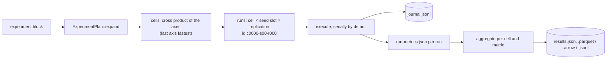

# Experiments and sweeps

An `experiment` block turns one scenario into a study: a factorial sweep over scenario
fields, a list of seed slots and a replication count. `v2xw experiment` expands it into
runs, executes them, pools each run's metrics, aggregates across replications with
confidence intervals and writes one results table, journalling as it goes so an
interruption costs only the run in flight. Code: `crates/v2xw-experiment`.

```yaml title="scenarios/revocation-latency.yaml (excerpt)"
experiment:
  sweep:
    actors.vehicles.demand.rate_veh_per_h: [1500.0, 6000.0, 24000.0]
    threats.attackers[0].fraction: [0.02, 0.10]
  seeds: [1, 2, 3]
  replications: 1
```

Three rates × two attacker fractions × three seed slots × one replication is 18 runs.

| Field | Meaning |
|---|---|
| [`sweep`](../configuration/reference/experiment.md#s-experiment-sweep) | dotted path (`a.b[0].c` indexes a list) → the values to try; the axes' cross product is the set of cells |
| [`seeds`](../configuration/reference/experiment.md#s-experiment-seeds) | seed **slots**: each declared value is mixed with the master seed, not used as the seed |
| [`replications`](../configuration/reference/experiment.md#s-experiment-replications) | runs per (cell, seed slot) |

!!! warning "A swept path must already exist"
    A sweep replaces a value in the serialised scenario, and an optional field left unset
    is not serialised. Set every swept field in the base file (as the study files do for
    `actors.vehicles.demand.rate_veh_per_h`, `security.pseudonym_change.period_s` and
    `threats.attackers[0].fraction`), or the plan is refused.

## The plan



The expansion is a pure function: it draws nothing, reads no clock and touches no file, so
the same block always yields the same runs in the same order.

- **Axis order** is the sweep's key order, which is lexicographic in the dotted path
  whatever order the YAML used.
- **Cell order** is an odometer with the last axis varying fastest.
- **Run order** within a cell is seed slot, then replication. A run's id is
  `c<cell>-s<slot>-r<replication>`.

**Seeds are derived, never drawn**:

$$
\text{seed} = \mathrm{SHA\text{-}256}(\texttt{"v2xw/experiment/seed/1"} \parallel m \parallel s \parallel d \parallel r)[0..8]
$$

with $m$ the master seed, $s$ the slot index, $d$ the declared slot value and $r$ the
replication, read as a little-endian `u64`. The cell index is deliberately not an input:
every cell uses the same seed for the same (slot, replication), which is **common random
numbers**. Two protocols compared at slot 3 ran on the same arrivals, fading draws and
attacker decisions, so their difference is not inflated by between-run variance. Mixing in
the master seed keeps two experiments that both chose `[1, 2, 3]` from sharing streams.

## Running a sweep

```sh
v2xw experiment status scenarios/pdr-vs-distance.yaml --out runs/pdr    # the plan, nothing run
v2xw experiment run    scenarios/pdr-vs-distance.yaml --out runs/pdr --format parquet
v2xw experiment resume scenarios/pdr-vs-distance.yaml --out runs/pdr    # after an interruption
```

```text
experiment      pdr-vs-distance
plan            544d30e4…
outputs         runs/pdr
sweep           2 cell(s) x 5 seed slot(s) x 1 replication(s)

journal         none — this sweep has not been started here
progress        0 of 10 run(s) done, 10 outstanding
next
  c0000-s00-r000
  c0000-s01-r000
  …
```

Flags (`--concurrency`, `--ci`, `--no-recording`, `--node-only`, `--no-verify`,
`--keyframe-ms`, `--build-utc`, `--format`): [`v2xw experiment`](../getting-started/cli.md#experiment).
The manifest timestamp is read once and shared by every run, so two runs of one cell differ
in their seed and nothing else.

!!! warning "Serial by default"
    `--concurrency` defaults to 1 (`runner::DEFAULT_CONCURRENCY`). Each concurrent run
    holds its own world, scheduler, node state and recording buffer, so `k` runs cost `k`
    times the peak memory of one, and the engine already uses the machine's cores inside a
    single run. Raise it only on a machine with memory to spare.

**The journal.** `journal.jsonl` is append-only, one line per finished run, flushed before
the runner moves on, keyed by run id. Its header carries the plan digest (SHA-256 of the
sweep's canonical JSON), so a changed sweep is refused rather than mixed into the old
table. `run` skips whatever the journal says is done; `resume` additionally refuses when no
journal for this plan exists. Each entry's wall-clock time is a measurement, never part of
the results.

## Outputs

```text
runs/pdr/
├── experiment.json          the expanded plan
├── journal.jsonl            what has finished
├── results.json             the results table, with its plan digest
├── results.parquet          with --format parquet (or .arrow, .jsonl)
└── runs/
    └── c0000-s00-r000/
        ├── scenario.yaml        the materialised scenario of this run
        ├── run-metrics.json     this run's metrics reduced to one value per metric per bin
        ├── metrics.json, run-report.json, manifest.json
        └── recording.mcap       unless --no-recording
```

### From windows to one value per run

A run emits a sample per metric, per dimension bin, per window. `reduce` pools the windows
first, so a window of four trials and one of four thousand are not weighted alike:

| Sample shape | Pooled across windows |
|---|---|
| proportion (`pdr`, `det_recall`, …) | successes and trials added; the interval is computed once, over the real trial count |
| ratio of sums (`cbr`, `envelope_overhead`, …) | numerators and denominators added |
| scalar | the windows' points averaged |
| distribution | the windows' means averaged |
| count | added |

### From runs to a row

`aggregate` turns a cell's replications into one row per metric and bin, carrying
`replications`, `replications_with_value`, `samples`, `mean`, `ci_lo`, `ci_hi`,
`ci_level`, `ci_method`, `stddev`, `min`, `max` and `per_replication`.

| `ci_method` | When | Interval |
|---|---|---|
| `wilson` | a proportion | the Wilson score interval over the pooled successes and trials, computed by `v2xw-metrics` |
| `normal-over-replications` | anything else, with at least two replications | $\bar x \pm z\, s/\sqrt{k}$ over the $k$ replications' values |
| `none` | fewer than two usable replications, or a pooled proportion the metric calls insufficient | no interval: the mean is a fact about one run, not an estimate |

!!! note "The normal approximation"
    With $k$ below about thirty, $z\,s/\sqrt k$ is narrower than a Student-$t$ interval.
    The row carries `replications` and `stddev` beside the interval so a reader can see what
    it is worth and recompute it under another rule.

## The MA policy family

A sweep over `security.scms.ma_policy.preset` additionally writes `ma-policy-family.csv`
and `ma-policy-family.md`: one row per (policy, seed) and a mean with a 95 % interval per
policy. The interval here is Student's $t$ over the seeds,
$\bar x \pm t_{0.975,\,n-1}\, s/\sqrt n$, because with two or three seeds the normal
quantile would overstate the precision. Every point is a full run, so unlike
[`v2xw ma-replay --policies`](comparing-runs.md#v2xw-ma-replay) it includes the feedback
(revoked devices stop sending, CRL delays apply). Ground truth is joined only after every
run has decided.

## Figures

`v2xw_experiment::figures` turns a results table into Plotly figure JSON from declared
presets (`rq-pdr-distance`, `rq-density-congestion`, `rq-pseudonym-privacy`,
`rq-revocation-latency`, `rq-rat-comparison`, `rq-insider-detection`,
`rq-vertical-slice`). It is a library API; there is no `v2xw figure` command:

```rust
use v2xw_experiment::figures::{preset, render};
let spec = preset("rq-pdr-distance").expect("a known preset");
for file in render(&spec, &table).write(std::path::Path::new("runs/pdr/figures"))? {
    println!("{file}");
}
```

A panel whose metric has no provider in this build says so on the figure instead of
drawing an empty axis.

## The foundry

`v2xw_experiment::foundry` is a MAP-Elites quality-diversity search over scenario space for
the cases a detector misses: one elite per descriptor cell (attack family, density band,
topology, attacker band, RAT, protocol), so the archive is a map of where a **fixed**
detector fails. Mutations touch only adversary, environment and topology settings, never
`detection.*`, `security.verification_policy` or a detector threshold, and an injected
operator is held to the same list. An elite replays as a scenario file plus a seed. It is a
library API over the same run executor (`foundry::search`), writing `archive.json` and
`FOUNDRY_REPORT.md`; `foundry_eval` checks whether a proposed mutation operator beats
random search.

## Study files that ship with a sweep

| File | Sweep | Runs |
|---|---|---|
| `pdr-vs-distance.yaml` | propagation tier × 5 seeds | 10 |
| `density-sweep-congestion.yaml` | 5 demand rates × 3 seeds | 15 |
| `pseudonym-privacy.yaml` | 4 pseudonym periods × 3 seeds | 12 |
| `pseudonym-strategies.yaml` | 5 pseudonym-change strategies | 5 |
| `revocation-latency.yaml` | 3 demand rates × 2 attacker fractions × 3 seeds | 18 |
| `glosa-energy.yaml` | GLOSA compliance × 3 seeds | 9 |
| `rat-comparison.yaml` | radio technology × 5 seeds | 15 |
| `pq-signatures.yaml` | 7 signature schemes | 7 |
| `pq-full-stack.yaml` | 3 KEMs × 2 signatures | 6 |
| `pq-certificate-cycle.yaml` | 2 fragmenters × 2 seeds | 4 |
| `threshold-pca.yaml` | 3 threshold protocols | 3 |

Each states at the top what it measures and what it does not. For a ladder of one
parameter, a set of overlay files (`meta.base`) is the alternative to a sweep: each is its
own scenario with its own hash and runs under the file's seed, while a sweep's cells share
the derived seeds of their slots ([Scenarios](../scenarios.md#overlays-metabase)).
