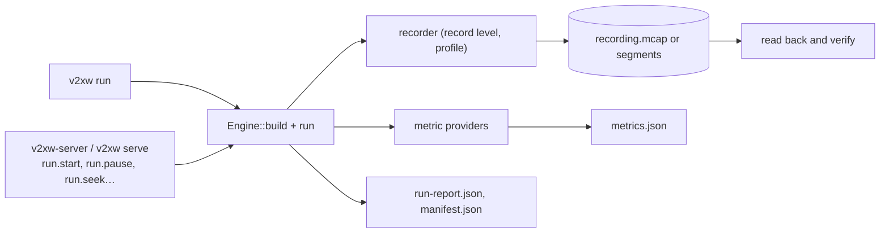

# Running and recording

A run is a scenario, a seed and an engine build. There are two ways to drive one: `v2xw run`
from the command line, which runs to the end and writes a run directory, and the engine
server, which streams the run to the Studio and takes control calls. Both execute the same
engine and the same event loop ([Architecture](../architecture.md#the-event-loop)).



## `v2xw run`

```sh
v2xw run scenarios/attack-fake-positions.yaml --out runs/attack
v2xw run scenarios/midtown-normal.yaml --city seattle --duration 15m --build-utc 2026-11-01T00:00:00Z
```

Every flag with its default: [`v2xw run`](../getting-started/cli.md#run). The scenario is
loaded, the city and overrides applied, and then validated, so the checked scenario is the
one that runs (an override that pushes a timeline event past the end is refused).

| Override | Scenario field | Notes |
|---|---|---|
| `--duration 15m`, `--duration-s 900` | [`time.duration_s`](../configuration/reference/time.md#s-time-duration-s) | `--duration` wins |
| `--rate-veh-per-h N` | [`actors.vehicles.demand.rate_veh_per_h`](../configuration/reference/actors.md#s-actors-vehicles-demand-rate-veh-per-h) | no effect when the scenario states a per-lane-km rate |
| `--city ID` | `city`, `world` | moves roadside units, rescales demand ([what changes](worlds-and-maps.md#what-city-changes)) |
| `--veremi veremi-ext\|veremi-1` | `exporters` | adds or sets the VeReMi exporter ([Datasets](datasets.md#veremi-traces)) |

Each override changes the scenario hash and is in `scenario.resolved.yaml`. `--build-utc`
fixes the manifest timestamp, the only clock reading on this path; pass it when two
manifests must compare field by field.

## What a run writes

| File | Contents | Reproducible |
|---|---|---|
| `recording.mcap` | every record and VWP frame, the manifest metadata, the resolved scenario attached | its data section is; its file hash is not |
| `scenario.resolved.yaml` | the scenario after overlay merge, migration, defaults and overrides | yes |
| `metrics.json` | every `metric.sample` | yes |
| `run-report.json` | event, frame and record counts per channel; `content_digest` | yes |
| `manifest.json` | build hash, engine and crate versions, every model with its card hash, world, scenario and seed, crypto mode, the files above digested | all but `build_utc` and the recording's file hash |
| `progress.jsonl` | one line per progress interval (empty when there is none) | no: wall-clock measurements |
| `checkpoint.json`, `recording.NNNN.mcap`, `recording_index.json` | with `--checkpoint-every` | the segments' contents are |
| `<exporter>/` | one directory per named exporter ([Datasets and exports](datasets.md)) | yes |

**The digest to compare is `content_digest`**: SHA-256 over every message's topic, log time
and bytes in stored order. The MCAP writer emits its summary index in hash-map order, so
`recording.mcap`'s own SHA-256 may differ between two identical runs; `v2xw run` prints
both. Channels, encodings and the manifest fields: [Recording format](../dev/recording-format.md).

## Recording levels

`--record-level` decides which records reach the recording. Metrics are computed in the
engine from the full record stream at every level, so `metrics.json` is the same.

| Level | Keeps | Use |
|---|---|---|
| `full` (default) | every record and the snapshot stream (`vwp/keyframe`, `vwp/delta`) | the Studio replays it; `check-traffic` and `energy` need it (`gt.kinematics`) |
| `receptions` | every record, no snapshot frames, no `gt.kinematics` | per-reception analysis at about a third of the size |
| `events` | drops the per-reception journals `node.rx`, `phy.rx`, `node.verify` (they grow with the square of the fleet) and `gt.kinematics` | attack and backend studies with many vehicles |
| `metrics` | metric samples and summary records only: scenario events, MA decisions and cases, revocations, spawns and despawns, credential milestones | runs of days |

Other ways to make a recording smaller or blind:

| Flag | Effect |
|---|---|
| `--node-only` | the NODE-only profile: every ground-truth record is refused and in the snapshot frames an unequipped actor's slot is empty and lanes and the attacker flag are blanked |
| `--no-recording` | no file at all; with `--digest` the record stream is still hashed (`stream_digest`) so two runs can be compared bit for bit |
| `--keyframe-ms` | the keyframe period (a whole number of mobility steps): seek granularity against size |
| `--attach-world` | adds the world payload (tens of MB for a city); off by default |
| [`time.metric_period_s`](../configuration/reference/time.md#s-time-metric-period-s) | metric window length (1 s when unset); a minute's period writes a sixtieth of the samples |
| [`time.warmup_s`](../configuration/reference/time.md#s-time-warmup-s) | windows that end inside the warm-up are not sampled |

For scale: the 60-second `scenarios/phase1-grid.yaml` (one or two vehicles) writes a
recording of about 0.55 MB at `full`. Size grows with the fleet, and the per-reception
journals with its square, which is what the coarser levels are for.

## Long runs: progress, checkpoint, resume

```sh
v2xw run scenarios/manhattan-day.yaml --out runs/day \
    --record-level metrics --checkpoint-every 1h --progress-every 30m
# … interrupted …
v2xw resume runs/day/checkpoint.json
```

- **Progress.** Every `--progress-every` (default 15 minutes of simulated time for runs of
  an hour or more), a JSON line goes to `progress.jsonl` and a short line to stderr: the
  simulated instant, wall clock for the slice, memory footprint and the engine's collection
  sizes. `--quiet` keeps the file and silences stderr. None of it reaches a digest.
- **Checkpoint.** Every `--checkpoint-every`, the open recording segment is finished and the
  next opened (`recording.0000.mcap`, `recording.0001.mcap`, … listed in
  `recording_index.json`), and `checkpoint.json` (format `v2xw-checkpoint/1`) records the
  scenario and world hashes, build timestamp, the instant, the record digest and count at
  that instant, and how much of each output was complete. Each segment is a complete
  recording that `v2xw info` and the Studio open.
- **Resume.** `v2xw resume` rebuilds the engine from `scenario.resolved.yaml`, replays to the
  checkpoint with outputs off, **refuses to continue unless the record digest matches**,
  cuts the outputs back to the checkpoint and carries on. The finished outputs equal an
  uninterrupted run's.

!!! note "What a checkpoint does not store"
    It does not serialise the engine's memory; resuming re-simulates the time before the
    checkpoint without recording it. What it saves is everything written before the
    checkpoint and the proof that the resumed run is the same run.

`v2xw-server --resume <checkpoint.json>` serves a checkpointed run paused at the
checkpoint's instant, for inspection in the Studio.

## Verification and `v2xw info`

After a run the recording is read back unless `--no-verify` (or `--no-recording`): every
record and frame is walked, the content digest computed and each chunk's CRC checked. The
summary line says `integrity VERIFIED` only when every chunk carried a checksum and it
matched. `v2xw info` runs the same walk on any recording and prints the manifest, the
channels with their visibility class and counts, and the attachments
([first simulation, step 5](../getting-started/first-simulation.md#5-inspect-the-recording)).

## Running under the server

`v2xw-server` and `v2xw serve` hold one run and stream it over WebSocket (`/vwp/v1`) while
taking JSON-RPC calls on the socket and on `POST /rpc`. Run control:

| Method | Parameters | Does |
|---|---|---|
| `run.start` | `scenario` (path or document), `city`, `seed`, `speed` (0–100), `paused`, `record` (default true), `record_path`, `label` | load a scenario and begin the stream; returns run id, state, world and scenario hashes |
| `run.pause` / `run.resume` | | pause at the next mobility-step boundary after flushing every frame; resume |
| `run.step` | `unit` (`step`, `event`, `keyframe`, `second`), `count` (1–100,000) | advance a paused run |
| `run.seek` | `t_ns`, `fraction` or `event`; `pause_after` (default true) | reposition; the keyframe and deltas arrive before the reply. Outside the produced range it fails with `-32003`, whose data carries the range that works |
| `run.speed` | `speed` (multiple of real time, 0 unthrottled), `sync` (`free`, `client`) | pacing |
| `run.stop` | `finalize_exports` (default true) | stop and finalise outputs; returns the recording path and digest |
| `run.status` | | state, position, end, speed, profile, live, actor and node counts |
| `export.recording` | `path`, time range, `channels`, `profile` (`full`, `node`), `compression` | copy part of the recording, optionally stripped to the node profile |

```sh
curl -s -X POST http://127.0.0.1:8787/rpc -H 'content-type: application/json' \
  -d '{"jsonrpc":"2.0","id":1,"method":"run.status","params":{}}'
```

How far back `run.seek` can go is bounded by the server's `--retain` (mobility steps,
default 36,000) and `--retain-mb` (default 1,024 MB). Every method, its errors and the
stream frames: [Engine server and RPC](../dev/server.md) and
[VWP v1](../protocol/vwp-v1.md).

`./run-sim.sh [scenario]` is the shortcut for the Studio: it builds `v2xw-server` if needed
and starts it paused, unthrottled, on `$V2XW_PORT` (default 8787), reading the assistant's
variables from `.env`.
