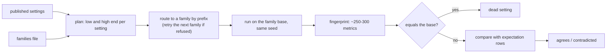

# Sensitivity analysis

`v2xw sensitivity` asks of a parameter: does it move the metric theory says it moves, in
the direction theory says? Every check runs a base scenario and a changed one **on the same
seed**. Same seed is common random numbers: the two runs draw the same vehicles, phases and
fading wherever the change does not reach, so a small effect is not lost in run-to-run
noise, and a setting the run never reads gives a bit-identical run. Code:
`crates/v2xw-engine/src/sensitivity.rs` and `sensitivity/{sweep,expect}.rs`.

| Mode | Command | What runs |
|---|---|---|
| spec | `v2xw sensitivity <spec.yaml>` | the rows of one spec file, each a one-at-a-time change on its base |
| catalogue | `v2xw sensitivity --catalogue` | every published numeric and choice setting, at each end of its recommended range |
| expectations | `v2xw sensitivity --expect` | only the perturbations the expectation table names, plus the two-setting interaction checks |

Every flag: [`v2xw sensitivity`](../getting-started/cli.md#sensitivity).

## Spec files

```yaml title="a spec file"
base: ../scenarios/sensitivity/dsrc-grid.yaml   # relative to this file
set: { time.duration_s: 3.0 }                   # applied to every run
rows:
  - name: lower transmit power
    set: { radio.devices.obu.tx_power_dbm: 5.0 }
    metric: range_m
    expect: down          # up | down | same | changes
    band: [0.2, 0.8]      # optional: changed / base must fall in it
    min_change: 0.05      # optional: relative change required (default 0.01)
    base_set: { }         # optional: fields applied to both runs of this row
    source: Friis / log-distance law
```

| Row field | Meaning |
|---|---|
| `name` | the row's label |
| `set` | the dotted fields this row changes |
| `metric` | the measured metric to judge |
| `expect` | `up`, `down`, `same` or `changes` |
| `band` | optional `[lo, hi]` the ratio changed / base must fall in, where theory gives one |
| `min_change` | relative change that counts as a move (default 0.01) |
| `base_set` | fields applied to both runs, so the row is measured where the setting acts |
| `source` | the theory or citation the expectation rests on |

The metrics are measured while the run goes, from `phy.prr`, `node.tx`, `node.rx`,
`mac.cbr` and the run report, as running sums and histograms (never the records, so a large
fleet does not hold its `phy.rx` stream in memory): PDR and PRR, the range edges `range_m`
and `range90_m`, PRR per distance band (`prr_0_200`, `prr_200_400`, `prr_400_600`,
`prr_600_1000`), CBR, latency stages, age of information and inter-packet gap.

```sh
v2xw sensitivity scenarios/sensitivity/radio-dsrc.yaml                 # PASS/FAIL per row on stderr, a table on stdout
v2xw sensitivity scenarios/sensitivity/radio-dsrc.yaml --base-only     # every metric of the base, and its PRR curve in 20 m bins
v2xw sensitivity scenarios/sensitivity/radio-dsrc.yaml --markdown out/radio.md --json
```

The command exits 1 when a row does not move as expected. Shipped spec files in
`scenarios/sensitivity/`: `radio-dsrc.yaml`, `radio-dsrc-dense.yaml`, `radio-cv2x.yaml`,
`radio-gn.yaml`, `phy-channel.yaml`, `test-mac-congestion.yaml`,
`test-mac-congestion-sidelink.yaml`, `test-networking.yaml`, `test-networking-dsrc.yaml`.
The same rows run as tests in `crates/v2xw-engine/tests/sensitivity_*.rs`.

## The catalogue sweep

```sh
v2xw sensitivity --catalogue --plan                          # settings, values and families; runs nothing
v2xw sensitivity --catalogue --only radio.phy,radio.mac --jobs 2 --cache out/sens.jsonl
v2xw sensitivity --catalogue --cache out/sens.jsonl --markdown out/catalogue.md --strict
```

The settings come from the engine's published settings index
(`scenario::publish::fields`), the same index the Studio's settings window and the
assistant read, so a field added to the schema is swept with no edit here. Each setting is
moved to the low and high end of its recommended range (parsed from its guide text and kept
inside the validator's bound), else half and twice its default; a choice to its other
values (at most `max_choices`); a switch to its other value.



Each run is measured into a fingerprint: the radio harness's metrics, every numeric leaf
of the run report (`report.*`), the sample-weighted mean of every metric sample
(`metric.*`) and the ground-truth traffic state (`traffic.*`, `vru.*`).

| Result | Meaning |
|---|---|
| **dead** | the fingerprint equals the base's: the setting is not read, or read by nothing a metric observes, on that family. Same seed means this needs no tolerance |
| **contradiction** | an expectation row disagrees with the measured direction or size |
| **refused** | every family's loader rejected the perturbation (usually by design: a setting that needs a partner setting) |

`--cache FILE` keeps a JSON-lines record of finished perturbations; a rerun reuses every
entry whose setting, value and family scenarios match, so a stopped sweep resumes and only
changed entries re-run. `--strict` exits 1 on a contradiction.

### The families file

`scenarios/sensitivity/catalogue.yaml` (`--families`) holds:

| Key | What it says |
|---|---|
| `families` | named small scenarios: `{name, base, set}`, for example `dsrc` (40 vehicles on a 1.2 km open grid, 802.11p, 2 s), `cv2x`, `nr`, `gn`, `security`, `scms`, `traffic`, `saturated`, `osm`, `canyon`, `pedestrians`, `freeway`, `freight` |
| `routes` | `{prefix, families}`: which families a setting runs on, first match wins; the last route (`""`) is the fallback |
| `skip` | `{prefix, reason}`: settings not swept (descriptive fields, the seed, the run length, settings that need a structure a scalar cannot supply) |
| `values` | literal values that replace the computed ends, where the range would make a run too large or names no usable range |
| `max_choices` | the most values a choice is swept at |
| `context` | `{prefix, set}`: prerequisites both runs share so a setting is measured where it acts (for example `radio.channel_model.nakagami_shape` with `fading: nakagami`) |

The latest full catalogue run and how to read its tables:
[Sensitivity catalogue](../reference/sensitivity-catalogue.md).

## Expectations

An expectation row encodes one piece of theory, with its citation, about one setting:

```yaml title="crates/v2xw-engine/tests/expectations/radio.yaml (excerpt)"
- {setting: radio.devices.obu.antenna_gain_dbi, change: high, metric: prr, expect: up,
   source: "EIRP and receive gain add dB for dB to the link budget (Friis 1946; ETSI EN 302 571 EIRP limits)"}
- {setting: radio.channel_model.path_loss_exponent, change: high, metric: prr, expect: down,
   source: "log-distance law: 10 n log10(d) more loss (Rappaport 4.9; Cheng et al., IEEE JSAC 2007 measured n 2-4 for V2V)"}
```

| Field | Meaning |
|---|---|
| `setting` | the dotted setting |
| `change` | `low` or `high` (the ends the sweep computes), or a literal value |
| `metric` | a fingerprint name |
| `expect` | `up`, `down`, `same` or `changes` |
| `min_change` | relative change required (default 0.01) |
| `source` | the theory and its citation |

Only physics and traffic theory with a citation goes in the table. The files are
`crates/v2xw-engine/tests/expectations/*.yaml` by topic (radio, PHY and channel, MAC
congestion, networking, security and SCMS, traffic flow, VRU safety, run cost, couplings).
Every row and the theory behind each contradiction:
[Sensitivity expectations](../reference/sensitivity-expectations.md).

### Interaction checks

Two settings together, as a 2 × 2 factorial on one family with all four runs on the same
seed: the base, the factor alone (A), the condition alone (B) and both (AB). The factor's
effect without the condition, $A - \text{base}$, is compared with its effect under it,
$AB - B$, in the metric's own units (Montgomery, *Design and Analysis of Experiments* 9e,
§5.2: the interaction is the difference between the simple effects).

```yaml title="crates/v2xw-engine/tests/expectations/interactions/interactions.yaml (excerpt)"
- name: density x reactive DCC (CBR)
  family: dsrc
  base_set: {time.mobility_step_ms: 50, messages.rate_hz: 20.0}
  factor: {actors.vehicles.demand.params.max_total_vehicles: 160}
  condition: {radio.models.dcc: {id: dcc/etsi/reactive-ts102687, params: {}}}
  metric: cbr_mean
  expect: dampens
  direction: up
  source: "reactive DCC moves to a longer Toff as CBR crosses 0.30/0.40/0.50/0.60 … (ETSI TS 102 687 V1.2.1 Table A.2)"
```

| `expect` | Holds when |
|---|---|
| `dampens` | the effect under the condition is smaller in size (it may vanish) |
| `amplifies` | it is larger in size, the same way |
| `holds` | it keeps its sign |
| `reverses` | it changes sign |

`direction` is the factor's effect alone, checked too.

```sh
v2xw sensitivity --expect --plan                     # rows, perturbations, interactions, anything unplanned
v2xw sensitivity --expect --jobs 2 --cache out/expect.jsonl --markdown out/expect.md
```

`--expect` exits 1 when a row or an interaction fails, or when a row names a setting and
end the sweep cannot plan. `crates/v2xw-engine/tests/sensitivity_catalogue.rs` is the fast
CI subset: it checks that every expectation names a plannable setting and end, and that a
few link-budget and frame settings on the DSRC family move the way the table says.

## Writing a new expectation

1. Find the setting's path and recommended range in the
   [configuration reference](../configuration/reference/index.md).
2. Check which family it routes to (`--catalogue --plan --only <path>`); add a route or a
   `context` if no family exercises it.
3. Add a row with the theory and its citation to the topic file, and run
   `v2xw sensitivity --expect --only <path>`.
4. If the run contradicts it, either the expectation or the engine is wrong; the
   contradiction table in [Sensitivity expectations](../reference/sensitivity-expectations.md)
   is where each one is explained.
