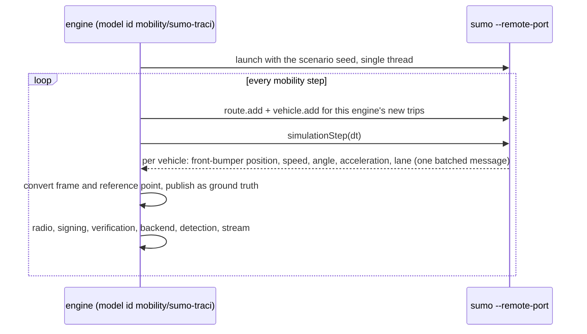

# SUMO co-simulation

[Eclipse SUMO](https://eclipse.dev/sumo/) and this engine meet in four places
(`crates/v2xw-interop`):

| Direction | What | How |
|---|---|---|
| SUMO → engine | a SUMO network as the world | `world.source.kind: sumo-net` ([Worlds and maps](worlds-and-maps.md#sumo-netxml-and-opendrive)) |
| SUMO → engine | SUMO route files as demand driven by this engine's mobility | `actors.vehicles.demand.kind: mobility/demand/sumo-rou` |
| SUMO ↔ engine | SUMO drives the traffic over TraCI while this engine runs radio, security, backend and UI | `mobility.provider: sumo` |
| engine → SUMO | the world and demand in SUMO formats; SUMO-format outputs | `v2xw export-sumo`; the `sumo-*` exporters ([Datasets](datasets.md#sumo-output-files)) |

## Finding SUMO

SUMO is found through [`mobility.sumo_home`](../configuration/reference/mobility.md#s-mobility-sumo-home),
else `$SUMO_HOME`, else the `sumo` directory of the `eclipse-sumo` Python wheel in the
virtualenv `$V2XW_SUMO_VENV` (`<venv>/lib/python3.*/site-packages/sumo`):

```sh
python3 -m venv ~/sumo-venv && ~/sumo-venv/bin/pip install eclipse-sumo
export V2XW_SUMO_VENV=~/sumo-venv          # or SUMO_HOME=/path/to/sumo
```

`just sumo-install` prints the install options (`brew install --cask sumo-gui` on macOS, or
`uv pip install eclipse-sumo libsumo`). Nothing else in the engine needs SUMO: the
shipped-scenario suites run without it, which is why the TraCI scenarios live in
`scenarios/interop/`.

## The TraCI tier (`mobility.provider: sumo`)

```yaml title="scenarios/interop/sumo-grid.yaml (excerpt)"
world:
  source: {kind: sumo-net, path: worlds/sumo/grid3.net.xml}
  imported_at: "2026-10-07T00:00:00Z"
mobility:
  provider: sumo
  route_files: [worlds/sumo/grid3.rou.xml]     # SUMO reads and routes these itself
  # sumo_args: [--default.carfollowmodel, IDM]
actors:
  vehicles:
    demand:
      kind: mobility/demand/poisson            # also applies: routed here, inserted into SUMO
      rate_veh_per_h_per_lane_km: 20.0
```

| Setting | Meaning |
|---|---|
| [`mobility.provider`](../configuration/reference/mobility.md#s-mobility-provider) | `native` (default) or `sumo` |
| [`mobility.route_files`](../configuration/reference/mobility.md#s-mobility-route-files) | `.rou.xml` files SUMO loads and routes itself |
| [`mobility.sumo_args`](../configuration/reference/mobility.md#s-mobility-sumo-args) | extra SUMO command-line options |
| [`mobility.sumo_home`](../configuration/reference/mobility.md#s-mobility-sumo-home) | SUMO's installation directory (holding `bin/sumo`) |

The world must be the `net.xml` SUMO runs: the importer keeps each SUMO edge id as the edge
name and each lane's index, so a SUMO lane id is always a world lane and the reverse,
without geometric matching.



**What SUMO owns:** every vehicle's motion: car following, lane changing, junction
behaviour and its own signal programmes.

**What the engine owns:** everything else: messages, radio, network, security, the
credential system, attackers, detectors, metrics and the stream to the Studio, all computed
on SUMO's published states.

**The frame conversion.** SUMO publishes the front bumper and an angle in degrees clockwise
from north; this engine publishes the rear reference point and a heading counter-clockwise
from east, so $h = \pi/2 - \text{angle}\cdot\pi/180$ and
$\mathbf{p} = \mathbf{p}_\text{front} - L(\cos h, \sin h)$, after the importer's shift.

**Determinism.** SUMO is deterministic for a fixed `--seed` and one simulation thread; the
engine passes the scenario seed, sorts what it publishes by actor id, and assigns actor ids
in sorted SUMO-id order of first appearance, so two runs with the same seed publish the
same states.

### What is and is not synchronised

| Synchronised | Not synchronised (from the model card's limitations) |
|---|---|
| vehicle position, speed, heading, acceleration and lane, every step | **signal states**: SUMO runs its own programme and does not publish it back; SPaT the engine generates follows the world's plan, which is the same programme only when SUMO's `tlLogic` was imported unchanged |
| this engine's demand, inserted into SUMO on this engine's routes | vehicles inside a junction are on SUMO internal lanes, which the world folds into connectors; their lane position is left empty there |
| SUMO-routed vehicles from `route_files` | **pedestrians and SUMO persons are not read** |

## SUMO route files driven natively (`mobility/demand/sumo-rou`)

A `.rou.xml` driven by this engine's own mobility, with no SUMO install:

```yaml title="scenarios/interop/sumo-rou-native.yaml (excerpt)"
actors:
  vehicles:
    demand:
      kind: mobility/demand/sumo-rou
      params:
        path: worlds/sumo/grid3-calibrated.rou.xml
        probability_flows: bernoulli        # or equal-spacing
```

Read: `<vType>` (`vClass`, `maxSpeed`, `accel`, `decel`, `tau`, `minGap`, `sigma`,
`speedFactor` including `norm`/`normc`, `speedDev`, `desiredMaxSpeed`, `probability`),
`<vTypeDistribution>`, `<routeDistribution>`, `<route>`, `<vehicle>`, `<trip>` and
`<flow>`. Flows with `vehsPerHour`, `period` or `number` are equally spaced as in SUMO;
`period="exp(λ)"` draws exponential headways; `probability` p is a Bernoulli trial every
second (SUMO's definition; `equal-spacing` keeps the mean and drops the variance).
`departLane`, `departPos` and `departSpeed` keywords that need the occupancy at insertion
fall back to the nearest supported meaning and are counted as approximations. Every other
attribute and `<param>` is counted by name in the import ledger, never dropped silently. A
vehicle with a route drives exactly the file's edges.

## Exporting to SUMO

```sh
v2xw export-sumo scenarios/phase1-grid.yaml --out out/sumo
```

| File | What |
|---|---|
| `<stem>.nod.xml` | junctions: `traffic_light` when signalised, `allway_stop`, `priority`, `right_before_left` |
| `<stem>.edg.xml` | edges with lanes, speeds, widths and allowed classes (`spreadType="right"`) |
| `<stem>.con.xml` | permitted lane-to-lane connections |
| `<stem>.net.xml` | when `netconvert` is found (`$SUMO_HOME`, `$V2XW_SUMO_VENV`) |
| `<stem>.rou.xml` | every trip the scenario's demand draws over the run, with this engine's route |

!!! warning "Signal programmes are not exported"
    `netconvert` generates its default programme for each `traffic_light` node, so a SUMO
    run on an exported world has the same signalised junctions and different timings.
    Junction internals are left to `netconvert`. A world that came from a `net.xml` keeps
    its SUMO edge ids, so its `.rou.xml` runs on the original network unchanged: run SUMO on
    that file, not on an export.

## Cross-validation

`cross_validate` (`just cross-validate`, `--quick` for shorter runs) compares traffic on a
grid and on Midtown with SUMO, and radio against Veins and OpenCV2X. For traffic it runs the
same trips through both simulators: the
network is SUMO's (`netgenerate --grid`, and `netconvert` on the Midtown extract), one trip
list is routed once by this engine's free-flow Dijkstra, and both drive those routes, so
differences are in the driving models, not in routing. Both runs are measured by the same
observer (Edie's generalised flow, density and speed, among others) and the report is
written to `target/validation/cross-validation.md`. It needs SUMO. Scope and results:
[Validation and conformance tools](../dev/tools.md).
