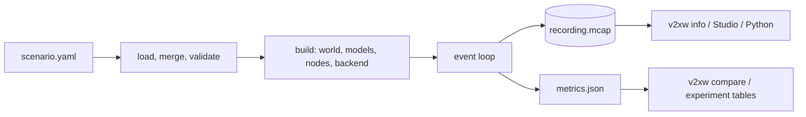

# V2X World

**A connected-vehicle simulator with a real US SCMS.**

V2X World is a deterministic, discrete-event simulator of connected-vehicle (V2X) systems,
written in Rust. One run models the road traffic, the radio channel, the network and
message layers, the IEEE 1609.2 security envelope, the credential system that issues and
revokes certificates (the US SCMS or the ETSI ITS PKI), the attackers, and the
misbehaviour detectors and authority. The same scenario, seed and build give the same
bytes out on every supported platform. It is built for research on V2X security and
privacy: what credential management costs in bytes, queueing and latency; how long a
misbehaving vehicle stays believed; what a roadside eavesdropper learns across pseudonym
changes; and what post-quantum signatures cost on the air.



## What one run contains

| Layer | Modelled | Page |
|---|---|---|
| World | OpenStreetMap, SUMO `net.xml` and OpenDRIVE imports, procedural grid, radial and random networks, buildings, DEM terrain, vegetation | [Worlds and maps](guide/worlds-and-maps.md) |
| Traffic | IDM, EIDM, Krauss, Gipps, Wiedemann 99, ACC/CACC; MOBIL and sublane lane change; HCM gap acceptance; fixed-time, actuated and NEMA signals; pedestrians and cyclists; a mesoscopic tier; demand from Poisson arrivals, OD matrices, counts, GTFS and assignment | [Traffic and mobility](models/traffic.md), [Traffic demand](guide/traffic-demand.md) |
| Radio and network | IEEE 802.11p, LTE-V2X and NR-V2X sidelinks, cellular Uu; path loss, fading, obstruction; ETSI and SAE congestion control; WSMP and GeoNetworking; fragmentation | [Radio and network](models/network.md) |
| Messages | BSM, CAM, DENM, CPM, VAM, SPaT, MAP and others, with real encodings where the code has them | [Messages](models/messages.md) |
| Security | IEEE 1609.2 / ETSI TS 103 097 envelopes, real or modelled ECDSA, post-quantum and hybrid schemes as cost models, verification policies, P2PCD | [Security and crypto](models/security.md) |
| Credentials | the CAMP SCMS (enrolment, butterfly keys, linkage values, reports, revocation, CRLs) and the ETSI TS 102 941 PKI | [SCMS and credentials](models/scms.md) |
| Threats and detection | position, timing, identity and credential attacks, jammers, an eavesdropper; local detector suites; misbehaviour-authority pipelines | [Threats and detection](models/threats.md) |
| Measurement | MCAP recordings that replay byte for byte, metrics with sample counts and intervals, exports, sweeps, comparison, sensitivity | [Metrics and outputs](recording-and-metrics.md) |

Every model ships a model card: its equations, every parameter with a unit, default and
cited source, its assumptions, what it ignores and how it was validated
([model parameters](configuration/reference/models.md)).

## Where to go

<div class="grid cards" markdown>

-   :material-rocket-launch: **Getting started**

    ---

    Build the tool, run a shipped scenario, read its outputs, open it in the browser.

    [:octicons-arrow-right-24: Introduction](getting-started/introduction.md) ·
    [Your first simulation](getting-started/first-simulation.md)

-   :material-book-open-variant: **User guide**

    ---

    Scenarios, worlds, demand, running and recording, comparing runs, sweeps,
    sensitivity analysis, exports and SUMO.

    [:octicons-arrow-right-24: Scenarios](scenarios.md)

-   :material-function-variant: **Models**

    ---

    The equations and sources behind each layer, and what each model leaves out.

    [:octicons-arrow-right-24: Models overview](models/index.md)

-   :material-tune: **Configuration reference**

    ---

    Every scenario setting and model parameter, generated from the engine's own published
    surface.

    [:octicons-arrow-right-24: Generated reference](configuration/reference/index.md)

-   :material-hammer-wrench: **Development**

    ---

    Architecture, crates, testing, the server protocol and how to add a model, detector,
    metric or setting.

    [:octicons-arrow-right-24: Architecture](architecture.md) ·
    [Extending](extending.md)

-   :material-api: **API**

    ---

    The Rust crates (`cargo doc`) and the `v2xw` Python package.

    [:octicons-arrow-right-24: Rust API](api/index.md) ·
    [Python API](api/python.md)

</div>

## Quick start

Rust comes from `rust-toolchain.toml` through rustup; the Studio needs Node 22+ and
pnpm 10. Full prerequisites: [Install and build](getting-started.md).

```sh
git clone https://github.com/ak3zaidan/V2X-World.git && cd V2X-World
cargo build --release -p v2xw-cli                       # target/release/v2xw and v2xw-server
./target/release/v2xw validate scenarios/highway-congestion.yaml
./target/release/v2xw run scenarios/highway-congestion.yaml --out runs/highway
./target/release/v2xw info runs/highway/recording.mcap

worlds/fetch.sh manhattan                               # the OpenStreetMap extract (ODbL, git-ignored)
./target/release/v2xw run scenarios/midtown-normal.yaml --out runs/midtown

./run-sim.sh                                            # engine on :8787, paused
pnpm --dir ui install && pnpm --dir ui --filter @vwp/studio dev   # http://127.0.0.1:5173
```

`highway-congestion.yaml` builds its own road network and needs no download. The command
reference is [Command-line tool](getting-started/cli.md).

## How to cite

Cite the software as described in
[`CITATION.cff`](https://github.com/ak3zaidan/V2X-World/blob/main/CITATION.cff) (GitHub's
"Cite this repository" button reads it); the BibTeX entries for the software and the paper
are on [Citation and licence](about/citation.md). Name the engine build and the scenario
hash a result came from: both are in every run's `manifest.json`, and together with the
seed they reproduce the run. The code is Apache-2.0 and the [V2X-SCMS-MBD
dataset](https://huggingface.co/datasets/akzaidan/v2x-scms-mbd-mini) is CC BY 4.0; the licences of
the third-party ASN.1 modules and the map data are on the same page. The standards and
papers the models implement: [Standards and references](about/standards.md).
