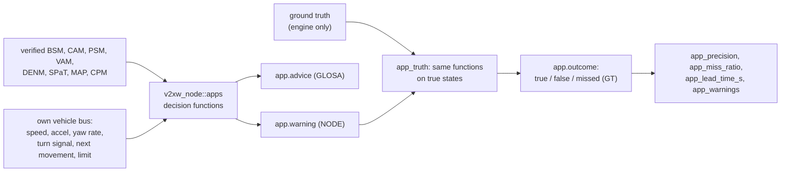

# V2X applications

The applications are where a communication result becomes a safety or traffic result.
Each equipped vehicle runs them on what its radio stack delivered and on its own vehicle
bus; the engine then runs the same decision functions on ground truth and labels every
warning true, false or missed. A lost BSM becomes a late or missed warning, a ghost vehicle
a false one, a stale SPaT a wrong advisory.

Code: `crates/v2xw-node/src/apps.rs` (the applications), `vehicle.rs` (the vehicle bus),
`events.rs` (SRM/SSM, DENM triggers), `crates/v2xw-engine/src/app_truth.rs` (labelling),
`priority.rs` (signal priority), `perception.rs` (sensors), `safety_events.rs` (scripted
emergencies), `crates/v2xw-metrics/src/apps.rs` (metrics). Settings:
[`apps`](../configuration/reference/apps.md),
[`perception`](../configuration/reference/perception.md),
[`events`](../configuration/reference/events.md).



## What an application may read

- the messages its stack delivered and verified, decoded from their own octets: a BSM's
  or CAM's position, speed, heading, acceleration, event flags and path prediction; a
  PSM's or VAM's; a DENM's event; a SPaT's signal states and timing; a MAP's lanes;
- its own GNSS belief and its own vehicle bus (`v2xw_node::vehicle`): speed,
  acceleration, yaw rate, turn signal, the navigation's next movement, the speed limit.

A heard road user is a `Track`. Before a decision, a track is advanced by the message's
age at its own speed and acceleration, never reversing:

$$
d(\Delta t) = \max\!\big(0,\; v\,\tau + \tfrac12 a\,\tau^2\big),\qquad \tau = \begin{cases}\min(\Delta t,\, v/(-a)) & a < 0\\ \Delta t & \text{otherwise.}\end{cases}
$$

## The applications

`apps.enabled` (default: all eight) lists which run on every equipped vehicle.

| Id | Application | Fires when | Default threshold | Source |
|---|---|---|---|---|
| `fcw` | forward collision warning | a vehicle ahead in the ego's predicted path (heading within 30°, inside a 1.8 m half-corridor on the ego's yaw-rate arc, ≤ 150 m, ego ≥ 2.8 m/s) would be hit within the TTC threshold, and the driver is not already braking as hard as avoiding it requires | `apps.fcw_ttc_s` = 2.4 s | NHTSA NCAP FCW confirmation test (2013): alert no later than 2.4 s TTC for a decelerating lead |
| `eebl` | emergency electronic brake light | a same-direction vehicle ahead brakes hard (BSM hard-braking flag or `accelSet` past 0.4 g, or an EEBL DENM) | ≤ 300 m ahead, within 5.4 m laterally (the ego's lane and the next) | 0.4 g: J2735 event flag; 300 m: CAMP VSC-A EEBL range as recalled, a parameter |
| `ima` | intersection movement assist | a crossing vehicle and the ego would reach the conflict point within a short time of each other | `apps.ima_tti_s` = 4 s look-ahead, ΔT ≤ 1.5 s | ΔT: FHWA SSAM conflict threshold (FHWA-HRT-08-051); 4 s is this build's choice |
| `lta` | left-turn assist | the ego is about to turn left (within 30 m) and an opposing vehicle arrives inside the critical gap | `apps.lta_gap_s` = 4.1 s | HCM 6th ed. Exhibit 20-11, base critical headway for a major-street left turn |
| `bsw` | blind spot and lane change warning | a same-direction vehicle in the blind zone (0.5 to 3.0 m beside, up to 3 m behind the rear); `lcw` when the ego signals toward it | | ISO 17387 (LCDAS) adjacent zone |
| `pcw` | pedestrian collision warning | a pedestrian or cyclist would be in the ego's path | `apps.pcw_ttc_s` = 3 s, ±1 m | this build's choice: no V2P timing is standardised |
| `rlvw` | red-light violation warning | the ego would enter on red and cannot stop comfortably after a 1 s reaction | `apps.rlvw_decel_mps2` = 3.4 m/s² | AASHTO 3.4 m/s² comfortable deceleration; ITE 1.0 s perception-reaction time |
| `glosa` | green-light optimal speed advisory | (advisory) the speed that reaches the stop line on green | from 300 m, minimum advice 20 km/h, 1 s margin | Katsaros et al. 2011; the minimum and margin are this build's choice |

A warning is issued once (`issue`), refreshed at most once a second (`update`) and cleared
when its condition has been gone for 300 ms (`clear`), on `app.warning`. GLOSA writes
`app.advice`.

### Decision quantities

**Time to collision** (FCW, PCW): the smallest $t \le 10$ s on a 50 ms grid at which the
ego at constant speed $v_e$ closes the net gap $g$ on a lead at $v_l$ that brakes at
$a_l < 0$ and stops:

$$
v_e\,t \;\ge\; g + x_l(t),\qquad x_l(t) = v_l\,t' + \tfrac12 a_l\,t'^2,\; t' = \min(t,\, v_l/(-a_l)).
$$

A non-positive gap from two GNSS errors is an apparent overlap; it counts only once the
ego is truly closing.

**Required deceleration** (FCW suppression):

$$
d_{\text{req}} = \begin{cases}
\dfrac{v_e^2}{2\,(g + v_l^2/(2(-a_l)))} & a_l < 0,\ v_l > 0 \\[2mm]
\dfrac{v_e^2}{2g} & v_l \le 0 \\[2mm]
\dfrac{(v_e - v_l)^2}{2g} & \text{otherwise.}
\end{cases}
$$

FCW stays silent when the driver already brakes at $-a_e \ge d_{\text{req}}$.

**RLVW**: with distance $d$ to the stop line and reaction time $t_r$,

$$
d_{\text{need}} = \frac{v^2}{2\,(d - v\,t_r)},\qquad \text{warn if } d_{\text{need}} \ge 3.4\ \text{m/s}^2 \text{ and the driver is not braking at } 0.9\,\tfrac{v^2}{2d}.
$$

**GLOSA**: with $t_{\text{left}}$ the likely change instant of the SPaT (`likelyTime`, or
`minEndTime` when it is not sent; CTI 4501) and margin $m$:

- on green, if $d / v_{\text{limit}} \le t_{\text{left}} - m$: advise $\min(v, v_{\text{limit}})$ if the
  current speed makes it, else $d/(t_{\text{left}} - m)$; otherwise no speed (it will stop);
- on red: advise $d/(t_{\text{left}} + m)$, capped at the limit, or nothing below the 20 km/h
  minimum.

A driver decides once, with probability `apps.glosa_compliance` (default 0) on a stream
keyed by the actor, whether to follow; a follower's speed is capped at the advice while
it stands.

## Labelling against ground truth

`v2xw_engine::app_truth` runs the same decision functions over true states:

| Term | Rule |
|---|---|
| truth episode | for every equipped ego and subject within 300 m (EEBL's reach), each mobility step the decision fires on true states; consecutive steps form one episode |
| true warning | an `issue` whose (ego, subject, application) had an episode open, ended within 1 s before, or opening within 1 s after |
| false warning | an `issue` with no such episode |
| missed | an episode of at least 300 ms that ended with no `issue` for that subject and application |
| lead time | the true TTC left at the issue instant (FCW, IMA, LTA, PCW) |

Labelled applications: `fcw`, `eebl`, `ima`, `lta`, `pcw`, `rlvw`. `bsw` and `lcw` are
advisory and neither matched nor counted as missed. RLVW's truth uses the signal the
approach truly shows (the controller's plan as it runs now, priority service included).

### Metrics

| Metric | Formula | Unit | Visibility |
|---|---|---|---|
| `app_warnings` | warnings issued (rising edges) | count | NODE |
| `app_precision` | true / (true + false) | ratio, Wilson interval | GT |
| `app_miss_ratio` | missed / (true + missed) | ratio, Wilson interval | GT |
| `app_lead_time_s` | true TTC left when a true warning issued | s, distribution | GT |

All are per application (`app` dimension). They do not account for whether the driver
reacted, for warnings about objects reported only in CPMs, or for EEBL and RLVW lead time
(no TTC). See [Metrics and outputs](../recording-and-metrics.md).

### Surrogate measures

`v2xw_node::safety` computes the surrogate safety family (TTC, PET, DRAC) over what the
node believed, quantised to 10⁻³, with the FHWA SSAM 1.5 s conflict threshold; the metric
crate's ground-truth `ttc_min`, `pet` and `drac` (`metric/safety/surrogates-and-flow`)
are the truth side. Their difference under attack is the attack's effect on safety. The
catalogue's `safety-app/fcw-vsca`, `ima-vsca` and `eebl-vsca` cards describe that module;
the applications a run executes are the `v2xw_node::apps` set above.

## Signal priority for emergency vehicles

An emergency-class vehicle with `srm` in `messages.sets` sends an SRM to a junction whose
MAP it heard, once it is within 300 m, repeated every second. The RSU with the `spat`
role hands it to the controller (`v2xw_engine::priority`, NTCIP 1211 strategies) and
answers with an SSM when `ssm` is on.

| Action | Rule | Default |
|---|---|---|
| green extension | while the requested green would end before the vehicle's ETA plus a margin, hold the plan clock | at most 10 s; margin 2 s |
| early green | while the requested movement is red, end a conflicting green that has run its minimum; its amber, all-red and clearances run in full; never cut a pedestrian clearance or a walk below the minimum | minimum green 7 s (MUTCD 2009 §4E.06 walk) |
| recovery | walk the offset back during greens only, at most a fraction of real time, so a green runs 80 to 120 % of its length | rate 0.2 |
| lapse | a request not repeated | 2 s |

NTCIP 1211 leaves the limits to the operator; the defaults are this build's (the 10 s
extension from FHWA's TSP handbook range of 5 to 15 s, as recalled). Each action is a
`signal.priority` record. The drivers, the SPaT and the page's lamps all read the moved
plan. The NEMA dual-ring controller applies the same strategies to its phases
([Traffic](traffic.md#intersections-and-signals)).

## Perception

`v2xw_engine::perception` is the one place that reads true positions and hands a vehicle
a list of perceived objects: detected with a probability, placed with an error, hidden when
something is in the way. It is the input to CPMs ([Messages](messages.md#cpm-ts-103-324-v211)).

| Default sensor | Range | Field of view | Source |
|---|---|---|---|
| long-range radar | 250 m | ±9° | Continental ARS 408-21 datasheet, far range |
| short-range radar | 70 m | ±45° | the same sensor's near range |
| front camera | 80 m | ±26° | a 52° mono camera (Mobileye EyeQ class); the range is this build's choice |

| Model element | Rule | Status |
|---|---|---|
| detection probability | linear from `pd_near` 0.99 at the sensor to `pd_far` 0.90 at range | this build's choice, in the range ETSI TR 103 562 assumes |
| position error | Gaussian, σ = 0.10 m + 0.5 % of range (radar), 0.20 m + 2 % (camera), 0.03 m base (lidar) | this build's choice, the order of datasheet accuracies |
| occlusion `centre-line` (default) | hidden when the line to the reference point crosses a building or passes within half a body width of another vehicle | |
| occlusion `outline` | seen when any silhouette corner is in range and view with a clear 2.5D line past buildings and other vehicles' oriented rectangles | Günther, Riebl et al., IEEE VNC 2016 (Artery's visible-corner rule) |
| tracking | perfect association; confirmed after 3 hits in the last 5 scans, dropped after 1 s unseen; only confirmed tracks are reported | M-of-N rule |
| roadside suite | RSUs with the `cpm` role; default four 80 m cameras, 90° each, facing east, north, west, south | TS 103 324 §7.1.3 |

Suites are configurable per vehicle class (`perception.classes`), with mount anchor
(`front`, `rear`, `centre`), offsets, height, azimuth, range (≤ 409.5 m) and field of view.
Draws come from the `perception` RNG domain.

### Collective perception figures

The run report's `cpm` block (`v2xw_engine::run::cpm_metrics`, after ETSI TR 103 562
V2.1.1 §6):

| Figure | Definition |
|---|---|
| `awareness_direct_permille` | road users within 150 m an equipped vehicle heard a CAM, BSM, VAM or PSM from within 1 s, over all road users within 150 m |
| `awareness_with_cpm_permille` | the same, also counting road users a received CPM reported |
| `redundancy_milli` | object reports received in CPMs per distinct (receiver, object, second) |
| `size_*` | CPM payload median, 95th percentile and 100-octet bins |
| `generation_mhz` | CPMs per sending station per second, ×1000 |
| `cpms_verified`, `rsu_cpms_sent`, `rsu_cpms_verified`, `rsu_objects_decoded` | CPMs verified and decoded, infrastructure CPMs sent and received |

## Scripted safety events

The calibrated drivers rarely brake past 0.4 g, so the emergency applications need an
emergency put there. The timeline (`events`) offers:

| Kind | The vehicle | Defaults |
|---|---|---|
| `safety.hard-brake` | brakes at `decel_mps2` to a stop, stands `hold_s`, drives on | 0.5 g (4.90 m/s²), 2 s |
| `safety.breakdown` | brakes to a stop, hazard lights on, stands until `until` | 3 m/s² |
| `safety.cut-in` | changes lane to `side` into the gap ahead of that lane's follower | `left` |

0.5 g is above J2945/1's 0.4 g flag; on the ETSI stack an EEBL DENM needs `decel_mps2`
≥ 6 (UN R48). `target: auto` (default) picks the first fitting vehicle in actor-id order
and waits up to `within_s` for one.

```yaml
events:
  - t: 120
    type: safety.hard-brake
    params: { target: auto, decel_mps2: 4.9, hold_s: 2 }
```

## Modelled versus simplified

| Modelled | Simplified or absent |
|---|---|
| eight applications on verified, decoded messages and the own vehicle bus | no driver model of reaction to a warning; a warning is the HMI output |
| per-message age extrapolation of tracks | FCW, IMA and PCW geometry is planar; no elevation |
| truth labelling with the same decision functions | BSW/LCW are not labelled; CPM-only objects are not used by the applications' labels |
| GLOSA from SPaT `likelyTime` with per-driver compliance | GLOSA advice does not model eco-driving acceleration profiles |
| NTCIP 1211 extension, early green and recovery | limits are this build's defaults, not an operator's |
| sensor detection, error, occlusion and M-of-N tracking | perfect data association; no false positives from clutter; detection probability and error are uncited choices |
