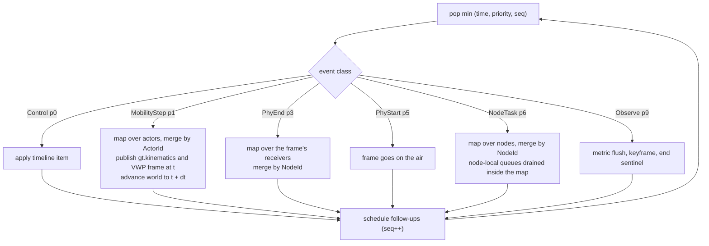

# Determinism and time

Same scenario file, same seed, same engine build and same plug-in set give the same
records, the same metrics and the same digests. This page explains how the engine keeps
that promise: what simulated time is, how events are ordered, where random numbers come
from, which sources of nondeterminism are banned, and how a run is checked and resumed.

Code: `crates/v2xw-core/src/{time,event,rng,hash,math,manifest}.rs`,
`crates/v2xw-engine/src/{event,run}.rs`, `crates/v2xw-node/src/clock.rs`,
`crates/v2xw-cli/src/checkpoint.rs`. Settings: [`time`](../configuration/reference/time.md)
and [`seed`](../configuration/reference/seed.md).

## Simulated time

| Quantity | Type | Unit | Notes |
|---|---|---|---|
| instant | `SimTime = u64` | ns since `t0` | 584 years of range; symbol boundaries (8 µs), slot times (13 µs) and propagation delays (about 1 µs per 300 m) are exact integers |
| span | `time::Duration(u64)` | ns | a delay, not an instant; arithmetic saturates, and a negative span clamps to zero |
| civil time | `WallClock` | s | `time.t0` (RFC 3339) plus `SimTime`; a pure function of the scenario |
| IEEE 1609.2 `Time32` / `Time64` | `WallClock::time32`, `time64` | TAI s / TAI µs since 2004-01-01T00:00:00Z | leap seconds included from the IANA `leap-seconds.list` table (`time::LEAP_SECONDS`); a `t0` of 2026-01-01T00:00:00Z gives `Time32` 694 310 405 |

The kernel always counts nanoseconds. `time.des_resolution` (`1ns`, `1us` default, `1ms`) is
the resolution promised to models; the loader refuses a resolution the run cannot keep,
for example `1ms` with a PHY or MAC that times frames in microseconds.

Floats appear only at the edges. `time.duration_s` is converted once
(`Time::horizon_ns`, rounded to the nanosecond), and `ns_to_secs` is exact only for the
first 2⁵³ ns (about 104 days), so it is used for model inputs and display only.

!!! note "The wall clock"
    Nothing in the engine reads the host clock. The civil time of the run is `time.t0`,
    which is scenario data (default `2027-03-04T07:00:00Z`). The only other real-world
    instant is the manifest's `build_utc`, which the caller supplies
    (`v2xw run --build-utc`) and which is excluded from every digest.

### Time settings

| Setting | Default | Range | Meaning |
|---|---|---|---|
| `time.t0` | `2027-03-04T07:00:00Z` | RFC 3339 | civil instant of `SimTime` 0 |
| `time.duration_s` | 60 | > 0 s | run length |
| `time.mobility_step_ms` | 100 | 10 to 100 ms | mobility period |
| `time.des_resolution` | `1us` | `1ns`, `1us`, `1ms` | resolution promised to models |
| `time.metric_period_s` | 1 s when unset | 0.1 to 3600 s | metric flush window |
| `time.warmup_s` | none | ≥ 0 s | no metric sample is recorded for a window that ends inside it |
| `time.calendar` | `real` | `real`, `compressed` | credential-system calendar |
| `time.time_dilation[]` | none | `{from_s, to_s}` | windows in which no radio frame is generated |
| `time.fast_forward[]` | none | `{from_s, to_s}` | windows the engine jumps through between credential-system events |

Full table with status notes: [generated `time` reference](../configuration/reference/time.md).

## The event queue

One binary heap holds every cross-node event, ordered by the total order
`(time, priority, seq)` (`v2xw_core::event`):

- **time**: `SimTime`;
- **priority**: fixed per event class, never chosen by a plug-in;
- **seq**: one global monotonic counter stamped when the event is scheduled.

Two events at the same instant therefore run in an order fixed by rule, and two events
with the same time and priority run in the order they were scheduled. Because scheduling
itself happens in deterministic order (id-sorted merges), the whole run is deterministic.

| Priority | Class | Payload (`v2xw_engine::Event`) | Scheduled by |
|---:|---|---|---|
| 0 | `Control` | a scenario timeline item, start or end | the timeline, at load |
| 1 | `MobilityStep` | none (period `time.mobility_step_ms`) | itself |
| 2 | `SignalPhase` | the signal whose controller advances | the mobility phase |
| 3 | `PhyEnd` | one frame whose arrival ends (receivers resolved inside the phase) | the PHY |
| 4 | `MacTimer` | a node and channel whose backoff, AIFS or SPS reservation expires | the MAC |
| 5 | `PhyStart` | one frame whose transmission begins | the MAC |
| 6 | `NodeTask` | the batched node phase, or one node's own wake-up | mobility and node phases |
| 7 | `NetDeliver` | an SDU and the node it reaches | the network layer |
| 8 | `FlowTimer` | a protocol flow step whose timer expires | credential and backend protocols |
| 9 | `Observe` | metric flush, UI keyframe, exporter flush, end of run | the run |

The order encodes causality at one instant: scenario control is visible to everything,
kinematics for `t` are final before any radio event at `t` reads them, a reception is
decided before the MAC reacts, and observation looks at a fully settled instant.

!!! warning "Stable numbers"
    The priorities, the RNG domain codes and the entity encoding below are part of the
    determinism contract. Changing any of them changes every golden digest.

## The main loop and phases

`crates/v2xw-engine/src/run.rs` runs one single-threaded loop over the heap. A few event
classes are *phases*: pure maps over actors, receivers or nodes, which may run on a
thread pool and are merged in id order. A phase never touches the heap while it maps, so
thread count changes wall time and nothing else.



Node-local work (signing, verification queues, stores, detectors) is drained inside the
node map and never reaches the global heap, so the heap grows with traffic between nodes
rather than with work inside them.

### The mobility step

Mobility is periodic. A step dispatched at `t` publishes the state at `t` (the
`gt.kinematics` records and one VWP keyframe or delta), then advances the world to
`t + dt`. Each step is a **Jacobi update**: every decision reads a frozen start-of-step
snapshot, so the order in which actors are visited cannot change the result.

A radio event at $t'$ strictly inside a step reads positions by the published
extrapolation rule (`Kinematics::extrapolate`, applied only in `Engine::position_at`):

$$
\mathbf{p}(t') = \mathbf{p}(t) + \mathbf{v}(t)\,(t' - t), \qquad t \le t' < t + \Delta t .
$$

### Generation phase

Every node draws a generation phase $\varphi \sim U[0, T)$ once, so a fleet's BSMs and
CAMs are not synchronised on the engine's step grid. The rules are on the
[messages page](messages.md#generation-timing).

## Random numbers

There is no shared sequential generator. Every draw comes from an `RngStream`, a ChaCha12
keystream whose 32-byte key is

$$
\text{key} = \operatorname{SHA\text{-}256}\big(\text{master\_seed}_{\text{le},8} \,\|\, \text{domain\_code}_{\text{le},4} \,\|\, \text{entity\_encoding}\big).
$$

The key depends only on *who* draws and *what for*, so one entity's sequence is independent
of every other entity's activity, of event order and of thread count. `seed` is the only
seed a scenario sets (decimal, `0x…` or `"0x…"`); there is no field for a sub-stream seed.

| Domain | Code | Purpose |
|---|---:|---|
| `spawn` | 1 | demand and spawn decisions |
| `mobility` | 2 | car-following acceleration noise only |
| `lane-change` | 3 | lane-change decisions |
| `gnss` | 4 | GNSS position and time error, outages |
| `shadow` | 5 | large-scale shadowing |
| `fading` | 6 | small-scale fading |
| `mac-backoff` | 7 | CSMA/CA contention windows |
| `sps-selection` | 8 | sidelink SPS resource selection |
| `abstract-rx` | 9 | abstract-tier reception coin flip |
| `attack` | 10 | attacker behaviour |
| `service-time` | 11 | queueing service times |
| `backend` | 12 | backend batching jitter, retries |
| `collusion` | 13 | attacker group formation |
| `perception` | 14 | detection, position error, false positives |
| `report` | 15 | misbehaviour report generation |
| `crypto` | 16 | modelled cryptography material (`crypto_mode: modeled` only) |
| `desired-speed` | 17 | driver desired speed |
| `reaction-time` | 18 | driver reaction time |
| plug-in | high bit set | the high bit, then the first four octets of SHA-256(model id) as a little-endian `u32`, shifted right by one |

One domain names one purpose: two models drawing from the same `(domain, entity)` key
would interleave and depend on each other's order. A plug-in's domain is derived from its
model id (`PluginDomain::for_model`), never picked by hand.

| Entity | Tag | Payload | Lifetime |
|---|---|---|---|
| `Global` | `0x00` | | cached |
| `Actor` | `0x01` | `u32` | cached |
| `Node` | `0x02` | `u32` | cached |
| `Link` | `0x03` | `u32` tx, `u32` rx | cached |
| `LinkFrame` | `0x04` | `u32` tx, `u32` rx, `u64` frame | single use, never cached |
| `Lane` | `0x05` | `u32` | cached |
| `Signal` | `0x06` | `u32` | cached |
| `Custom` | `0x07` | `u16` kind, `u64` id | cached |

`RngRegistry::checkout(&self)` is the one sanctioned accessor and works inside parallel
phases: it borrows the stream from a sharded, locked cache and panics if the same key is
checked out twice at once. A per-frame scope (`LinkFrame`) is derived, used and dropped,
because caching one generator per frame per link would not fit in memory at scale.

Samplers (uniform, normal, Nakagami and the rest) are implemented in `rng.rs` with fixed
algorithms and documented draw counts, never with the `rand` crate's distributions.

## Banned sources of nondeterminism

The conformance kit (`tests/conformance/src/firewall.rs`) scans the source tree,
recursively and outside comments and tests, and fails on any of these:

| Check | Forbidden | Why | Use instead |
|---|---|---|---|
| hash order | `HashMap`, `HashSet` | std hash iteration order is randomised per process, so any ordering, id assignment or digest it reaches differs between runs | `BTreeMap`, `BTreeSet`, a sorted `Vec` |
| wall clock | `Instant::now`, `SystemTime`, `UNIX_EPOCH` | a duration measured on a real clock differs between identical runs | `SimTime`, `time.t0` |
| transcendental | `.sin(`, `.cos(`, `.exp(`, `.powf(` and the rest | std transcendentals call the platform libm, whose precision varies by platform and version | `v2xw_core::math` (the pure-Rust `libm` port of musl) |
| ground truth | node code reading truth | belief and truth separation | `NodeView` |

Exemptions are data in the rule table, each with a reason (the CLI's `wall.rs`, the
server's HTTP task, two Arrow metadata maps). `sqrt`, `+ − × ÷`, `abs`, `floor`, `ceil`,
`round` and `trunc` are IEEE-754 exact and need no wrapper; `mul_add` must not be used,
because whether it fuses depends on the target.

Every recorded float is quantised on its declared grid at write time
(`math::quantize_to`, `v2xw-world/src/quant.rs`, `v2xw-record/src/grid.rs`), and metric
digests hash the integer grid index, not the float.

## Node clocks and GNSS time

A node does not read simulated time. It reads its own clock (`v2xw_node::ClockModel`,
card `clock/gnss-locked-tcxo`): GNSS-disciplined while a fix holds, free-running at the
oscillator's drift otherwise. Every freshness check a node performs (the 1609.2
`generationTime` window, CAM age, replay guards) and every generation interval uses the
believed time.

$$
\text{offset}(t) = \text{offset}(t_{\text{lost}}) + \varepsilon\,(t - t_{\text{lost}}) \quad\text{(holdover)},\qquad \text{offset} \leftarrow 0 \text{ on reacquisition}.
$$

| What | Value in the engine | Where |
|---|---|---|
| node runtime drift | 0 ppm: believed time equals true time | `ObuRuntime`, `RsuRuntime`, VRU device construct `ClockModel::new(0.0)` |
| deliberate skew | `security.scms.lifecycle.clock_skew_s` steps a share (`clock_skew_share`) of devices ahead | `phase2.clock_skew_for`; the device signs, rotates and judges on its own clock |
| telemetry | `clock_offset_ns` (the one ground-truth integer in the 208-byte `NodeTelemetry` record) | VWP §3.5.2 |

The catalogue also registers two clock cards from `v2xw-mobility`: `clock/drift/none`
(abstract: believed equals true) and `clock/drift/tcxo-ocxo`, which adds a GNSS
time-transfer error $\mathcal N(0, \sigma)$ with $\sigma = 30\,\text{ns}/1.96$ (GPS SPS
Performance Standard 2020, Table 3.8-3: ≤ 30 ns at 95 %) and a per-unit fractional
frequency error drawn once (TCXO 2 ppm, OCXO 0.5 ppb by default).

!!! warning "Library model, not wired"
    `clock/drift/tcxo-ocxo` is implemented and carded in `v2xw-mobility::clock`, but the
    engine's node runtimes do not use it: their clocks run at zero drift unless a
    scenario sets `clock_skew_s`. Clock-drift and holdover studies need that wiring first.

## Real and compressed calendar

The credential system runs on a calendar (`time.calendar`):

- `real` (default): one-week i-periods counted from the US SCMS epoch, 2015-01-06 04:00
  US Eastern (SCMS Manager IEEE 1609.2.1 Profile §2.1.17, Table 2), with US Eastern
  daylight-saving time, federal holidays and business days (`v2xw_proto::scms::calendar`).
  A run starting 2026-10-16 provisions i = 614.
- `compressed`: the only way to set a shorter `security.protocol.params.i_period_s`. Its
  i-period numbers and validity windows are not the deployment's, and the manifest and
  the run report say so.

`time.fast_forward` windows freeze traffic, generate no radio event and jump from one
credential-system event to the next (top-ups, RA shuffles, CRL publication and fetches,
re-enrolment, root rollovers) on the mobility-step grid; a backend event lands on the step
a full run would have handled it on. `time.time_dilation` windows only suppress radio
frames, counted in the run report. Both are recorded in the manifest. Details of the
SCMS calendar: [SCMS](scms.md#calendar).

## Digests and replay

| Digest | Over | Where |
|---|---|---|
| scenario hash | canonical JSON of the resolved scenario | manifest |
| world hash | the world's content | manifest, `/world/{hash}.vwb` |
| card hash | SHA-256 of each registered card's canonical JSON, pinned as `id@version` | manifest `plugins` |
| record digest | SHA-256 over every record emitted, in order | `v2xw run --no-recording --digest` (`stream_digest`), checkpoints |
| metric digest | integer grid indices, sample counts and keys; runtime diagnostics structurally excluded (`DigestSet`) | `metrics/summary.json` |
| file digests and `data_digest` | SHA-256 of each output file; aggregate over sorted paths and hex digests | manifest |

The aggregate data digest is

```text
h = SHA-256()
for rel in sorted(paths):
    h.update(rel)                          # UTF-8 path
    h.update(hex(sha256(file_bytes)))      # 64 lower-case hex characters
data_digest = hex(h)
```

The manifest also pins the engine version, a build hash over compiler, platform, git
commit and dirty state, the master seed and the crypto mode. Wall time and memory use are
diagnostics and never enter a digest.

Compare two runs bit for bit without writing recordings:

```bash
v2xw run scenarios/connected-intersections.yaml --no-recording --digest
```

## Checkpoint and resume

```bash
v2xw run scenarios/manhattan-day.yaml --checkpoint-every 1h
v2xw resume runs/<name>/checkpoint.json
```

A checkpoint (`checkpoint.json`, format `v2xw-checkpoint/1`, method `replay`) stores the
run's inputs (resolved scenario, scenario hash, world hash, build timestamp), the instant
`t`, the **record digest at `t`** with the record count, and how much of each output was
complete (recording segments, `metrics.json` bytes and samples, `progress.jsonl`). The
recording is written as segments `recording.0000.mcap`, `recording.0001.mcap`, …, each a
complete MCAP file, closed at every checkpoint and listed in `recording_index.json`.

`v2xw resume` rebuilds the engine, re-runs to `t` with outputs off, **refuses to continue
unless the record digest at `t` equals the checkpoint's**, truncates the outputs to what
was complete at `t` and carries on. The finished outputs equal an uninterrupted run's
(`crates/v2xw-cli/tests/longrun.rs` checks this by file digest, with a forged checkpoint that must be refused as its control).

!!! note "What a checkpoint does not store"
    It does not serialise the engine's memory. Resuming costs re-simulating the time
    before `t` without recording; what it saves is everything already written and the
    proof that the resumed run is the same run.

## Guarantees and their limits

| Guarantee | Status |
|---|---|
| same inputs on one machine give identical records and digests | the contract; checked by the byte-identity and wire-vector tests in `v2xw-record` and the resume test in `v2xw-cli` |
| independent of thread count | phase-parallel maps merged in id order; the RNG tests pin streams byte for byte for 1 and 8 threads |
| independent of OS and CPU (macOS, Linux, Windows; x86-64, arm64; WebAssembly) | the design contract of `math`, `rng` and the firewall. CI (`.github/workflows/ci.yml`, `determinism` jobs) imports a committed OSM fixture on Ubuntu, macOS and Windows and fails if the world and payload digests differ or any value is off its quantisation grid |
| same recording replayed gives the same frames | the browser replay reader (`v2xw-wasm`) decodes the recorded VWP stream; it re-runs nothing |

Limits, stated:

- A different engine build, a different card (any parameter, any default) or a different
  plug-in set is a different run; the manifest records which.
- Out-of-process plug-ins are outside the Rust firewall; the registry hashes their
  replies into the run digest instead of linking their code.
- The cross-platform CI check covers world import and quantisation; full-run digests are
  compared within one platform.
