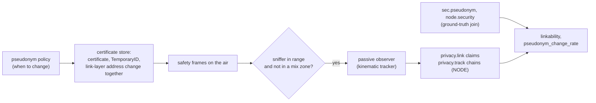

# Privacy

The pseudonym scheme exists to defeat one adversary: someone with receivers by the road
who writes down what they hear and tries to follow a vehicle across certificate changes.
The engine models the scheme (pseudonym change policies, silent periods, mix zones), the
adversary (a passive observer that only listens), and what the backend learns (the
separation of SCMS roles), and measures the result.

Code: `crates/v2xw-engine/src/pseudonym_policy.rs` (strategies and eavesdropper coverage),
`crates/v2xw-node/src/stores.rs` (`RotationPolicy`, the certificate store),
`crates/v2xw-threat/src/privacy.rs` (the observer), `crates/v2xw-engine/src/privacy_metrics.rs`
(metrics), `crates/v2xw-proto/src/scms/pki_view.rs` (`pki.knowledge`),
`tools/pki_view/aca_blindness.py` (ACA blindness check). Settings:
[`security.pseudonym_change`](../configuration/reference/security.md),
[`threats.eavesdropper`](../configuration/reference/threats.md),
[`messages.bsm.path_history_on_change`](../configuration/reference/messages.md).



## What changes on a pseudonym change

On a change the node replaces, together, the signing certificate, the BSM `TemporaryID`
(the first four octets of the certificate's digest) and the link-layer address derived
from it, and restarts the BSM `msgCnt` at a random value (C2C-CC BSP RS_BSP_182; J2735
allows a restart on a change of identity). The first BSM after start-up also carries a
random `msgCnt` (SAE J2945/1 §6.3.6.2 DATAACC-002). A scheduled change happens in the node's own store; the engine's policy can also
ask the store to change now. An expiring certificate always changes.

The path history in a BSM's Part II carries over a change by default (`keep`: SAE
J2945/1 has no clearing rule and asks for 200 m of history); `clear` restarts it, a
research option.

## Change strategies

`security.pseudonym_change.strategy`:

| Strategy | Rule | Source |
|---|---|---|
| `by-region` (default) | the region's rule: `j2945-1` under the US IEEE 1609.2 envelope, `time` every 5 minutes under `etsi103097`; a `by-region` scenario that sets `period_s` gets the `time` rule | |
| `time` | after `period_s` of use (300 s unless set) | SAE J2945/1 `CERTCHG`, USDOT SCMS primer |
| `j2945-1` | after 5 minutes **and** at least 2,100 m in a straight line from the last change point, never while the BSM carries a critical event flag | SAE J2945/1 APR2020 §6.5.3 CERTCHG-001 to -003, Table 21 (`vCertChangeInterval`, `vCertChangeDistance` with 100 m tolerance) |
| `distance` | after `distance_m` in a straight line from the last change point (2 km unless set) | NYC CV pilot |
| `nyc-pilot` | at 2 km or after 5 minutes, whichever comes first | NYC CV pilot |
| `c2c-cc` | first after a random [800, 1500] m; the second at least 800 m on plus a random [120, 360] s; the third after a random [10, 20] km; then every random [25, 35] km | C2C-CC Basic System Profile R1.5.1, RS_BSP_521 to 524 |
| `mix-zone` | inside a zone around each signalised intersection (radius `mix_zone_radius_m`, 30 m) once the pseudonym is `mix_zone_min_age_s` old (60 s) | Freudiger et al., *Mix-zones for location privacy in vehicular networks*, WiN-ITS 2007 (CMIX) |
| `silent` | no scheduled change (control arm) | |

Distances are straight-line displacement from the last change point, not distance
driven. The mix-zone radius and minimum age are this build's choices (CMIX fixes neither).

`silent_period_s: [min, max]` adds, under any strategy, a silent period after every change:
no safety message for a uniform draw from the range (Huang et al., IEEE WCNC 2005;
PRESERVE's 3 to 13 s). A silent vehicle is invisible to its neighbours' safety
applications too.

```yaml
security:
  pseudonym_change:
    strategy: c2c-cc
    silent_period_s: [3, 13]
threats:
  eavesdropper:
    id: threat/observer/passive-privacy
    params: { sniffer_fraction: 0.25, range_m: 200 }
```

Draws come from the plug-in domain of `security/pseudonym-policy`, keyed by the node.

## The eavesdropper

`threats.eavesdropper` (`threat/observer/passive-privacy`) sets the observer's coverage:

| Parameter | Default | Meaning |
|---|---|---|
| `sniffer_fraction` | 1.0 | share of signalised intersections with a sniffer (all junctions if the world has none signalised), spread deterministically |
| `range_m` | 200 m | each sniffer hears every safety frame sent within this disc (a receiver on a pole, not a link budget) |

Without the section the observer is global: it hears every safety frame on the air, the
worst case. A frame sent inside a mix zone is not readable by the observer: the zone key's
encryption is modelled by that rule, not performed.

### The tracker

The observer sees receptions and nothing else (`ObservedMessage`, the detector firewall):
it has no credentials, transmits nothing and never learns which vehicle a digest belongs
to. It is the constant-velocity, best-hypothesis tracker of Wiedersheim, Ma, Kargl and
Papadimitratos (*Privacy in inter-vehicular networks: why simple pseudonym change is not
enough*, WONS 2010).

Prediction over a silence $\Delta t$, with $\sigma_0$ the larger of the broadcast confidence
and a floor, and $a$ the plausible-acceleration bound:

$$
\hat{\mathbf p}(t) = \mathbf p + \mathbf v\,\Delta t,\qquad \sigma(\Delta t) = \sqrt{\sigma_0^2 + \big(a\,\Delta t^2/2\big)^2}.
$$

A candidate predecessor $u$ is kept when $\lVert \text{claim} - \hat{\mathbf p}_u \rVert \le z\,\sigma_u$, and
the posterior over the gated set $\Psi$ is

$$
w_u = \exp\!\Big(-\tfrac12 (r_u/\sigma_u)^2\Big),\qquad p_u = \frac{w_u}{\sum_{k\in\Psi} w_k}.
$$

The observer links the best hypothesis, or declines (method `unlinked`). With
`link_by_sequence`, a successor whose `msgCnt` continues a predecessor's (the counter can
have advanced at most $\lfloor \Delta t / 0.1\,\text{s} \rfloor + 1$) is linked by sequence;
an honest vehicle restarts its counter at a change, so this catches a sender that does not.

| Parameter | Default | Source |
|---|---|---|
| `z_gate` | 3.0 | a 3σ gate carried from the earlier implementation; not externally cited |
| `sigma_floor_m` | 5.0 m | position-consistency threshold carried from the earlier implementation; not externally cited; stops a sender evading by stating zero confidence |
| `accel_bound_mps2` | 3.0 m/s² | F2MD `MIN_MAX_ACCEL` |
| `max_silence_s` | 13 s | PRESERVE's longest silent period |
| `min_fixes_for_velocity` | 2 | structural |
| `track_unverifiable` | true | a passive observer needs no trust anchor |
| `link_by_sequence` | true | J2735 `MsgCount` is on the air in the clear |
| `min_message_interval_s` | 0.1 s | J2945/1 100 ms |

## Privacy measures

Anonymity at a change (ETSI TR 103 415 §5.1.2), on every `privacy.link` record:

$$
S = -\sum_{u\in\Psi} p_u \log_2 p_u \quad\text{(effective set, bits)},\qquad d = \begin{cases} S/\log_2|\Psi| & |\Psi| > 1\\ 0 & |\Psi| \le 1\end{cases}.
$$

$d = 0$ with one candidate is the honest answer (nobody to hide among); $d = 1$ means the
observer learned nothing.

| Record (NODE) | Fields |
|---|---|
| `privacy.link` | observer, predecessor and successor digests, `posterior`, `candidates`, `anonymity_set_size` (the size of $\Psi$, candidates plus target), `effective_anonymity_set_bits` ($S$), `degree_of_anonymity` ($d$), `method` |
| `privacy.track` | one chain of pseudonyms followed: `origin` and `last` digests, `links`, `fixes`, `duration_s` (last minus first reception, the WONS 2010 tracking duration), `closed_reason` |

Metrics (`metric/security/pseudonym-privacy`):

| Metric | Formula | Unit | Not accounted for |
|---|---|---|---|
| `linkability` | correct observer links / pseudonym changes, cumulative | ratio | a declined link counts as a change not bridged; correctness is the ground-truth join from `sec.pseudonym` and `node.security`, never the observer's |
| `pseudonym_change_rate` | Σ changes / Σ vehicle-hours observed (fast-forward hours excluded) | 1/(veh·h) | changes before a vehicle's first `node.security` row |
| `cert_pool_valid` | distribution of certificates each vehicle holds valid now | count | certificates for later periods |
| `backend_link_up` | rows whose vehicle's backend access was usable / rows | ratio | down time between rows |

The anonymity-set size, degree of anonymity and tracking duration are record fields to
aggregate from the recording; they are not in the metric catalogue.

## What the backend learns

The US SCMS separates roles so that no single entity can link a device's pseudonyms
([SCMS](scms.md)):

| Property | Mechanism | Where |
|---|---|---|
| the RA never learns a certified public key | butterfly expansion: the PCA adds a secret random value to the RA's cocoon key | `v2xw_sec::butterfly` |
| the PCA cannot link two certificates to one device | cocoon keys are pseudorandom without the expansion key; the RA shuffles requests across devices (1,000 requests or 2 days, CAMP 1.2.2) | RA shuffle |
| the PCA does not learn the device's enrolment identity | the RA strips it before forwarding (IEEE 1609.2.1 §4.1.3) | `tools/pki_view/aca_blindness.py` checks the recorded PDUs |
| neither LA alone can link | the linkage value is the XOR of two pre-linkage values from two LAs; the RA cannot open a pre-linkage value | `v2xw_sec::linkage` |
| revocation is forward-only | publishing $ls(i)$ reveals certificates from period $i$ on, never earlier | `CrlLinkageEntry::matches` |
| the MA must ask | the MA needs the PCA and both LAs to resolve a report | separation rules in `v2xw_proto::scms` |

`pki.knowledge` records what each entity holds in its own identifiers, with the
ground-truth join kept apart, so a study can audit what each party could link.
`pki.flow` carries each SPDU's bytes and the plaintext its recipient opened by really
decrypting it.

### ACA blindness check

```bash
python -I tools/pki_view/aca_blindness.py runs/<name>            # writes aca-check.json
python -I tools/pki_view/aca_blindness.py runs/<name> --inject   # positive control
```

It decodes the RA-bound requests (each signed by the device's enrolment certificate, the
whole certificate), collects every enrolment certificate and its `HashedId8`, and searches
every ACA-bound PDU, wire bytes and opened plaintext, for any of them. `leaks` must be 0;
`--inject` appends one enrolment certificate to the first ACA-bound blob, and `leaks` must
then be at least 1, which proves the check can fail. It needs the oracle tooling under
`tools/oracle` and a recording with `security.scms.pki_view` on.

## Modelled versus simplified

| Modelled | Simplified or absent |
|---|---|
| the deployed and proposed change rules, silent periods and mix zones | RS_BSP_520 (silence at cold start) has nothing to act on: vehicles enter already driving |
| identifiers changing together (certificate, TemporaryID, link-layer address, `msgCnt` restart) | the path history carries over by default (`keep`), as J2945/1 asks |
| a passive observer at a share of signalised junctions | sniffer reception is a disc, not a link budget; mix-zone encryption is a readability rule |
| kinematic best-hypothesis tracking with cited gate and silence bounds | no linking by radio fingerprint or message-timing pattern |
| the SCMS role separations, with recorded per-entity knowledge | a backend insider combining several entities' knowledge is not simulated; `pki.knowledge` lets a study audit what such an insider could link |
