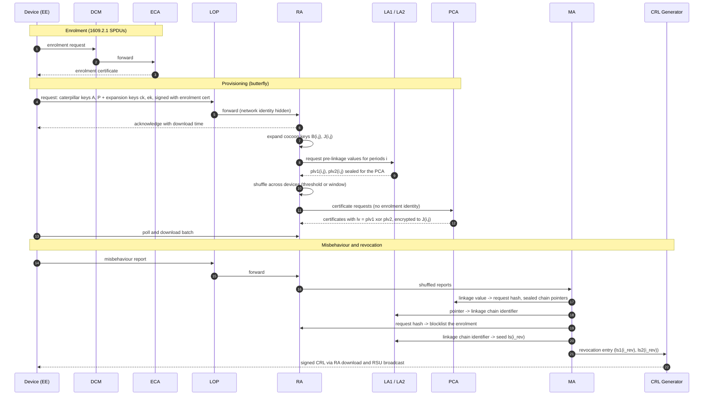

# SCMS and credential systems

Code: `crates/v2xw-proto` (entities, flows, protocols), with the cryptographic core in
`crates/v2xw-sec` and the run-time wiring in `crates/v2xw-engine/src/phase2.rs`,
`scms_topology.rs`, `credentials.rs`, `pseudonym_policy.rs` and `ma_policy.rs`. Selected by
`security.protocol.id` (and the same id in `actors.backend.protocol`).

Two protocols are selectable: the US CAMP SCMS (`protocol/scms/camp`) and the ETSI ITS
PKI (`protocol/etsi/ts102941`). Settings:
[`security`](../configuration/reference/security.md),
[`actors.backend`](../configuration/reference/actors.md); every default with its source:
[SCMS constants](../reference/scms-constants.md).

## CAMP SCMS (`protocol/scms/camp`)

Implements the US Security Credential Management System as specified by CAMP (SCMS PoC
EE Requirements and Specifications, Release 1.2.2), IEEE 1609.2.1 and the SCMS Manager
profiles, with Brecht et al., *A Security Credential Management System for V2X
Communications* (IEEE T-ITS 2018) for the design rationale. Modules:
`crates/v2xw-proto/src/scms/` (`run/` holds the behaviour of each flow).

### Components

| Component | Role in the engine |
|---|---|
| End entity (EE) | an OBU, RSU or VRU device: holds its enrolment certificate, butterfly keys and pseudonym pool |
| Device Configuration Manager (DCM) | proxies the device's enrolment to the ECA |
| Enrolment CA (ECA) | issues the enrolment certificate (US profile: `crlSeries` 4, region USA/Canada/Mexico) |
| Registration Authority (RA) | accepts requests, expands cocoon keys, shuffles, routes to the PCA, serves batch downloads, keeps blocklists |
| Pseudonym / Authorization CA (PCA, the 1609.2.1 ACA) | issues pseudonym certificates and encrypts each response to the device |
| Linkage Authorities LA1, LA2 | each hold a linkage-seed chain and produce pre-linkage values the RA cannot open |
| Location Obscurer Proxy (LOP) | hides the device's network identity from the RA |
| Misbehaviour Authority (MA) | receives reports, decides, runs linkage resolution and revocation |
| CRL Generator (CRLG), CRL store and broadcast | signs CRLs on their cadence; distribution by download through the RA and by RSU broadcast |
| SCMS Manager, five electors, Root CA, Intermediate CA, Policy Generator | governance: the elector-signed CTL (any 3 of 5), offline roots, the Global and Local Policy Files |

`scms/deployment.rs` builds the topology from a preset: the default
(`us-production-2025`) models two production providers on one CTL, each with its own roots
and online components; a single-SCMS reference topology is kept for comparison. Provider
regions and fleet shares are labelled assumptions.

The role separations of Brecht et al. are enforced on the placement: a scenario that
co-hosts PCA with RA, PCA with either LA, LA1 with LA2, LOP with RA or MA, or MA with RA,
either LA or PCA is refused unless it sets `security.protocol.params.relax_separation`.

### How the layer measures cost

The purpose of this layer is to measure what credential management costs (round trips,
queueing delay, bytes) and what each party learns. Every backend role is therefore a node
with a service queue on modelled links, never a function call:

- every message between entities crosses a `v2xw_proto::net::Link` and pays for its bytes;
  `Kernel::dispatch` refuses delivery between nodes without a link;
- every compute step is charged to the entity's queue (an entity fills an `Outbox` and the
  kernel decides when its work finished);
- every flow declares which credential signs what and the stage timestamps it emits
  (`spec::FlowSpec::stages`); tests require the emitted stages to equal the declaration;
- end entities read no backend state; answers reach them only as messages;
- every byte count on a link has a provenance (`sizes::SizeProvenance`): the real encoder,
  a cited constant, or a model-card parameter with a calibration plan.

### Flows

Each flow (`v2xw_proto::stage::FlowId`) emits its declared stages, in order
(`scms::FLOWS`, checked by `tests/flows.rs`):

| Flow | Participants | Stages |
|---|---|---|
| enrolment | EE, DCM, ECA | requested, proxy-forwarded, certified, installed |
| provisioning, top-up | EE, LOP, RA, LA1, LA2, PCA | requested, proxy-forwarded, acknowledged, expanded, pre-linkage-ready, shuffled, certified, batch-ready, downloaded, installed |
| pre-generation | RA, LA1, LA2, PCA | expanded, pre-linkage-ready, shuffled, certified, batch-ready (the RA's weekly job for an account that has not asked yet) |
| misbehaviour report | EE, LOP, RA, MA | detect, report-sent, proxy-forwarded, shuffled, report-received (US format per the SCMS Manager MBR specification, `scms/mbr.rs`) |
| linkage resolution | MA, PCA, LA1, LA2, RA | decision, resolved, blocklisted |
| CRL issuance | MA, CRLG, CRL store, CRL broadcast | issued, published, first-rsu-broadcast |
| CRL distribution | CRL store, EE | downloaded, processed, enforced |
| re-enrolment | EE, RA, ECA | requested, acknowledged, certified, installed (SCMS Manager re-enrolment standard; 1609.2.1 successor enrolment request) |
| policy distribution | SCMS Manager, PG, RA | decision, issued, published |
| RSU application and identification certificates | | non-pseudonym certificates (`scms/appcert.rs`) |

### Butterfly key expansion (`v2xw_sec::butterfly`, CAMP SCP1)

The device uploads two caterpillar public keys $A = aG$ and $P = pG$ and two AES-128
expansion keys $ck$ and $ek$. With $\iota = (i, j)$ packed into a 128-bit block
$x = \text{prefix}^{32} \| i^{32} \| j^{32} \| 0^{32}$ (prefix $0^{32}$ for signing, $1^{32}$ for
encryption):

$$
f(k, \iota) = \big(\mathrm{AES}_k(x{+}1) \oplus (x{+}1) \,\|\, \mathrm{AES}_k(x{+}2) \oplus (x{+}2) \,\|\, \mathrm{AES}_k(x{+}3) \oplus (x{+}3)\big) \bmod n .
$$

| Party | Computes |
|---|---|
| RA | cocoon signing key $B_{ij} = A + f_1(ck, \iota)\,G$; cocoon encryption key $J_{ij} = P + f_2(ek, \iota)\,G$ |
| PCA, explicit certificate | certified key $B_{ij} + cG$, with $c$ secret to the PCA |
| PCA, implicit (ECQV) | reconstruction value $P_U = B_{ij} + kG$, $r = e k + d_{CA}$ |
| device, explicit | $d = a + f_1(ck, \iota) + c \pmod n$, checked $dG$ = certified key |
| device, implicit | $d = e\,b_{ij} + r$ with $b_{ij} = a + f_1(ck, \iota)$, checked $dG = eP_U + Q_{CA}$ |
| device, response | opened with $h_{ij} = p + f_2(ek, \iota)$ (IEEE 1609.2.1-2022 §9.3.4, original variant) |

So the RA never learns a certified key, the PCA cannot link two certificates to one device
(the cocoon keys are pseudorandom without $ck$, and the RA shuffles), and the device
re-derives every private key itself. Test vectors: CAMP `bfkeyexp.txt` with every
intermediate and the OpenSCMS (Apache-2.0) signing and encryption vectors, plus cocoon keys,
explicit and implicit issuance and response encryption per IEEE 1609.2.1-2022 §9.3
(`crates/v2xw-sec/tests/official_vectors.rs`). Only the original butterfly variant is
accepted; the unified and compact unified variants are refused.

### Linkage values (`v2xw_sec::linkage`, CAMP SCP2)

Per Linkage Authority $x \in \{1, 2\}$ with a 16-bit identifier $la\_id_x$:

$$
\begin{aligned}
ls_x(i) &= \operatorname{trunc}_{128}\big(\operatorname{SHA\text{-}256}(la\_id_x \| ls_x(i{-}1) \| 0^{112})\big)\\
plv_x(i, j) &= \operatorname{trunc}_{72}\big(\mathrm{AES}_{ls_x(i)}(la\_id_x \| j \| 0^{80}) \oplus (la\_id_x \| j \| 0^{80})\big)\\
lv(i, j) &= plv_1(i, j) \oplus plv_2(i, j)
\end{aligned}
$$

Only the PCA ever computes $lv$; the 9-byte value is the `LinkageValue` in each
certificate. Revocation publishes $ls_x(i)$ for the current period, never $ls_x(0)$, and a
CRL entry refuses to match an earlier period, so revocation is forward-only; tests check
that certificates from before the revocation period stay unlinkable. Two seeds revoke every
future certificate of a device, about 40 bytes per entry (Brecht 2018 §VI-F). Vectors:
CAMP `lv.txt` and `glv.txt`. Group linkage exists and is off by default.

### Revocation

Active (a linkage-based series-1 CRL is produced, distributed, installed
and enforced) and passive (issuance stops and the device runs out of certificates).
Revocation latency is decomposed into the stages of the path, from the detector firing to
the receivers that install the CRL (`revocation_latency_stage`). Hash-based CRLs (series 2, 3, 4, 256) cover non-pseudonym
certificates. CRLs are real `Ieee1609Dot2Crl` encodings with their sizes from the encoder.

### Calendar

`time.calendar: real` (default) runs one-week i-periods counted from the US
SCMS epoch, 2015-01-06 04:00 US Eastern, with US Eastern daylight-saving time, US federal
holidays and business days (`scms/calendar.rs`) for rules such as CRL publication within
one business day. `compressed` allows a shorter `i_period_s`; every output labels it.
`time.fast_forward` windows let a run cover weeks of credential activity.

### Parameters

`security.protocol.params` (`scms/params.rs`), with `security.scms.lifecycle` fields
winning over the same keys. Principal defaults:

| Parameter | Default | Source |
|---|---|---|
| i-period | 1 week (10,080 min) | SCMS Manager 1609.2.1 Profile §2.1.17 Table 2; CAMP 1.2.2 Table 3 |
| certificate lifetime | 1 week + 1 h overlap | SCMS Manager Profile Table 2 |
| certificates per period | 20 | CAMP 1.2.2 Table 67; USDOT SCMS primer p.8 |
| initial batch | 3,120 (20 × 52 × 3) | primer p.7 |
| periods ahead | at most 156 (three years) | primer p.7; CAMP 1.2.2 Table 67 |
| download poll interval | 5 min, at most 100 polls | SCMS Manager Profile Table 3 |
| enrolment lifetime | 6 years | CAMP 1.2.2 Table 3 |
| certificate request shuffle | 1,000 requests or 2 days | CAMP 1.2.2 §5.2.15.5 Table 67 |
| report shuffle | 10,000 reports or 1 day | CAMP 1.2.2 §5.2.8.4 |
| linkage CRL cadence | daily (series 1) | `scms::ACTIVE_REVOCATION` |
| CRL overdue tolerance | 2 weeks | CAMP 1.2.2 Table 67 |
| electors, quorum | 5, any 3 | SCMS Manager elector specification |

The full list, with status and reasons: [SCMS constants](../reference/scms-constants.md). Further deployment options under
`security.scms` (TLS version, CRL polling, CRL-overdue scope, MA policy, server sites and
capacity). Backend service times and availability per entity: `actors.backend`.

## ETSI ITS PKI (`protocol/etsi/ts102941`)

`crates/v2xw-proto/src/etsi/`. Enrolment with the Enrolment Authority, standard and
butterfly authorization (TS 102 941 §6.2.3.5) with the Authorization Authority,
authorization-ticket batch download, ECTL issuance by the Trust List Manager and
publication at the CPOC, CA-only CRLs signed by the Root CA, fetches from the
Distribution Centre that return only newer list versions (§6.3, §6.3.3), and TS 103 759
misbehaviour reporting with an EA blocklist. Certificates and cryptographic components are
sized by the real COER encoder and cited constants; the TS 102 941 message framing that no
clause fixes is a card parameter with a calibration plan.

## Threshold protocols (`crates/v2xw-proto/src/threshold/`)

A t-of-n committee replaces one server's private-key operation (`security.threshold`
names which roles). Shipped: FROST (RFC 9591), threshold ECDSA (CGGMP21), a t-of-n
umbrella authority, and t-of-n linkage-seed release. The group arithmetic is not executed;
the rounds, per-round message sizes, per-round compute from cited anchors, what each party
learns, and slow, offline and malicious members (identifiable abort and restart) are.
Flows: distributed key generation, signing, proactive refresh.

## Post-quantum provisioning

`v2xw_proto::hybrid` applies the signature and KEM schemes of
[security.md](security.md) to the credential system: what entities pay and carry when
certificates are hybrid or post-quantum, and provisioning without butterfly expansion.

## Pseudonym change

How often a device switches certificates (`security.pseudonym_change`: SAE J2945/1
`CERTCHG`, the NYC pilot rule, C2C-CC, mix zones), and the eavesdropper that measures the
result, are on [Privacy](privacy.md).

## Modelled versus simplified

| Modelled | Simplified or absent |
|---|---|
| every SCMS role as a queued node on links that charge for bytes and compute | backend service times and availability are profile parameters (`actors.backend`), several `todo-calibrate` |
| real IEEE 1609.2.1 SPDUs, certificates and CRLs, sized by the encoder | TS 102 941 message framing that no clause fixes is a card parameter |
| butterfly expansion and linkage values against CAMP and OpenSCMS vectors | unified and compact unified butterfly variants are refused |
| the US two-provider deployment on one CTL | provider regions and fleet shares are assumptions |
| the MA's decision as a family of rules ([Threats](threats.md#the-misbehaviour-authority-detectionma)) | the deployed US MA rule is not published; no single rule is asserted |
| threshold committees' rounds, sizes, compute and failures | the threshold group arithmetic is not executed |

Every SCMS default with its status (cited, derived, measured or assumption) and source:
[SCMS constants](../reference/scms-constants.md).
